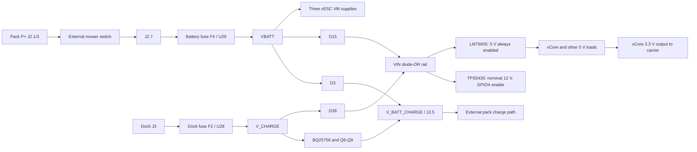

# Pre-manufacturing review — OpenMower YardForce carrier

Reviewed **2026-10-05**, commit **17e06696e046fd63da448bbfbb7e3ee1c5d85f46**, Git tag **v1.2.1**. PCB silkscreen identifies **OpenMower Mainboard 1.2.0**, compatible with **xbot core 1.x**. These are different identifiers; pin the manufacturing release to the commit and an explicit assembly list.

**Assessment: resolve the confirmed manufacturing-data and charger-wiring issues before ordering.** The board has matching schematic/PCB pad connectivity and several sound implementation details, but those facts do not establish safe source-fault behavior, recoverable firmware, adequate regulator bypassing, or USB signal integrity. No design correction was applied in this review.

### Prioritized actions

| Priority | Action | Classification / evidence |
|---|---|---|
| Before assembly release | Fix U11/U12's missing exported ordering code and duplicate `Footprint`/`FOOTPRINT` fields; regenerate and inspect BOM/CPL. | Confirmed generated-output defects, M1–M2. |
| Before PCB release | Tie U27 ACP/ACN to VAC when omitting the input shunt, following TI's checklist. | Confirmed guidance deviation; resulting malfunction not measured, P1. |
| Before selecting protection/pack | Reconcile the two 2 A time-delay fuse SKUs with the marked 2 A fast / 2.5 A medium fuses; establish actual pack NTC wiring and charger TS protection. | Confirmed fuse specification conflict; TS effectiveness conditional on external pack, M3/P2. |
| Before claiming operating limits | Specify pack/dock voltage, transient energy and concurrent loads; coordinate the TVS, 40 V aux regulator/diodes, MLCCs, input fuse and recovery path. | Conditional electrical/thermal risk, P3 and load budget. |
| Before PCB release or power qualification | Increase effective input bypass capacitance and improve U4's input loop; review charger gate loops. | Exact capacitor bias data and measured layout deviation, P4/L2/L3. |
| Before USB release | Restore a continuous reference under both USB conductors; provide switched-port bulk capacitance; qualify J28's actual connector footprint. | Confirmed geometry/component deviations; functional effects conditional, L1/L4/I1. |
| Before firmware/fixture release | Resolve the xCore I2C2/GPIO documentation conflicts, pin module/firmware variants, establish a fail-safe xESC inhibit/timeout, retain charger temperature/WDT protection, and supply VTref/reset for recovery. | Firmware/system requirements and confirmed access limitations, I2–I8/R1. |

Severity denotes consequence, not probability. **Confirmed defect/deviation** means the artifact demonstrably conflicts with its required identity, connection, or cited guidance; **conditional risk** states the source/load/firmware condition needed; **recommended improvement** improves robustness without asserting failure; **firmware requirement** cannot be credited to passive hardware. High confidence in a net or rating does not imply that an unmeasured failure occurred. No user-specific voltage, load, transient margin, module revision or deployed firmware assumptions were supplied during the review; numerical examples are explicitly labeled.

## Actual design and assembly scope

The active root is `hw-openmower-yardforce.kicad_sch`. Its hierarchy comprises **12 sheet instances from all 10 schematic files**: root, Connectors, DCDC, Charger, Core, GPS, RobotConnectors, Amplifier, AuxPSU, and three instances of `xESC.kicad_sch` named xESC/xESC1/xESC2 (U8/U9/U10). **No orphan schematic file was found.** The backup ZIP in `hw-openmower-yardforce-backups/`, autosave marker and lock/preferences files were not treated as active circuitry. A PCB lock file exists; source files were read only, with all executable export/refill operations confined to temporary copies.

The fresh hierarchy contains **288 component references** (including manual-module and assembly-only placeholders), **345 nets**, **1,123 schematic pin endpoints**. There are **293 PCB footprints**, of which 284 correspond to schematic references and nine are graphics/guidance features (two share reference `REF**`). There are **39 schematic DNP references**, 36 existing PCB footprints marked DNP, and **249 non-DNP schematic references**. The actual KiBot run generated **85 BOM groups and 248 placement rows**; a solder jumper is not a purchased placed component.

DNP and manual assembly must be interpreted deliberately:

- J22/C21/R9/R10 are DNP and physically absent from the PCB. J23 is DNP but routed; J24 is the populated Ethernet jack. The schematic says fitting the optional connector can prevent a Classic 500 enclosure from closing. Do not override that note casually.
- U8/U9/U10 (xESC modules), U13 (WitMotion/Sabo-style GNSS) and XA1 (ArduSimple) are DNP plug-in module placeholders, not proof that production robots omit their modules. U18–U46 are socket-assembly dummy symbols where applicable. J26 orders the xCore **socket**, not the computer/control module.
- F2/F4 are DNP electrical/fuseholder placeholders; U14–U17 and U28/U29 order the clips and fuses. TP1/external gate-drive option, R72/R73 TS divider, optional snubbers/timing/feedback components, J20/J25, R52 and amplifier R6/R7 are DNP. Their absence is explicitly considered below.
- The `rotated` KiBot variant applies placement rotations, not a complete alternative electrical BOM. The config also recognizes Config/DNP-style filtering. The tested KiBot run honored **all 36 original PCB DNP flags** in both BOM and CPL. A separate, versioned final module/harness/optional-population list is still needed.

The board is nominally **1.6 mm, four copper layers, 35 µm copper each**, with 0.10 / 1.24 / 0.10 mm dielectric spacings and configured FR4 εr=4.5. Layers are F.Cu, In1.Cu-GND, In2.Cu-PWR-SIG, B.Cu. In2 includes both a +5 V pour and routed signals. This is design metadata; no fabricator laminate/impedance confirmation was provided. Project rules have one Default netclass (0.20 mm clearance/track, differential width0.20 mm/gap0.25 mm, via0.60/drill0.30 mm), no netclass assignments, and no custom `.kicad_dru` file. Global track/clearance minima are zero, minimum drill 0.20 mm, via minimum 0.45 mm/annulus 0.10 mm, hole clearance0.25 mm and copper-to-edge0.50 mm; these settings alone do not impose power-current, timing or impedance constraints.

Documentation inspected includes README, schematic notes, `.kibot.yaml`, rotation filter, `config.kibom.ini`, local symbol/footprint libraries, project rules/exclusions and GitHub KiBot workflows. No local firmware source/pin configuration, committed ERC/DRC result, or existing release/production fabrication package was found. The workflow uses KiCad9 KiBot and explicitly disables ERC/DRC; it defines BOM, placement, Gerber/drill, schematic PDF, board images and release ZIP outputs. The review reproduced BOM/placement with available KiCad10 tools; it did **not** generate or approve a new Gerber package or retrieve historical CI artifacts.

### Power boundaries

D4 clamps V_CHARGE; D7/D11/D17 clamp VBATT. Neither is a series disconnect. Module internals and the external pack/BMS are separate review boundaries.

## Manufacturing data and component-selection findings

### M1 — U11/U12 have no orderable part number in the generated assembly BOM

**Confirmed defect · High manufacturing severity · High confidence.** U11/U12 are populated SN74LVC07ADBR buffers at (130.2,149.5)/(141.2,149.5) mm. Their exact C2676799 identity is stored under `LCSC Part`; `.kibot.yaml` exports only `JLC`. Running the configured BOM and placement outputs on a temporary copy produced an SN74LVC07ADBR row with **empty `LCSC Part #`**. These buffers implement ultrasonic level conversion and the Home/Play button inputs. Automatic assembly cannot reliably select them from the intended field; omission disables those paths. Normalize the ordering field or explicitly map it, regenerate the BOM, and review the assembler's matched parts before release. The selected TI SSOP-14 DB package is consistent with the current footprint and pin numbering. [Exact supplier SKU](https://www.lcsc.com/product-detail/C2676799.html), [TI datasheet](https://www.ti.com/lit/ds/symlink/sn74lvc07a.pdf), local `.kibot.yaml`, generated BOM described below.

### M2 — Case-conflicting schematic properties corrupt the manufacturing/exported footprint fields

**Confirmed defect · Medium severity · High confidence.** Numerous original symbols contain both a valid `Footprint` and empty `FOOTPRINT`. For example C12 has `Capacitor_SMD:C_0805_2012Metric` plus empty `FOOTPRINT`; U27 has `local_CHARGER:BQ25756RRVR` plus the same empty duplicate. KiBot 1.9.0 emits `Field conflict` warnings and the generated BOM has many blank footprint cells. KiCad 10.0.4 exports 270/288 components without a canonical footprint field; DRC reports 199 footprint mismatches and 199 field mismatches against the PCB. This is **field-name shadowing**, not evidence that all those footprints are absent in the original schematic or electrically wrong. Delete/normalize the conflicting custom fields in a later correction, then regenerate netlist/BOM and rerun parity using the release KiCad version. Use the actual PCB package definitions when reviewing this revision. Independently comparing connectivity found no physical-pad/net discrepancy.

### M3 — Ordered fuses contradict the documented dock and battery protection ratings

**Confirmed specification conflict · High priority before ordering · High confidence.** U28/U29 both order C356459, Hollyland **5HT-020H**, a **2 A time-delay** ceramic fuse. Board text and schematic notes instead specify **Dock 2 A F** and **Battery 2.5 A M** beside F2 at (122.225,44.1) and F4 at (122.225,53.45). F2/F4 are DNP/excluded schematic/footprint placeholders; U14–U17 supply the clips and U28/U29 supply the actual fuses. Therefore their DNP flags do not mean the assembled board has no fuses. The selected 5HT-020H's reference I²t is 7.952 A²s; its table allows up to 30 minutes at 2.1× rating and 750 ms–80 s at 2.75×. It cannot be treated as an instantaneous 2 A clamp or substituted for a fast fuse without analysis. Resolve which ratings/time curves are intended, select exact SKUs accordingly, and make BOM, silk, assembly instructions and source-fault coordination agree. The selected battery fuse also bounds the shared motor-plus-electronics load; see the power review. [Hollyland manufacturer catalog, 5HT table](https://www.hollyfuse.com/UploadFile/%EF%BC%88%E5%B7%B2%E5%8E%8B%E7%BC%A9%EF%BC%89%E7%94%B5%E6%B5%81%E4%BF%9D%E9%99%A9%E4%B8%9D.pdf), [exact ordered SKU](https://www.lcsc.com/product-detail/C356459.html); archived `datasheets/C356459_5HT-020H.pdf`, page 1 visually inspected.

### M4 — Preserve exact manufacturer/suffix identities instead of trusting generic symbol names

**Recommended improvement · Medium significance · High confidence.** C3040446 selects **FUXINSEMI BSS138**, whereas Q1/Q4's schematic links onsemi documentation. Q6–Q9 use a library identity named BSC070N10NS3G but order **Infineon BSC0702LS, 60 V**; a 100 V rating inferred from the library name would be wrong. U6 TPS2061C has active-low enable despite its active-high symbol; U7 is a **2 Kbit**, 2.5 V minimum, SO8N EEPROM, not a similarly named low-voltage variant. D7/D11/D17 select **Jingdao SMCJ33CA-L**, whose documented surge rating is 600 W, not a generic 1500 W SMCJ assumption. U11/U12's imported symbols declare all pins passive, weakening ERC. These mismatches and gaps should be corrected in library/production metadata; the electrical review below uses the ordered variants. Supplier metadata itself is not infallible: it labels TPS2061C active-high/low-side, contrary to TI. The archive index records the authoritative documents and stale supplier revisions.

## Mower I/O, reset states and ADC review

### R1 — Stop/lift input selection and ultrasonic inputs need defined startup/disconnect behavior

**Conditional system risk · High consequence if relied on for motion permission · High confidence in wiring; external modules/firmware unresolved.** U47/U48's select pin 1 connects only to J26.143 `/GPIO7`; both enables pin 15 are grounded, so the multiplexers always drive their outputs. There is no carrier select pull. OEM lift inputs J5.10/.12/.15/.16 similarly have no carrier bias; disconnected OEM wiring leaves those mux inputs floating. U11 trigger input pins 1/3/5/9/11 connect directly to core GPIO15/14/16/19/21 without carrier pulls. U12 echo input pins 1/3/5/9/11 connect to J7 without echo-side pulls. Pull resistors on the **buffer outputs** do not define a floating buffer input.

This is not proof of unsafe deployed behavior: the exact firmware and external sensor/cover electronics are unspecified, and the schematic explicitly records successful model-specific validation. It means the carrier alone does not establish deterministic states during core reset/removal or unplugged harnesses. Choose an explicit default for GPIO7 matching the intended assembly; bias unused/disconnected logic inputs; initialize trigger outputs and selected sensor mode before enabling any motor. Require invalid/missing stop/lift input states and loss of the core to inhibit motion. Verify both mux selections against the actual OEM or discrete-hall harness. [TI SN74LVC157A §4.4 and function table](https://www.ti.com/lit/ds/symlink/sn74lvc157a.pdf), [SN74LVC07A §6.3/8](https://www.ti.com/lit/ds/symlink/sn74lvc07a.pdf).

### R2 — Direct switch/Hall wiring can violate the mux's input edge specification

**Conditional risk / recommended improvement · Medium severity · High confidence in requirement; actual edge rates unmeasured.** U47/U48 are ordinary SN74LVC157A inputs, not Schmitt inputs. TI specifies maximum input transition rate **10 ns/V**. Hall inputs have 10 kΩ pullups to 5 V; stop inputs have 10 kΩ pulls to 3.3 V. If a sensor is open-drain or a contact releases into 50 pF of input/harness capacitance, the 5 V pullup has τ=0.5 µs and slope near 2 V about **167 ns/V**, outside that limit. Contact bounce adds a separate problem. Actual OEM actively driven edges may be much faster; no sensor waveform was measured. Add suitable 5 V-tolerant Schmitt conditioning for slow/contact inputs, or establish compliant edge rates and suitable pull strength over harness capacitance. Firmware debounce handles logical bounce but does not repair a violated CMOS input edge specification. Raw external UART7, Hall and USB lines also have no carrier-level ESD network; improve protection if the defined harness/environment requires it rather than assuming IC handling-ESD ratings establish connector immunity.

### R3 — ADC divider ranges and filtering are valid for bounded sources, not the TVS clamp envelope

**Conditional overvoltage risk; firmware sampling requirement · Medium severity · High confidence in calculation.** J26.149 `/AGPIO0` and .151 `/AGPIO1` are module analog inputs. Each divider has 0.1% top/bottom resistors and a 1 kΩ series resistor, with 470 nF at the ADC; the dock channel also has 100 pF. Calculations below assume a 3.3 V full-scale reference and no module-side loading; include module reference/ADC error and capacitor tolerance when specifying accuracy.

| Path | Divider / series / filter | Nominal ADC gain | 3.3 V full scale, nominal / resistor worst case | Nominal τ / 1% settling | ADC at 24 V / 29.4 V |
|---|---|---:|---:|---:|---:|
| Battery `/VBATT` → AGPIO0 | R56 32.4k, R57 3.24k, R78 1k; C61 470n | 1/11 | 36.30 / 36.234 V | 1.854 ms / 8.54 ms | 2.182 / 2.673 V |
| Dock `/V_CHARGE` → AGPIO1 | R54 33k, R55 2.7k, R79 1k; C57 470n (+C60 100p) | 0.0756303 | 43.633 / 43.553 V | 1.643 ms / 7.57 ms | 1.815 / 2.224 V |

Corner calculation raises the bottom resistor 0.1% and lowers the top 0.1%. At 29.4 V the top resistors dissipate about 22/22 mW, below their 100 mW nominal rating. Pole frequencies are approximately 85.8/96.9 Hz. This filter is useful measurement conditioning, but is too slow to be the only fast fault cutoff. At the battery TVS's specified 53.3 V clamp, the battery divider attempts **4.845 V**; at the dock TVS's 64.5 V clamp, the dock divider attempts **4.878 V**. No dedicated carrier clamp at those ADC nodes guarantees the module's absolute limits, especially with 3.3 V unpowered. The series resistors limit current but do not by themselves establish allowed injection current or prevent back-powering. Bound the source waveform or add a coordinated clamp with verified unpowered behavior; characterize module input protection. Firmware must use these gains, allow settling, configure sufficient ADC acquisition time, and treat out-of-range readings as faults. R78/C61 lie near (48.9,160.9)/(47.3,160.875); R79/C57 near (45.7,164.975)/(47.3,164.975), close to J26 rather than the remote divider. [xCore electrical ratings](https://core.x-tech.online/docs/interfaces/electrical-ratings/), component/net appendix, exact resistor and TVS datasheets in the index.

### Correct mower-interface connections explicitly checked

- U11/U12 SN74LVC07ADBR: pins 14=3.3 V, 7=GND; six non-inverting open-drain channels use 1→2, 3→4, 5→6, 9→8, 11→10, 13→12. Inputs/outputs accept 5.5 V, and Ioff supports partial-power-down isolation. The five trigger outputs pull to 5 V; five echo outputs and Home/Play outputs pull to 3.3 V. This is valid unidirectional level translation with the identified startup caveats. Supply capacitors C19/C20 exist on the correct rail.
- U47/U48 SN74LVC157ADR: pin16=3.3 V, pin8=GND, pin15=GND, pin1=GPIO7. Five-volt Hall input levels are permitted at the selected 3.3 V supply. Channel mapping is 2/3→4, 5/6→7, 11/10→9, 14/13→12. U48's unused first channel has both inputs grounded and its output NC. C17/C77 decouple their supplies. Do not assume deselection makes the actively driven outputs high impedance.
- U47 outputs GPIO10/11/12/13 select Hall3/2/1/0 when S=0, or LLIFT_LBUMP / RLIFT_LIFTX / STOP1 / STOP2 when S=1. U48 outputs GPIO6/5/1 select Hall6/5/4 when S=0, or REAR_STOP / LLIFT2_LIFT / RLIFT2_RBUMP when S=1.
- J27 and J40 form a **series** rear-stop loop: J40.1=REAR_STOP, J40.2=J27.1, J27.2=GND. R63 pulls REAR_STOP to3.3 V. Open wiring reads high at this node; whether that inhibits motion is a firmware requirement.
- Rain R47=10k isolates AGPIO3 from the external RAIN node with C15=100nF and D21 PDZ3.3B cathode to RAIN/anode GND. D21 is a general Zener with 3.32–3.53 V at5mA and a soft low-current knee, not a precision3.3V surge clamp. An externally driven miswired cable has no series current limiter before this Zener; rain-sensor impedance and firmware excitation must be specified.
- Battery harness notes identify J2.1 always-on P+, J2.3 the external switch feed, J2.7 switched P+, J2.2 GND, J2.5 switched charge input, J2.8 green temperature wire; J2.4 yellow temperature wire is NC. This exact external switching/NTC topology is a power-review dependency, not a generic battery-connector assumption.
- J1's left/right motor phase and Hall circuits, J10/J21 cutter alternatives, J5/J6 UI alternatives, J7 five ultrasonic pairs, J8/J9/J12–J15 discrete Hall connectors, J11 perimeter, J17 rain and J19 UART match the exported net assignments. Connector keying/contact numbering against every original mower loom has **not** been physically verified; retain the documented model-specific harness validation.

## Actual capacitor bias data

Supplier archives for Samsung parts are a generic **November 2015** catalog, so exact manufacturer product pages were additionally obtained. Their curves are typical 25°C measurements at120Hz/0.5Vrms, **not guaranteed minimum capacitance**:

| Exact ordered MLCC | References | Typical retained capacitance at DC bias | Consequence |
|---|---|---|---|
| CL31A107MQHNNNE,100µF/6.3V X5R1206 | C9,C31–C34 | 44.7µF at3.3V; **29.17µF at5V** | Four main5V output ceramics total about116.7µF at5V, before tolerance/temperature/aging; C14 supplies separate680µF bulk. C9 is about29µF at its5V amplifier rail. |
| CL31A106KBHNNNE,10µF/50V X5R1206 | C11,C16,C24,C25,C66,C67,C70,C71,C74,C75 | **3.39µF at12V;1.35µF at24V;1.03µF at29V;0.982µF at30V** | Recalculate buck input ripple/transients using effective values; motor-rail220µF capacitors help bulk storage but do not replace close high-frequency bypassing. |

[Samsung100µF exact product/curves](https://product.samsungsem.com/mlcc/CL31A107MQHNNN.do), [Samsung10µF exact product/curves](https://product.samsungsem.com/mlcc/CL31A106KBHNNN.do). Both complete pages with embedded numerical curves are archived in `datasheets/`. Values between curve points were linearly interpolated. Do not count nominal capacitance as usable capacitance or claim a load-step/startup margin without a measurement or validated model. Exact DC-bias curves for FH50V4.7µF parts were not obtained; that remains a gap.

## Power conversion, protection and recovery

## Priority findings

### P1 — Confirmed wiring deviation: U27 ACP/ACN have floating common-mode voltage

**Medium severity; confirmed guidance deviation; high confidence.** U27.29 ACN and .30 ACP are shorted only to one another on `Net-(U27-ACN)`; no resistor, supply or ground shares this net. Omitting the input sense resistor is supported, but TI's *BQ25756 Schematic Checklist*, input-power row ACP-ACN/ILIM_HIZ, specifically requires shorting both pins **to VAC** when RAC is omitted. Correct the net to the intended VAC node. The present short forces zero differential sense but does not establish the intended common-mode voltage, leaving leakage/noise/incorrect current-sense behavior unqualified. Do not overstate this as measured failure: confirmed design-guidance deviation, functional consequence is conditional. U27 center(193.15,77.0).

Evidence: [TI checklist](https://e2e.ti.com/cfs-file/__key/communityserver-discussions-components-files/196/BQ25756-Schematic-Checklist.pdf), archived `datasheets/BQ25756_TI_schematic_checklist.pdf`; BQ25756 datasheet §7.2.1.2.7 permits omitting sense resistor/shorting ACP and ACN and grounding ILIM_HIZ, but the checklist supplies the otherwise missing common-mode instruction.

### P2 — Conditional thermal-safety/noncharging defect: charger TS has no populated bias network

**High potential safety consequence; conditional risk; high confidence in board facts, pack wiring unresolved.** R72 = 5.24k from REGN to TS and R73 = 30.31k TS to GND are both DNP. U27.8 TS instead connects only to battery J2.8 (green temperature lead); J2.4 yellow temperature lead is NC. This circuit cannot turn an ordinary passive NTC to ground into the required REGN-ratiometric voltage. Such a pack pulls TS near0V and the default enabled TS check blocks charging as hot; a two-wire sensor returning through J2.4 would also lack a return. Exact OEM pack sensor topology/value was not documented, so do not assert a particular pack is wrong. Confirm every supported pack wiring, populate/calibrate the TS divider and connect return appropriately. TI example 103AT 10k uses exactly 5.24k / 30.31k for 0–60°C, explaining these DNP values. Merely disabling EN_TS makes charging possible but removes hardware battery-temperature protection; MCU cannot compensate without an independent temperature measurement (none traced in this circuit). R72(189.2,68.2),R73(187.6,68.2).

Source: [BQ25756](https://www.ti.com/lit/ds/symlink/bq25756.pdf) §6.3.4.6, pp26–28, tables6-25/6-30. TS default EN_TS=1; clearing EN_TS ignores TS and reports normal status. Need system clarification on pack NTC and whether separate BMS temperature protection is required/guaranteed.

### P3 — Conditional protection coordination gap: TVS clamps exceed the vulnerable populated rail devices

**High severity if the rated voltage is exceeded; conditional risk; high confidence in device limits. Occurrence depends on the source/regeneration/surge envelope.** Dock path is J3→F2→`/V_CHARGE`→D28→`/VIN`→U4/U5. D4 SMBJ40CA on V_CHARGE has 40V stand-off,44.4–49.1V breakdown@1mA,64.5V clamp@9.3A. Thus U4 TPS5430 is already beyond40V absolute maximum (36V recommended maximum) before D4 even reaches specified breakdown. The clamp can also exceed50V input ceramics C38–41/C80/C24/C25/C26/C11 and Q6/Q7 60V VDS. Battery VBATT→D15→VIN has D7/D11/D17 SMCJ33CA-L,36.7–40.6V breakdown and 53.3V clamp@11.3A; also not a guaranteed≤40V clamp for U4, nor≤50V for all MLCCs. D16 SS54 catches the U4 switch node and is only 40V reverse rated. Source OR diodes D15/D28/D3 are40V parts and require opposite-source/reversal corner review.

BQ25756 ACOV is tied GND and ACUV toVAC, intentionally giving its full 4.2–70V operating window: it will not trip near the board's36/40V limit. Even lowering its ACOV would only stop charging; V_CHARGE→D28→VIN still powers the aux converter and main5V converter. No MCU-controlled series overvoltage disconnect was found. Fuse protection responds to current/time, not voltage, so it does not establish a safe clamp or save ICs before a slow fuse clears. The order review confirmed both fuse SKUs5HT-020H are2A time-lag; their maximum30min at2.1In especially cannot establish transient coordination. Define maximum sustained source voltage and surge energy; coordinate clamp, source impedance/series disconnect and every upstream exposed component. A lower TVS is not automatically sufficient for a~29V pack and40V abs-max load; calculate its full tolerance/clamp curve or use a higher-voltage aux regulator/disconnect. Do not classify ordinary~29V operation itself unsafe.

Sources: `datasheets/C84730_SMBJ40CA.pdf` p3, Brightking revTVS-SMBJ SERIES-001(A1); `datasheets/C7470408_SMCJ33CA-L.pdf` pp1–2 (Jingdao2018.03); [TPS5430](https://www.ti.com/lit/ds/symlink/tps5430.pdf) §§5.1/5.3. Exact Jingdao **-L** part is600W/11.3A, despite one contradictory1500W bullet in its PDF; do not use generic1500W SMCJ rating. D4(150.2,55.2),D17(119.7,87.2),D28(142.4,91.2),D15(144.0,107.0),U4(141.6,123.5).

### P4 — Component selection and placement: effective input ceramic capacitance is far below nameplate

**Medium severity; conditional power-integrity risk; high confidence in the exact Samsung typical curve. Ripple estimates are conditional.** C11/C24/C25 C13585 = Samsung CL31A106KBHNNNE,10uF50V1206X5R. The review obtained exact manufacturer curve:1.352uF@24V,1.026uF@29V,0.982uF@30V typical 25°C, before tolerance/temp/aging. U5 local nominal 20uF plus 470nF C26 is therefore only~2.5uF at29V assuming C26 retained 470nF. U4 local C11 is ~1uF. Both share VIN, but cap distances prevent treating all distant capacitance as equivalent HF bypass. Large220uF caps on VBATT/V_CHARGE lie upstream of D15/D28; there is no bulk cap directly on VIN. TI LM76005 §8.2.2.4 recommends10–22uF HF capacitance and specifically accounts for bias (example2×4.7uF100V); TPS5430 recommends10uF and requires checking ripple if smaller.

Simple ideal source-isolated capacitor estimates at29V/full load:5V/5A LM76005 at 400kHz with2.5uF gives~0.72Vpp input ripple;12.321V/3A TPS5430 at 500kHz with1.026uF gives~1.43Vpp. These are illustrative, not predictions/measurements, since shared caps, source impedance and trace inductance affect waveforms. Select less strongly derated parts/increase capacitance and place sufficient bulk downstream of the OR diodes; validate hot-plug and combined full-load input ripple.

**Actual placement deviation** (measured PCB geometry): U4 VIN7(144.3,122.865)→C11 pad1(146.325,126.8) distance4.425mm, actual1mm-wide route6.066mm; C11 GND pad 2 is5.642mm from U4GND6. TI explicitly asks capacitor within1mm of VIN and GND. Move bypass to pins, shrink VIN/PH/diode/GND loop. This is not a DRC issue.

Source: `datasheets/CL31A106KBHNNN_Samsung.html`; [LM76005](https://www.ti.com/lit/ds/symlink/lm76005.pdf) §8.2.2.4; TPS5430 pin-functions table.

### P5 — Recommended improvement: long charger gate paths need ringing verification and damping provisions

**Medium significance; recommended improvement; high confidence in measured geometry, switching behavior unmeasured.** Measured Q6 gate length is 37.51mm/3 vias, Q7 gate 32.12mm/2 vias, Q8 gate 16.65mm/2 vias, and Q9 gate 13.86mm. No per-gate resistors. Q6 path enters In2 beneath L4. Q6 SW/source return is routed alongside much of the drive, so do NOT claim the driver lacks a return path. Still these are substantial parasitic inductances for fast MOSFET gates, raising ringing, false-turn-on and EMI risk. Shrink/reposition U27 with respect to both bridges; add local gate-resistor footprints (tune from waveforms). TI checklist recommends these for nonideal layout. Validate VGS/VDS overshoot across buck/boost/transition/light-load/startup; no waveforms measured in review. The output side ceramic bank C55/56/58/59 is close to Q8/Q9, and R67 uses deliberate independent Kelvin traces (see positives below).

## Firmware requirements and fault behavior

1. Provision U27 over I2C after POR: 7-bit address 0x6B, 16-bit registers little-endian with consecutive-byte writes. It supports up to 1MHz, but actual bus timing and capacitance were not validated here. INT pad3 is NC, so poll status, faults and watchdog state; indicator LEDs are not a firmware fault-reporting path.
2. CE pin7 is fed by R21=100k/R75=10k, giving VAC/11 (~2.55V at28V), with no GPIO drive. VIH=1.3V and VIL=0.4V, so nominal VAC above14.3V holds CE high. This disables default charging at typical 7S dock voltage. Set DIS_CE_PIN=1 and EN_CHG=1 only after validating pack and source. This may be intentional; if autonomous charging is required, the CE circuit must change.
3. **Configure watchdog fail-safe behavior deliberately.** DIS_CE_PIN and EN_TS are reset by REG_RESET, not by watchdog expiry. EN_CHG_BIT_RESET_BEHAVIOR defaults to1, making expiry restore EN_CHG=1. Consequently, after firmware bypasses CE—and especially if it also disables TS—a host failure does not inherently stop charging. Set EN_CHG_BIT_RESET_BEHAVIOR=0, keep the watchdog active and refresh it, and retain independent pack protection. Prove behavior by resetting the host and withholding I2C writes during charge. See §6.4.1, registers0x17/0x1C.
4. With no input shunt, neither hardware nor software measures or limits adapter current. IAC_DPM cannot compensate for a missing sensor. Output charge current is still limited using R20/R67. The source must support charging plus system load, or firmware must reduce charging on droop. Configure VAC_DPM to suit the dock; default3.6V does not enforce a24–30V source budget.
5. R74=133k sets250kHz (table6-2; equation gives250.376kHz). TI recommends EN_PFM=0 when termination is enabled below2A (§6.3.3.4). This board's normal maximum charge current is only~1.064A, so apply the recommendation and verify taper/termination.
6. U4 enable is `/GPIO4` from xCore J26.137 with R46=10k pulldown. It defaults off if the host pin is high impedance. Firmware must drive high for fans/AUX and account for cooling during host reset/boot. Exact module reset state is not inferred here.
7. U5 is always enabled from VIN; defaults are400kHz DCM/PFM and6.3ms typical soft start (3.5ms minimum). DNP RT/SS parts are intentional. PGOOD has only a100k pullup to5V and is not connected to a host. No explicit power-good sequencing interlock exists; the module must tolerate ramp and brownout behavior.
8. U5 BIAS connects to5V through R26. Its absolute maximum is min(VIN+0.3V,30V). An external source powering main5V with VIN absent requires reverse-power analysis; no external 5 V backfeed protection was established. Use the normal VIN path for fixture power unless this condition is separately qualified.
9. U27's optional external DRV_SUP input via TP1 is DNP; default JP1 bridge1–2 uses REGN. To use external drive, remove bridge1–2 and bridge2–3, supply4.5–12V with at least50mA, and disable it when the converter is disabled (§6.3.3.2). Do not connect external12V to REGN.

## Calculations and selected component margins

- Charger Rbot = 15k || 220k = 14.04255k. Vbatreg = 1.536 × (1 + 249k/Rbot) = **28.7721 V**, or **4.1103 V/cell assuming 7S**. The schematic note says 4.12 V; the difference is minor. With 0.1% divider and ±0.5% VFB accuracy, the approximate range is 28.574–28.971 V (4.082–4.139 V/cell). Respect any intentionally reduced end voltage. Pack cell count and chemistry must be fixed; this is not an unspecified-pack charger.
- R20 = 47k gives nominal charge limit 50/47 = **1.0638 A**, using specified 5mΩ R67. R67 dissipates ~5.66mW. The KICHG ±4% table is characterized at smaller resistors/higher currents; do not claim that accuracy at 47k without confirmation. Firmware can reduce current, but the hardware ceiling can itself be disabled by a register.
- U5 is intended to generate 5 V with its 100k/25k divider. Using the electrical-characteristics table's VFB typical 1.006 V yields **5.030 V**; approximately 4.927–5.093 V including VFB 0.987–1.017 V and 0.1% resistors. L1 is MWSA1004S-6R8MT, ±20%, 25mΩ maximum DCR, conservative Isat 9.6 A / Irms 7 A (typical 12/8.5 A). At 28 V → 5 V, 400 kHz, 5 A: ripple 1.51 App, peak 5.755 A, RMS 5.019 A, and DCR loss ~0.63 W. Adequate nominal current margin; no thermal qualification was performed.
- Four C31–34 are CL31A107MQHNNNE 100uF/6.3V: **~116.7uF total at 5 V**, from the exact Samsung typical curve (-70.828%). Add C14 = 680uF for ~797uF typical effective total, before tolerances and external loads. LM76005 recommends limiting total output capacitance to 800–1200uF. This makes actual system capacitance and startup relevant, without proving failure. Charging 797uF to 5 V in 6.3 ms adds ~0.63 A average; with minimum 3.5 ms soft start, ~1.14 A. Verify startup with maximum module load/capacitance and source current limit. C27 may be populated to lengthen startup.
- C14/C13 are Panasonic EEEFK1E681SP: 25 V, 680uF ±20%, maximum 80mΩ ESR at 100 kHz, 850mArms, 2000h at 105°C, 10×10.2mm body. Nominal voltage ratings are adequate at 5 V/12.321 V. A footprint named 10×12.5 does not itself establish a wrong land pattern. Manufacturer labels this FKS series not recommended for new design; any replacement must preserve suitable ESR and loop stability.
- U4 output is 1.221 × (1 + 20k/2.2k) = **12.321 V**, with a worst static range approximately 11.853–12.792 V from 1% resistors and full-temperature VFB 1.196–1.245 V. If an external load needs ±5% around 12 V, some corners exceed 12.6 V. Center closer to 12.0 V/use a precision divider, or document load tolerance. L3 is MWSA1004S-220MT: 66mΩ maximum, conservative Isat 4.4 A / Irms 4.2 A (typical 5.5/5 A). At 28 V, 500 kHz, 3 A: ripple 0.627 App, peak 3.314 A, and ~0.596 W inductor copper loss. Evaluate saturation during fault/current-limit operation separately.
- U4 first thermal estimate at 28 V/3 A using TI's equations and 0.11Ω on resistance: conduction ~0.436 W, switching ~0.84 W, quiescent ~0.28 W, total ~1.56 W. The JEDEC 42.3°C/W reference would give ~66°C rise. Actual PCB and enclosure differ. D16 average current is ~1.68 A, loss about 0.92 W using the 0.55 V upper 5 A specification. Full 3 A auxiliary operation is not thermally qualified.
- For U4 with 22uH, 680uF bulk plus C16, TI's approximate crossover equation gives ~1.6 kHz, below the suggested ~3–30 kHz design range. The bulk capacitor ESR zero is ~2.93 kHz at 80mΩ. This is a **recommended stability check**, not confirmed oscillation. Actual ESR, ceramic bias and load matter. Verify load steps/loop gain or use a validated simulation before claiming full output performance.
- L4 is MWSA1004S-100MT: 10uH ±20%, 30mΩ maximum, conservative Isat 6.8 A / Irms 6.9 A (typical 8.5/7.8 A). Nominal current margin is ample around 1.06 A charging with comparable 7S input/output voltages. At low source voltage, boost input current increases as Vbat × Ibat / (efficiency × Vin); the fuse/source budget limits the useful input range.
- Q6–9 are exact BSC0702LS **60 V** MOSFETs, despite the library symbol's BSC070N10NS3G name. Source pins 1–3/gate4/common drain pad5 correspond correctly to physical drains5–8. Manufacturer Rev2.5 (2021-04-06) is newer than supplier Rev2.3 (2016-10-25). Typical Qg is 24nC at 4.5 V. Conservatively switching all four gates from REGN at 28 V input and 250 kHz gives ~0.552 W regulator loss: (28−5) × 4 × 24nC × 250kHz. Only one bridge switches in pure buck/boost. This is not a thermal pass. The 134 A headline is a case-temperature rating, not usable PCB continuous current.

Additional inductor qualification: Sunlord's “Max” and “Typ” Isat columns correspond to approximately20% and30% inductance loss respectively; its Irms columns correspond to20°C and40°C rise at20°C ambient. The lower numbers above are therefore conservative operating criteria, not measured manufacturing-tolerance bounds. Page139 footnote7 specifies **30VDC absolute maximum**. L4 can see nearly the full battery/input voltage between SW1 andSW2 during switching. The assumed~29V nominal envelope fits but leaves little voltage headroom; check actual node differential and clarify permissible transients with the manufacturer before claiming a broad charger input range. L1/L3 see VIN minus their output during high-side conduction and negative output during low-side conduction; evaluate their actual differential waveforms too.

**Aishi capacitor documentation gap:** C42/C47/C50 (also motor bulk caps) order C106516 = ERF1BM221G20OT, listed by LCSC as220uF/80V,10×20mm,P5. The freshly downloaded official RF catalog lists80V/220uF only as **ERF1BM221W20OT,12.5×20mm**. Neither the generic supplier catalog nor the official series PDF verifies ripple/ESR of the smaller ordered G20 variant. Obtain its exact specification drawing/ripple rating; do not copy the W20 variant's1.1Arms rating or claim a confirmed footprint error. Archive: `datasheets/AISHI_RF_manufacturer.pdf`, [manufacturer](https://www.aishi.com/files/RF.pdf).

## Load budget, fault recovery and reverse polarity

The 2 A dock fuse cannot support independent full 5 V/5 A, 12 V/3 A and 1.064 A charge claims simultaneously. At 29 V, charging consumes approximately 34.0 W input and the 5 V rail at 5 A consumes approximately 27.8 W, already 61.8 W / 29 V = **2.13 A**, with no auxiliary load. At 24 V the same combination is ~2.58 A. These estimates assume 90% efficiency, not measured efficiency. Derive simultaneous limits for every source state, including fuse temperature derating and inrush.

The diode OR permits 5 V recovery from either battery or dock when the other path fails, if the remaining source and fuse are healthy. Once both feeds fail, the host cannot recover until external power is restored. Firmware has no identified series disconnect to protect U4 from an overvoltage passed through D28/D15.

Polarity keying and correct harness construction are operating assumptions. V_CHARGE connects directly to U27 input, Q6 drain and polarized capacitors after the fuse. D4 is bidirectional, not a series reverse-polarity block. Reverse connection can reverse-bias capacitors or forward-bias MOSFET body diodes. Fuse clearing alone has not been demonstrated to protect those parts. Add reverse blocking if reversed harnesses must be survived; otherwise document keyed connector wiring and test harness polarity. Motor VBATT paths require the same explicit assumption.

No slew-control element limits battery/dock inrush. Multiple 220uF bulk capacitors and downstream rails charge on plug-in. Verify contact arcing, source/BMS startup, and fuse I²t. Source R/L and contact characteristics are missing, so a credible peak-current calculation is unavailable.

## Pin connections actually checked

| Device / pins | Actual connection and assessment |
|---|---|
| U27.1 SCL / .2 SDA | I2C1.SCL/SDA, correct pin roles. The documented module R14/R15 provide 2.2 kΩ pullups to 3.3 V; J26.94/.92 map correctly to U27.1/.2. |
| U27.3 INT | Explicit NC; polling required. |
| U27.4 STAT1 / .5 STAT2 / .6 PG | Each sinks a 5 V LED through 10k R34/R35/R76. Correct polarity, roughly 0.3mA maximum versus 5mA output limit. |
| U27.7 CE / .8 TS | Divider and external sensor issues above. |
| U27.9 ICHG / .10 ILIM_HIZ | 47k to ground sets nominal charge ceiling. Grounded ILIM is valid when input limit is unused. |
| U27.11 FBG / .12 FB | Bottom 15k || 220k returns to FBG; top249k senses battery after R67. Correct. C49 DNP. |
| U27.13 SRN / .14 SRP | SRN through R69 10Ω to battery-side R67pad1; SRP through R68 10Ω to converter-side pad2. Correct charging polarity. C83 470nF differential plus C81/C82 100nF common-mode filtering. |
| U27.15 / .16 / .31 NC | Explicitly floating as required. |
| U27.17 / .22 PGND / .37 EP | Grounded. |
| U27.18 SW2 / .19 HIDRV2 / .20 BTST2 / .21 LODRV2 | SW2 joins Q8 source, Q9 drain, L4pad2. Driver pins reach correct gates. C48 100nF and D2 100 V bootstrap circuit are correctly connected. |
| U27.23 DRV_SUP / .24 REGN | C78/C84 each 4.7uF to ground. JP1 default bridge1–2 joins REGN to drive supply. R66 feeds bootstrap diodes; external TP1 option DNP. |
| U27.25 LODRV1 / .26 BTST1 / .27 HIDRV1 / .28 SW1 | Q7 and Q6 gate assignments correct. SW1 joins Q6 source, Q7 drain, L4pad1. C76/D26 bootstrap correctly connected. |
| U27.29 ACN / .30 ACP | Shorted together without VAC tie; finding above. |
| U27.32 / .33 VAC / .34 ACUV / .35 ACOV | VAC pins join V_CHARGE with C80 1uF/C79 100nF. ACUV=VAC, ACOV=GND is valid widest input window, not board-level OVP. |
| U27.36 FSW_SYNC | R74=133k to ground, approximately 250 kHz. |
| Q6–9 | Source1–3, gate4 and common drain5 footprint mapping checked. Q6 drain raw charge, Q7/Q9 sources ground, Q8 drain converter output. |
| U5.1–5 SW / .6 BOOT | SW feeds L1. C29 470nF between BOOT and SW. |
| U5.7 / .23 NC | Floating correctly. NC19/27–30 correctly grounded for thermal spreading. |
| U5.8 VCC / .9 BIAS | C28 2.2uF to ground; BIAS gets5V through R26=0Ω and C51=1uF. Correct during normal powered operation. |
| U5.10 RT / .11 SS | R15/C27 DNP intentionally leave valid default400kHz/6.3ms. |
| U5.12 FB / .16 PGOOD | 100k/25k divider; optional feedforward C30 DNP. PGOOD100k to5V, no host connection. |
| U5.13–15 AGND / .17 SYNC / .18 EN / .20–22 PVIN / .24–26 PGND / .31 EP | Ground assignments correct; SYNC grounded selects PFM/DCM. EN=VIN is allowed. All PVIN pins joined. |
| U4.1 BOOT / .2–3 NC / .4 VSENSE / .5 ENA / .6 GND / .7 VIN / .8 PH / .9 EP | 10nF BOOT–PH, NC floating,20k/2.2k feedback,GPIO4 enable, correct supply/grounds. PH feeds L3 and D16 cathode; D16 anode grounded. |
| Polarized capacitors | C13/C14 positive to outputs; C42 positive to input, C47 to battery, C50 to converter output; all negatives ground. No polarity error found. |

## Correct PCB choices worth preserving

R67 uses deliberate Kelvin sensing: independent 0.2mm traces leave inner pad ends, not the wrong ends of power tracks. They remain paired along an approximately56mm route to R68/R69. This is long and near a switching circuit, but it is not a missing-Kelvin defect. Output ceramics C55/56/58/59 are close to Q8/Q9. Power MOSFETs have low on resistance specified at4.5V, suitable for5V REGN drive. LM76005 thermal NC and high-voltage-clearance NC treatments match the datasheet. Charger bootstrap diodes are100V parts. DNP timing, feedforward and optional bypass footprints are not missing mandatory values.

## Limits

No transient, thermal, current, Bode, semiconductor fault-injection or actual pack/source measurements were performed. External xESC modules and module firmware are not validated here. Pack NTC topology, chemistry, source fault envelope, inrush and auxiliary load limits remain unresolved.

## Communication, modules and production programming

Evidence basis: fresh hierarchical `netlist.xml`/`components.json` and original PCB pad data, compared to exact supplier datasheets, TI SLVSAU6I (May 2026), current ST DS9398 rev8 viewed online, ADI rev16 viewed online, and xCore manufacturer simplified schematic v1.1.13 dated 2024-09-24. xCore internal circuitry is on a removable module; no claim is made to have audited its unprovided full design or selected production revision. DNP components were excluded from the assembled circuit. Current xESC upstream hardware and firmware are supporting compatibility evidence, not proof of the firmware that will be shipped with this carrier.

## Prioritized findings

### I1 — USB host power outputs lack the specified bulk capacitance

**Medium severity; confirmed component-value mismatch, high confidence; functional failure conditional on cable/device/inrush.** U1 TPS2065CDBVR at (190.30,109.25) supplies J28 VBUS. C3+C4+C5 total **1.04 µF nominal** (470 nF+470 nF+100 nF), with no other component on that switched output. TI SLVSAU6I §8.2.2.3 requires at least **120 µF for USB-standard applications**, commonly 150 µF, and recommends at least 10 µF even for other inductive-load applications when output-negative excursions are possible. The low capacitance makes hot-plug VBUS droop and cable-inductance undershoot insufficiently controlled. The 5V rail's upstream bulk is separated from the port by U1 and is not equivalent local output capacitance. Fit an appropriately rated output bulk capacitor, account for tolerance/DC bias, and verify hot-plug and short removal at J28. USB enumeration alone does not establish this margin. The second switch U2 (same TPS2065CDBVR) supplies external USB harness header J4.1 and likewise has only C6+C7+C8=1.04µF nominal. Apply the same USB-port output-capacitance requirement to that downstream harness/port; an unspecified remote capacitor cannot be assumed. Include the harness inductance and capacitor location in the test. Source: [TI datasheet](https://www.ti.com/lit/ds/symlink/tps2051c.pdf) .

### I2 — Carrier SWD header does not implement a complete recovery/debug fixture connection

**Medium severity; confirmed limitation, high confidence.** J31 at the carrier exposes only SWDIO/GND/SWCLK; neither target VTref nor NRST reaches it. J26 also does not export STM32 NRST or BOOT0 through its SODIMM pin assignment. Three wires can flash a powered, responsive MCU using a debugger configured for 3.3V, but J31 alone cannot sense target voltage or perform genuine connect-under-reset when faulty firmware disables/reassigns debug, sleeps, or repeatedly resets. Provide VTref plus access to module NRST (or use the xCore module's Tag-Connect footprint). The module's own reset pushbutton/Tag-Connect and BOOT0 test point offer a repair path; their accessibility with the assembled enclosure is not established. Do not call USB-A J28 an STM32 programming port: it belongs to the CM4's downstream USB host hub.

xCore v1.1.13 schematic also shows CM4 GPIO connections to SWDIO/SWCLK through 1k resistors and to RESET, so a production debugger needs coordination with CM4 software: hold those CM4 pins as inputs/stop the flashing service. Sources: carrier netlist; [xCore documentation](https://core.x-tech.online/docs/schematic/hw-xbot-core.pdf) pages1,2,4; [xCore documentation](https://core.x-tech.online/docs/interfaces/) .

### I3 — Shared xESC MISO/ADC2 line is software-dependent inhibition, without a carrier safe-state bias

**High system severity; conditional risk, high confidence in carrier wiring and upstream evidence; selected firmware/configuration unresolved.** `/GPIO0` ties J26.145 to all three xESC U8/U9/U10 pad11; the net has **no carrier resistor**. The upstream xESC hardware at commit `09d183c1e4c1a6615d529db469284021d1371d67` connects this signal to STM32F405 PA6 (`MISO_EXT`), not directly to gate-driver enable. Upstream firmware commit `b51c7ad753ac008b61a532e6d9b6f417fed0d45e` configures PA6 analog input and treats it as ADC2; `timeout.c` supports ADC2-low or ADC2-high kill mode using a 1.65V threshold, while `applications/appconf_default.h` defaults kill mode to DISABLED. The gate enable is separately PB5. Thus carrier wiring alone does not establish emergency shutdown, and reusing MISO as a SPI output on any installed module can cause contention among three modules and the core.

If this line is the intended stop/inhibit, specify and verify the deployed xESC firmware/settings, select a defined fail-safe polarity, fit a matching external bias, and prove inhibition on core removal/reset/unpowered core, xESC restart, communication loss and misconfiguration. For ADC2-low kill, a hardware pulldown makes the inactive/high-impedance controller command inhibition; high-kill needs the opposite bias. Establish timeout/braking behavior deliberately—upstream timeout calls brake-current control, so stopping/braking may feed energy back into VBATT. Independent hardware gate/power inhibition is a recommended improvement where the intended stop function must remain effective with failed ESC firmware. This is not a claim that the current deployed firmware is wrong: none is pinned in this hardware repository.

Sources: [xESC hardware source](https://github.com/ClemensElflein/xESC/tree/09d183c1e4c1a6615d529db469284021d1371d67/PCB) ; [xESC firmware source](https://github.com/ClemensElflein/xesc_firmware/blob/b51c7ad753ac008b61a532e6d9b6f417fed0d45e/hwconf/xtech/xesc_all_variants/hw_xesc_all_variants.c#L130) ; [xESC firmware source](https://github.com/ClemensElflein/xesc_firmware/blob/b51c7ad753ac008b61a532e6d9b6f417fed0d45e/timeout.c#L196) ; [xESC firmware source](https://github.com/ClemensElflein/xesc_firmware/blob/b51c7ad753ac008b61a532e6d9b6f417fed0d45e/applications/appconf_default.h#L51) .

### I4 — Fix two misleading pin-polarity labels before future revisions/provisioning instructions

**Low severity; confirmed documentation/library defects, high confidence.** U6's selected C265129 is **TPS2061CDBVR, active-low enable**, but it uses the active-high `TPS2065CDBV` symbol with pin4 `EN`. U7's pin7 is called `~WC`, but ST defines **WC high = writes inhibited**, low = writes permitted. These are not inverted solder connections. The assembled circuit is consistent: R24 pulls `/GPIO2` low, keeping U6 on; R41 pulls U7 WC high, protecting the EEPROM. State `/GPIO2=1` as GPS reset/off; `/GPIO2=0` as normal/on. The same high GPIO drives Q1 on to pull UM9xx EN low. Rename/change symbols in a later design correction so firmware/fixture implementation does not reverse these controls. TI device comparison table and ST DS9398 §2.4 are authoritative; the supplier metadata incorrectly labels TPS2061C active-high/low-side. Sources: [TI datasheet](https://www.ti.com/lit/ds/symlink/tps2051c.pdf) ; [ST datasheet](https://www.st.com/resource/en/datasheet/m24c02-r.pdf) .

### I5 — USB/GNSS recovery has explicit boundaries

**Medium severity; conditional recovery risk, high confidence in carrier wiring.** U1 USB switch EN is permanently pulled to /5V through R1; FLT only goes to R3 and is not monitored. U2 on the external USB header J4 has the same architecture: EN through R2 to5V, FLT pulled by R4 without monitoring. Both switches have autonomous current limiting/thermal recovery but the core cannot intentionally power-cycle a wedged USB device or observe a port fault. Add GPIO/hub-controlled EN and fault sensing if unattended USB recovery is a requirement. TI specifies 1A continuous but 1.2–1.9A current limit over temperature; include that fault demand in the common 5V budget.

U6 can remove XA1's 5V and has internal output discharge, but XA1 IOREF remains tied to core 3.3V and its RX input remains connected directly to `/UART6.TX`. A truly unpowered GNSS receiver and full reset are therefore module-revision-dependent; the carrier does not disconnect all powering paths. ArduSimple also supports simultaneous USB/rail power, so a plugged-in USB cable will defeat a carrier-only 5 V power cycle. Applicable variants have IOREF and 5 V INPUT/OUTPUT switches: select INPUT for both before inserting the module because this carrier drives both rails. For U13, VCC is wired permanently to 5V and Q1 only controls EN; verify that the selected exact WitMotion/Sabo adapter's EN provides the required reset rather than assuming a full power cycle. Drive UART6 TX inactive/high-impedance during GNSS off/reset where required by that module; verify actual GNSS rail collapse and restart on the selected module. Sources: actual GPS nets; [ArduSimple user guide](https://www.ardusimple.com/user-guide-simplertk2b-budget/) ; TI switch §7.3.7/§7.4.

### I6 — Optional module identity and assembly choices must be pinned

**Medium severity; confirmed documentation gap, high confidence.** J26's ordering field selects a **socket**, FOXCONN AS0A621-H2S6-7H (alternate TE 2-2013289-1), not the xCore module. U8/U9/U10 value xESC2 does not identify a module revision. XA1 `Ardusimple_F9P` and U13 value `~` have no exact ordering identities; both are DNP in assembly and rely on later module insertion. Select one GNSS module/adapter and record exact part and hardware/firmware revision in the production BOM; do not fit both GPS receiver options simultaneously. Their TX outputs are combined only through 2.2k resistors R58/R59, which limit contention but do not arbitrate or provide valid logic when one transmits while the other holds idle. U13 RX2/TX2, both PPS outputs and XA1 reset are not routed for carrier use.

The HR911130A's documented operating range is **0–70°C**, not an industrial -40°C grade. This is conditional on the mower's declared storage/operation requirement; qualify a cold-rated replacement if subzero operation is required. The 5V USB-A connector ordering SKU is SHOU HAN AF 90 WJDG while its footprint is Molex 67643. The exact ordered drawing (revA0, 2016-10-20) puts the shell tabs 2.40mm behind the signal row; the PCB uses 2.71mm (0.31mm offset). Signal pin pitches match. Shell span13.10±0.20mm versus PCB13.14mm and board shell drill2.30mm versus drawing recommendation2.10mm leave some tolerance accommodation, so this is a **recommended physical fit qualification, not a proven assembly failure**. Obtain a sample and check seating/tab fit, or use the exact land pattern before production. Source: [exact drawing](https://datasheet.lcsc.com/datasheet/pdf/e4e1c62a7c21772c39b4fab5aaab58a9.pdf?productCode=C456018), archived C456018_AF_90_WJDG.pdf; [supplier](https://www.lcsc.com/product-detail/C456018.html).

## Programming and production access

All logic below is 3.3V unless stated otherwise. Header pad positions and mounted-module accessibility need a fixture drawing; nominal pad presence is not proof of physical pogo clearance.

| Target/path | Power / VTref | Ground | Data | Clock | Reset / boot / write control | Meaning / missing signals |
|---|---|---|---|---|---|---|
| xCore STM32 via carrier J31 | **Absent**; obtain VTref separately from J25.1 or /3.3V test contact | J31.2 | J31.1 SWDIO -> J26.162 | J31.3 SWCLK -> J26.160 | NRST/BOOT absent | Ordinary SWD if target powered and responsive; not complete connect-under-reset connector |
| xCore module Tag-Connect J1, documented v1.1.13 | pin9 3.3V reference; pin10 connects via diode to 5V (do not treat as Vref) | pin5 | pin4 SWDIO; pin6 STM32 UART10 RX via1k; pin8 UART10 TX via1k; pins3/7 CM4 UART via1k | pin2 SWCLK | pin1 RESET; BOOT0 on module TP1 | Complete SWD with NRST, provided module/revision and physical access agree; CM4 shared SWD must release bus |
| CM4 eMMC/boot provisioning | xCore 5V rated supply; module USB device port | module | module's dedicated USB device connector | USB | module boot/recovery controls | Carrier J28 is downstream host, cannot substitute; CM4 Lite uses SD card; exact CM4 variant not specified |
| Carrier ID EEPROM U7 via DNP J25 | pin1 /3.3V; 2.5–5.5V EEPROM range, use3.3V | pin5 | pin2 SDA -> U7.5 | pin3 SCL -> U7.6 | pin4 WC -> U7.7; pull LOW to write, release HIGH to protect | Address0x50; 16-byte pages/5ms write; module carries bus pullups; removed module requires fixture pullups |
| xESC U8/U9/U10 native SWD pad group | pad7 module3.3V sense, symbol calls3V3_IN; power module by specified5V rail | GND pads | pad9 SWDIO | pad8 SWDCLK | pad10 RESET | Four numbered pads are NC on carrier but physically exist; native fixture can potentially contact PTH pads from bottom; no common routed debug connection; do not tie all three SWDIOs together |
| xESC ordinary update over UART | normal5V plus VM when required by selected module; never assume UART powers module | commonGND | U8.12 TX -> coreUART1 RX; U8.14 RX <- coreUART1 TX; U9 usesUART2; U10 usesUART4 | asynchronous | no carrier reset/boot routed | Normal UART firmware updater depends on functioning bootloader/firmware; use SWD for blank/broken firmware; module USB is another module-local route |
| GNSS XA1 | switched5V1, IOREF=/3.3V | GND1/2/3 | D1 RX <- coreUART6 TX; D0 TX -> R59 -> coreUART6 RX | asynchronous | GPIO2 high cuts5V; XA1 RST1 NC; safeboot not on carrier | Configure receiver through UART/module USB; native emergency recovery remains module-local |
| GNSS U13 | pins2/8 /5V unswitched | pins5/11 | pin9 RX <- UART6 TX; pin10 TX -> R58 -> UART6 RX | asynchronous | pins6/12 EN pulled low byQ1 whenGPIO2 high | Exact adapter identity/EN semantics unresolved; no dedicated second-UART/recovery connector |

A feasible provisioning sequence is: (1) with motor modules disconnected and xCore removed, power the carrier EEPROM 3.3V rail in a controlled fixture at J25, provide SDA/SCL pullups, pull WC low, write and read-verify the 256-byte image/page boundaries, release WC high; (2) disconnect fixture power, install xCore while the carrier is unpowered, then apply the intended source and verify 5 V/3.3 V; provision CM4 through the module device port/SD route appropriate to its SKU; (3) flash the STM32 through module Tag-Connect with VTref/GND/SWDIO/SWCLK/NRST and keep CM4 SWD pins released; (4) flash and verify each xESC separately via native SWD, install exact variant/settings, establish command timeout/kill polarity and startup state before connecting motors; (5) with power off, install one GNSS option; on applicable ArduSimple variants, select INPUT for both IOREF and 5 V rail switches because the carrier supplies those rails. Apply power, configure UART/baud/protocol, validate the selected receiver firmware version, and verify cold boot and GPIO2 recovery; (6) run a nonmoving fault test with core reset/removal, communication loss, GNSS power-cycle, USB hot-plug, and each ESC reset before enabling motion. External5V injection with the main VIN absent must first be qualified against the carrier buck's reverse-bias limits (power review).

## Pin-by-pin checks and correct connections

- **U3 MAX98357AETE+T (C910544):** all16 pins plus exposed pad compared to TQFN diagram. DIN1=I2S.SDO, GAIN2 grounded through fitted R8 selects12dB; GND3/11/15 and EP17 all GND; SD_MODE4 pulls to5V through1M R5; NC5/6/12/13 individually unconnected; VDD7/8=5V; OUTP9/OUTN10 go only to differential speaker; LRCLK14=I2S.WS; BCLK16=I2S.CK. DNP R6/R7 do not participate. R5 with internal100k pulldown produces ~0.455V, the L/2+R/2 stereo-sum selection at5V. No MCLK is required; A variant expects I2S (one-bit delay), not the B variant left-justified format. STM32 must master BCLK and LRCLK, DIN changes meet rising-edge sampling, with supported8/16/32/44.1/48/88.2/96kHz rates and supported32/48/64 BCLK ratios. No direct mute GPIO; stopping clocks enters standby; outputs must never be grounded because this is a bridge output. C9/C10 connect across5V/GND; actual C9 effective biased capacitance not measured.
- **U1/U2/U6 TPS20xxC:** pins1 OUT,2GND,3FLT,4enable,5IN all correct for DBV5. C1/C2/C52 provide100nF input decoupling. U1/U2 have active-high pullups to5V, U6 has active-low GPIO2 with10k pulldown. All three FLT nets are merely pulled up, not monitored. Exact suffixes include output-discharge; avoid substituting the `-2` no-discharge variant without revisiting reset behavior.
- **U7 M24C02-WMN6TP:** pins1–3 E0/E1/E2 and4VSS grounded ->0x50,5SDA and6SCL correctly connect module I2C4 and fixture,7WC pulled high,8VCC3.3V with C63=100nF. The WMN6TP SKU is a2Kbit/256-byte EEPROM, SO8N, -40..85°C,2.5..5.5V; it is not a64Kbit part or a1.8V-R variant. The module schematic's 24AA025E48 SOT23 has A0 and A1 HIGH ->0x53, so **no EEPROM address conflict**. Module R12/R13 provide2.2k I2C4 pulls. xCore docs restrict this board-ID bus to100kHz even though U7 itself allows400kHz.
- **Q1 BSS138:** SOT23 G1 driven through150ΩR25 fromGPIO2, S2GND, D3 pulls U13 EN6/12 low. R24 provides10k gate-network pulldown. Ordered part is FUXINSEMI C3040446, not the onsemi part linked by the symbol; use the supplier FUXIN pinout/electrical specification. Its guaranteed RDS(on) at4.5/10V is not a proof at3.3V, though the low EN sink load is the intended use; exact module EN pullup current remains unspecified.
- **Ethernet J24 populated / J23 DNP / J22 DNP and absent:** pairs A=2/3, B=4/7, C=5/6, D=8/9 have preserved pairing; all four N/P names are reversed relative to Hanrun MDI +/- labels. This exactly follows the xCore manufacturer's tested HR911130A reference schematic, so it is **not established as a carrier defect**. The actual module PHY's polarity handling remains a module-level qualification. Pin1 aggregate PHY-side center taps goes via100nF toGND, pin10 internal cable-side termination capacitor goesGND; green11 anode,12 cathodeGND; yellow14 anode,13 cathodeGND, each anode300Ω from core LED output; shieldsGND. The documented jack includes magnetics and internal1000pF/2kV Bob-Smith capacitor; it is not a plain connector needing added external transformers. Cold operating grade is0..70°C.
- **USB J28:** correct pin1VBUS viaU1,2D− toJ26.177,3D+ toJ26.175,4GND and shellGND. USB signals terminate on the module USB hub, not STM32 MCU USB pins. Local ESD protection is not provided on this carrier; protection hidden within the module and cable/environment qualification were not established. The unused USBH2 schematic sheet-port mismatch has no second endpoint in exported netlist and is an ERC/documentation issue, not evidence of a broken populated USB port.
- **J26, 204 numbered pins:** carrier pad-to-symbol functional assignments were compared to the documented module connector. Power, grounds, Ethernet, UART groups, SPI1/2, I2C1/4, I2S6, CAN logic, GPIO/AGPIO groups, SWD, CM4 fan and USB are documented; the targeted comparison found unresolved I2C2 pin96/98 and GPIO mapping discrepancies between the simplified schematic and HTML pinout (see I7). Do not treat comparison to this unpinned documentation as verification of an actual installed module. Public HTML pinout is stale for USB (it labels pins175–195 reserved), whereas module schematic and interface overview explicitly connect the four USB2 host channels. PGOOD20 is unused, so carrier does not use the xCore supervisor to disable its own5V generation. Reserved pins remain unconnected. Carrier3.3V is a **module output, max500mA total**, and5V requirements are4.75–5.25V with manufacturer suggested3A supply for core alone/depending load. Current project's R52=10k is DNP, correctly honoring manufacturer warning not to pull CM_FAN_PWM down; do not fit it casually.
- **xESC three instances:** UART direction is correct in all cases (module TX12 -> coreRX; coreTX -> moduleRX14); 5V and battery VM are separate rails as required by the mini no-BEC architecture; grounds common. U8/U10 motor temperature intentionally NC; U9 motor temperature connects MC_T2. Hall U/V/W and motor U/V/W preserve their label ordering; actual motor harness phase/Hall commutation requires motor-specific commissioning. CAN1/2, native SWD7–10 andSCK13 are NC on carrier. The three independent UARTs are not a shared UART bus. The shared pad11 must be input-only for all ESC configurations.

## Unresolved scope limits

No selected xCore module revision, exact CM4 variant, xESC build/configuration, WitMotion/Sabo module SKU, speaker impedance/cable length, environmental temperature range, or physical production fixture drawing is pinned locally. No clocks originate on this carrier; oscillator startup/load capacitance and module flash/IMU/PHY timing were not independently validated. Firmware was inspected only from recorded upstream xESC commits, not a deployed image. Native module debug and boot mechanisms shown in public documentation must be checked against the modules actually ordered. Current amplifier and EEPROM PDFs could be viewed from manufacturer web sources but command-line downloads timed out; supplier archives are older (MAX rev11 May2018, ST rev2 Sept2013) and should not be mislabeled as latest. Archive inventory, source URLs and revision gaps are preserved in the datasheet index below.

## Actual programming-contact geometry

PCB geometry inspection confirms no footprints are placed on B.Cu. U8/U9/U10 native SWD contacts7–10 are1.7×3.0mm plated through-hole pads with mask openings on both sides. They are viable underside pogo candidates even though the carrier leaves these nets unconnected. Coordinate units are mm in the board's native coordinate system; all these contacts lie at y=110.500:

| Module | pad7 Vref x | pad8 SWCLK x | pad9 SWDIO x | pad10 RESET x |
|---|---:|---:|---:|---:|
| U8 left |26.640|29.180|34.260|36.800|
| U9 cutter |68.125|70.665|75.745|78.285|
| U10 right |109.540|112.080|117.160|119.700|

J31 uses1.7mm PTH pads: SWDIO1=(52.275,178.875), GND2=(49.735,178.875), SWCLK3=(47.195,178.875). A fixture still needs module power, common GND and target-Vref sensing, and must clear solder tails, socket/module pin projection and the installed enclosure. CAD does not show a backside component body obstruction; it cannot prove finished assembly contact reliability.

## Additional startup, clock and symbol evidence

The documented xCore uses STM32H723ZG. Manufacturer [DS13313 rev5](https://www.st.com/resource/en/datasheet/stm32h723zg.pdf), Table6 p56, identifies ordinary I/O as floating inputs during/after reset unless noted otherwise; PG10 (carrier GPIO7/mux select) has no exception in Table7 p68. Therefore firmware initialization does not establish the mux-select level during reset. Bias requirements must be provided externally where the reset state matters. Table7/8 also confirm the actual module audio choices PB5=I2S6_SDO, PA15=I2S6_WS, PG13=I2S6_CK and PG12=I2S6_SDI: I2S6 exists on this exact STM32 variant. PA15 starts as JTDI, so firmware must deliberately switch that pin to the correct I2S alternate function before enabling audio. No local carrier firmware/driver version was supplied to validate actual initialization or clock-tree choices.

Expanded ERC (geometry review) also exposed U13 EN6/EN12 typed as outputs and U3 exposed pad17 typed unspecified. U13 is DNP; its exact adapter semantics remain unresolved, but EN labels should be reconciled with its eventual authoritative pin specification before changing ERC types. MAX98357A EP17 is correctly grounded electrically despite the inaccurate pin type. These are symbol/ERC hygiene items, not established new electrical shorts.

### I8 — Fan drive and cooling dependency

**Medium severity, conditional load/thermal risk; high confidence in wiring, fan identity unresolved.** M1 is a 2-pin connector (ordering SKU C2935908), not a selected fan with a documented load. Its + terminal is5V; its - terminal is Q4 drain. Q4 ordered FUXINSEMI BSS138 C3040446 is a small50V,220mA MOSFET, with maximum6Ω on-resistance specified at VGS=4.5V; there is no guaranteed3.3V on-resistance in the checked version2.1 datasheet. R53=150Ω drives its gate from CM_FAN_PWM. Even at the4.5V guaranteed condition,220mA gives up to1.32V drop and0.29W conduction loss (I²R), before temperature and PWM switching effects;0.35W datasheet dissipation is not a practical universal board-level thermal guarantee. The official module pinout specifies 3.3 V fan PWM, so these 4.5 V figures cannot establish an upper loss bound at the documented drive voltage. Specify running/start/stall currents and actual gate-high voltage, then qualify thermal margin and spin-up; use a lower-resistance MOSFET characterized at the available gate voltage if needed. Source: [exact FUXIN supplier datasheet](https://datasheet.lcsc.com/datasheet/pdf/117d1e85a4741949c1a08c45dc4273be.pdf?productCode=C3040446), archived C3040446_BSS138.pdf. D22 B5819W is correctly oriented as flyback diode (anode drain, cathode5V).

J33 provides a separate4-wire fan option:1GND,2power selected by J34 center2 to1(12V) or3(5V),3tach NC,4CM_FAN_PWM. A selected fan must match the jumper voltage; no tach feedback is available to prove rotation. The same signal controls Q4 and J33.4, so its high state turns the2-wire fan switch on and corresponds to the high/100%-duty command for a compatible4-wire fan; no inherent opposite-polarity conflict is established. However switching2-wire fan supply at the selected PWM frequency is a fan-specific capability and must not be inferred from4-wire PWM support. Retain DNP R52: the module explicitly forbids pulling CM_FAN_PWM down. The public simplified module schematic omits the internal fan output stage; its pinout specifies 3.3 V, while pullup/current compatibility still requires the selected module/fan specification or measurement. Cooling failure and unpowered-core startup behavior should be included in the assembled thermal test.

## Expansion buses and module-documentation conflicts

### I7 — Module I2C2/GPIO documentation is inconsistent; verify the selected revision

The archived [xCore simplified schematic v1.1.13](https://core.x-tech.online/docs/schematic/hw-xbot-core.pdf), PDF page2 (LowLevel), explicitly shows module **R14 on I2C1.SCL and R15 on I2C1.SDA, each2.2k to3.3V**. It also shows **R16 on I2C2.SCL and R17 on I2C2.SDA, each2.2k to3.3V**. Module R12/R13 similarly pull I2C4.SCL/SDA up by2.2k. These are module reference designators, not carrier resistors. The carrier I2C1 contains only J26.94 SCL to U27.1 and J26.92 SDA to U27.2; it correctly relies on installed module pullups. The official [SODIMM pinout](https://core.x-tech.online/docs/interfaces/sodimm-pinout/) independently specifies included3.3V pullups on pins92/94/96/98. Carrier power removed from the module removes these pullups. An external fixture must provide its own3.3V pulls when testing the carrier without the module.

**Medium severity; conditional external-interface risk; confirmed documentation inconsistency, high confidence.** Official HTML and the carrier agree J26.96=I2C2.SDA (PB11),98=I2C2.SCL (PB10). However the simplified schematic's connector page4 labels96=I2C2.SCL and98=I2C2.SDA, reversed. Its MCU page correctly labels PB10SCL/PB11SDA. This review cannot establish the actual ordered module routing from mutually inconsistent manufacturer documents. Before an I2C2 accessory is finalized, verify pin96/98 continuity to PB11/PB10 on the exact module or obtain the production schematic; adapt the accessory mapping if necessary. This does **not** undermine the verified I2C1 charger mapping. Several GPIO-to-MCU table entries also differ between that PDF and HTML (for example GPIO15 PD8 versus PD9); carrier SODIMM net names remain internally consistent, but production firmware must be tied to the selected module revision.

Firmware owns these buses through the STM32: I2C1 communicates with U27 at0x6B, I2C2 is available only at J32, I2C4 serves carrier0x50 and module0x53 EEPROMs. Use open-drain operation and verify idleHIGH before transactions. At startup/reset, implement timeouts, release SDA, and attempt the usual nine SCL clocks plus STOP only when SCL can be driven/released; reset the controller peripheral afterward. A slave continuously holding SCL low cannot be cleared by controller peripheral reset or clock pulses. There is no dedicated carrier power-cycle switch for the J32 accessory or U27's input supply; recovery then depends on accessory reset/power removal or the system power architecture. Do not let a production programmer act as a competing I2C master while STM32 firmware owns the bus. Added accessory pullups combine in parallel with2.2k and must stay within sink-current limits; actual bus capacitance/rise time and maximum frequency were not measured.

| J32 pin(s) | Carrier signal | Module connection / obligation |
|---|---|---|
|1,2|5V|Normal5V supply; observe rail load budget|
|3,4|3.3V|Module output; share its500mA total limit|
|5,6|GND|Accessory and fixture logic reference|
|7 /9|UART8 TX / RX|Core TX to accessory RX, core RX from accessory TX; no RTS/CTS|
|8 /10|I2C2 SDA / SCL|J26.96/.98; resolve manufacturer pinout conflict above before production|
|12|SPI2 MISO|J26.84, MCU PB14; peripheral must release when deselected|
|14|SPI2 MOSI|J26.86, MCU PB15|
|16|SPI2 SCK|J26.88, MCU PD3; core intended clock master|
|11|AGPIO2|J26.153, PA4; possible software chip select if digital GPIO mode assigned|
|13|AGPIO4|J26.157, PB0; possible software chip select|
|15|AGPIO5|J26.159, PB1; possible software chip select|

**SPI2 has no dedicated chip-select conductor at J32**, but pins11/13/15 provide feasible GPIO chip selects. This is a firmware/accessory definition requirement rather than an unavoidable hardware defect. Assign a pin explicitly in the accessory pinout, add the inactive-state pullup/down at the accessory as its exact peripheral requires, and assert the inactive level before switching GPIO direction and enabling SPI clocks. Specify CPOL/CPHA, word width, rate and ownership from the selected peripheral; none is selected in this carrier. The available5V pin does not make the logic signals5V interfaces.

The official SODIMM pinout explicitly gives CM4 Fan PWM pin164 as3.3V. Thus Q4's FUXIN BSS138 lacks a guaranteed on-resistance at the **documented** gate drive, strengthening the need to qualify the exact fan's startup/current/thermal behavior. Its internal module output stage remains unprovided.

## Physical PCB review and check results

Evidence root: `/tmp/yardforce-review-20261005/`. All executable KiCad operations used an existing Docker image `ghcr.io/inti-cmnb/kicad10_auto:1.9.0`, with only that temporary directory mounted and network disabled. `kicad-cli version` returned **10.0.4**; pcbnew returned `10.0.4-10.0.4~ubuntu25.10.1`. The saved design is KiCad 9 format. ERC, DRC, hierarchical XML netlist export, SVG plotting, KiBot BOM/CPL generation, and zone refill were actually run. Source PCB, schematic, project, and libraries were not written by these operations.

## Important findings

### L1 — USB differential pair has an asymmetric reference-plane interruption

**High priority conditional SI/EMI risk; high confidence geometry, unmeasured operational effect.** J26 to J28 `/Connectors/USBH1.P` and `.N` are respectively 207.383 mm and 206.575 mm of carrier track, excluding module routing, connector pin lengths, and vias' vertical length. Both use two vias and 0.2 mm traces. Most routing is B.Cu, immediately over In2.Cu's +5V pour, with In1.GND much farther away across the 1.24 mm core.

A specific **27.416 mm** straight section of USBH1.N at **x=197.800, y=106.900–134.315685 mm** has **no filled copper directly underneath on In2.Cu**. USBH1.P beside it at **x=197.400, y=107.4182–134.150 mm** does have the +5V plane below it. This is not merely the necessary antipad at a signal via: the gap continues along the straight run. In2 `/I2C1.SCL` runs at x=198.000 from y82.650 to135.000; `/I2C1.SDA` at x198.400 creates the adjacent clearance slot. Actual filled polygon `Contains` checks at 0.01 mm spacing verified both centerlines. In2 +5V fill is unchanged by the temporary refill, so this applies to both saved and regenerated board.

Mechanism: asymmetric trace reference and coupling to the parallel I2C route alter impedance and differential/common-mode balance. USB might still work, particularly at lower speed; no eye/compliance measurement was made. The adjacent pair's length match does not resolve its reference discontinuity. Move I2C routing or the USB pair to give both conductors a continuous nearby reference; ideally keep USB above GND. Recheck return transitions and obtain the fabricator's actual impedance stackup. Nearest ground stitching vias to J28-side USB vias are approximately **6.50 mm and 7.47 mm** away; when reference changes between GND and +5V, a ground via alone also does not connect those reference planes.

Evidence: `geometry-saved.json`, `refplanes.json`, `probe_refplanes.py`, `usb_exact_gap.py`, `svg/*In2*`, `bottom-annotated.png`. Manufacturer guidance: TI **High-Speed Interface Layout Guidelines, SPRAAR7J, Feb 2023**, §§2.4 and3.6, archived as `datasheets/TI_HighSpeed_layout_SPRAAR7J.pdf`; [TI source](https://www.ti.com/lit/an/spraar7i/spraar7i.pdf) currently serves Rev J. This guidance is used for reference-plane principles, not as evidence that a specific untested link fails.

### L2 — TPS5430 input capacitor is farther away than its recommended hot-loop placement

**Medium priority recommended correction / conditional switching-noise risk; high confidence.** U4 at (141.600,123.500). Its VIN7 is (144.300,122.865), while C11 input pad1 is (146.325,126.800): **4.425 mm center distance**, connected by approximately **6.066 mm** of 1.0 mm track. C11's ground pad2 is **5.642 mm** from U4 GND6. This misses the datasheet's close-placement / within1mm recommendation (see TPS5430 pin-function table). Move C11 beside pins7/6, preferably rotate it so VIN and GND form a compact loop. The board does have ground copper and U4's exposed pad thermal vias; this is not a missing-capacitor or disconnected-ground finding. Confirm switching overshoot/EMI at the intended input/load after layout change.

### L3 — BQ25756's gate-drive routes are long and layer-changing

**Medium priority recommended improvement / conditional ringing risk; high confidence geometry.** U27 at (193.150,77.000), with Q6/Q7 near x159 and Q8/Q9 near x179. Actual gate copper lengths are Q6 **37.511 mm /3vias**, Q7 **32.122 mm /2vias**, Q8 **16.650 mm /2vias**, and Q9 **13.856 mm /0vias**. These nets connect directly without gate damping resistor footprints. Gate routes are mostly0.5mm wide, necked to0.3mm at the controller. Q6's route crosses In2 beneath L4. Its SW1 source return is routed alongside it for much of In2/B.Cu, which is a positive feature and must not be described as an unpaired gate drive.

Moving U27 or reorienting the switches to shorten these loops would reduce parasitic inductance and improve ringing/EMI margin. Provide optional damping positions if confirmed useful by the controller application guidance and gate-waveform measurements; do not insert arbitrary resistance without checking switching loss and timing. Test gate/source differential waveforms at the FETs and SW/BTST limits under startup, load steps, charging transitions, and fault recovery. [TI BQ25756 schematic/layout checklist](https://e2e.ti.com/cfs-file/__key/communityserver-discussions-components-files/196/BQ25756_5F00_Schematic_5F00_And_5F00_Layout_5F00_Checklist.pdf), archived `datasheets/TI_BQ25756_layout_checklist.pdf`, specifically recommends short paired HIDRV/SW routing and ground reference for LODRV. No explicit document revision was found in this checklist.

### L4 — J28 uses a different mechanical hole pattern from the ordered connector's drawing

**Medium priority confirmed drawing mismatch; high confidence geometry, actual insertion fit conditional.** J28 is ordered as SHOU HAN AF90°WJDG, LCSC C456018, but uses the Molex67643-0910 land pattern. The exact supplier drawing (A0,2016-10-20, sheet013) recommends a **2.40mm** offset between the signal-pin row and shell mounting-hole row; the actual PCB uses **2.71mm**, a **0.31mm offset mismatch**. PCB shell holes are2.30mm rather than drawing2.10mm; their extra radial clearance is only0.10mm. Signal-pin row span7.0mm and middle-pair pitch2.0mm do match; signal holes0.95mm are within the drawing's0.9±0.1mm recommendation. Shell-hole span13.14mm is close to the13.10±0.20mm body drawing.

Do not conclude the connector is guaranteed impossible to insert: compliant shell tabs and their full tolerance envelope were not established. However, the larger holes alone do not cancel the0.31mm row displacement. Correct J28 to the exact supplier land pattern (or select the actual Molex part and ordering identity), then verify shell orientation, edge position and a physical first-article fit. Archive/drawing: `datasheets/C456018_AF_90_WJDG.pdf`, first page; [exact LCSC-hosted manufacturer PDF](https://datasheet.lcsc.com/datasheet/pdf/e4e1c62a7c21772c39b4fab5aaab58a9.pdf?productCode=C456018), [ordered SKU](https://www.lcsc.com/product-detail/C456018.html). The supplier PDF first page was rendered and visually inspected, not merely text searched.

## Actual automated checks and caveats

`kicad-cli sch erc --format json --severity-all`: **24 reports**, comprising one active error,22warnings,one excluded error. Active error is `USBH2{P N}` sheet pin without a matching hierarchical label; isolated USBH2.P/N labels also warned. Library warnings include BSS138, xcore, BQ25756 and BSC070N10NS3G mismatches plus missing standard `Conn_01x03_Male` symbols. These checks used the container's KiCad10 system libraries against a KiCad9 project, so library warnings alone do not prove a wrong schematic pinout. Exact selected-component pin review remains necessary. Excluded ERC is U27 pin29 ACN input undriven, empty exclusion comment. Important project-disabled ERC checks: `power_pin_not_driven`, `single_global_label`, `four_way_junction`, `pin_to_pin`, `simulation_model_issue`, `footprint_filter`.

An **additional, separate** temporary project copy enabled `pin_to_pin` and `power_pin_not_driven` as errors, leaving the baseline project untouched. It produced35total reports,11more than baseline:

|Enabled-check addition|Count|Items|Interpretation|
|---|---:|---|---|
|Power input undriven|9|#PWR01; U1.IN; U5.VCC; U27.VAC/BTST1/BTST2/DRV_SUP; U7.VCC; U4.VIN|Many are external/passive-fed supplies or pin-type bookkeeping; U5 VCC is its internal LDO output. These are prompts to check supplies, not nine newly proven power defects.|
|Output/output connection|1|U13 EN6 and EN12|Check module symbol types/variant; U13 is DNP in default assembly. Not proof of electrical contention.|
|Unspecified/power-input connection|1 warning|U3 PAD17 to GND symbol|The required grounded exposed pad is present; improve symbol pin typing.|

Expanded evidence: `erc-expanded.json`; copied project `project-expanded-erc/`. No additional confirmed active connectivity fault was established solely by enabling these checks. The existing USB hierarchy error and excluded ACP/ACN issue remain separate findings.

Saved-fill DRC and regenerated-fill DRC both used `--schematic-parity --format json --severity-all`; regenerated run also used `--refill-zones --save-board` on the temporary project. Both return **21 geometry reports**, **0 unconnected items**, **399 schematic parity reports**. The violation and parity arrays are **exactly equal** before/after refill.

Geometry reports: **five active annular-width errors**, **ten silkscreen-to-edge warnings**, **six excluded courtyard overlaps**. Five annular reports concern U27 pad37 at (194.700,77.000), (194.700,75.840), (193.765,79.050), (192.535,74.950), (191.600,78.160). KiCad reports0.099999mm against0.100000mm minimum; nominal pads0.5mm with0.3mm drill give0.1mm. This is a1nm numerical boundary issue, **not evidence of a materially undersized annulus**. Resolve the checker tolerance or give a small real margin in a future authorized layout edit; verify the fab's drill/copper capabilities. Ten silkscreen warnings are the bottom `LLft2` text and edge-aligned J23/J24/J28 connector silk. They do not by themselves imply connector misplacement.

Excluded courtyard overlaps, retained without automatic rejection of the accepted placement: R25/U13, R58/U13 (comment `it's fine`), R24/U13, Q1/U13; J26/REF** at(115.4,120.74); J6/H3. All are same-side footprint courtyard reports; the GPS module and host/module clearances require actual standoff and connector height verification, while the CAD exclusions alone do not establish a body collision. No enclosure model or physical assembled board was checked.

Parity reports:199`footprint_symbol_mismatch`,199`footprint_symbol_field_mismatch`,1`extra_footprint`. The extra footprint is REF** at(38.1,58.975), a non-electrical feature. Much footprint mismatch noise follows case-colliding empty FOOTPRINT fields. The review independently compared net endpoint equivalence; use that result separately from this CLI parity count.

Important project-disabled DRC checks: `missing_courtyard`, `track_not_centered_on_via`, `tuning_profile_track_geometries`, `footprint_filters_mismatch`, `silk_overlap`, `silk_over_copper`, `pth_inside_courtyard`, `npth_inside_courtyard`, `footprint_type_mismatch`, `lib_footprint_mismatch`. Thus the clean connectivity result does not certify courtyard completeness or silkscreen manufacturability.

Saved/refilled polygon differences were actually quantified using parsed polygon hashes and pcbnew filled areas. Of19zones (16copper zones and3ruleareas), **7copper-zone filled polygon representations differ**. Six power zones shrink only0.002–0.004mm² each. The multilayer GND zone gains **65.476857mm²** summed across its layers and changes from351filled polygons/139167points to380polygons/185312points. The In2+5V plane is unchanged (23861.147781mm²). Remaining9copper zones are unchanged. Differences can include KiCad9→10 fill-engine and arc/polygon handling; no claim that the old board had opens is justified, since both checks report zero unrouted. Final manufacturing exports should use a deliberately chosen/reviewed tool version and refill, not assume the fills are byte-identical.

Evidence: `erc.json`, `drc-saved.json`, `drc-refilled.json`, `zone-fill-comparison.json`, `geometry-saved.json`, `geometry-refilled.json`. The comparison artifact handles both KiCad9 numeric-net and KiCad10 named-net zone formats and includes polygon hashes and measured filled areas.

## Placement/routing coverage and correct details

Actually viewed native KiCad exports of top and bottom copper with fabrication/silkscreen, plus power-region zooms. Exported all four copper layers and both fabrication layers for inspection; quantitatively sampled In1/In2 reference copper under USB/Ethernet. Geometry extraction contains293footprints,3154track/via objects,19zones. No bottom-side component footprints exist; apparent top module overlaps do not imply backside population.

Stackup:4layers, nominal1.6mm. Copper35µm each, F.Cu–In1 dielectric0.10mm, core1.24mm, In2–B.Cu dielectric0.10mm, FR4 Er4.5. The named In1.Cu-GND is predominantly GND; In2.Cu-PWR-SIG predominantly+5V with routed signals/clearance slots. This is design metadata, not a verified purchased laminate or measured impedance. Both USB and Ethernet routes use0.2mm tracks; characteristic impedance and highest-speed compliance were not measured or solved.

Ethernet route-only pair lengths (P/N, mm): ETH1 A20.603/22.711, B32.167/33.790, C30.060/27.864, D41.838/44.043; ETH2 A16.923/19.799, B33.720/37.647, C18.086/15.890, D25.362/27.566. A/B/D pairs each change layer once per conductor; C remains top. ETH2 B crosses In2 reference voids around x58–64,y123.6–125.9mm, so also review that route against the actual module PHY guidance/stackup. These lengths alone are not proof of an Ethernet defect; the PHY/module routing and full channel budget were not measured. `/USB_EXT` stays top, P19.606/N21.093mm, no vias.

Actual routing dimensions were measured independently of the project's zero minimum track-width/clearance constraints: **minimum routed track0.20mm**;638ordinary vias are0.60mm copper/0.30mm drill and3are0.45/0.20mm. Footprint thermal holes are separate and include U27/U5's0.50/0.30mm geometry. Left/right wheel phase trunks are3.0mm; mower phase trunks include2.5mm segments, with parallel top/bottom runs to the2×2 ESC phase-pad groups. Small0.5/1.0mm tracks on those same nets stitch local connector pad groups and should not automatically be called the sole motor-current bottleneck. Battery connector J2.7→fuse-side net uses4.5mm tracks on B.Cu/In2, while J2.1 feed uses2.5mm tracks. Charge return from J2.5 toward R67 uses2.5mm bottom trunk; its eleven0.60/0.30mm vias include sense-routing vias as well as a local power via bank, so their count is not an ampacity assertion. U4's final input-cap branch necks to1.0mm as quantified inL2. Copper necks within large filled regions were inspected visually, not exhaustively reduced to a mathematical minimum cross-section; there is no thermal/current-capacity certification.

Power regions: the three xESC motor power routes use broad VBATT copper and through-hole connector pads; no fabricated-current/temperature capability was inferred from width alone. The BQ charger switch nodes have compact top copper islands (~93 and96mm²), and Q8/Q9 have nearby C55/C56/C58/C59 HF ceramics. R67 has dedicated0.2mm **Kelvin sense tracks leaving the inner ends of its two pads**, paired around C50 toward R68/R69, rather than simply sampling two arbitrary power-plane locations. The route is long (~56mm before the local sense filter), but it is deliberate paired Kelvin routing. U5 input470nF C26 is near VIN (~2.18mm pad-center separation); its bulk10µF C24/C25 are farther out, with local input copper. U5 feedback divider R17/R18 sits opposite L1/SW, and U4 feedback divider R44/R45 sits opposite its switch node. These are positive placement choices. No current density, temperature-rise model, regulator loop response, or switching waveform was validated.

ADC filters R78/C61 and R79/C57 are adjacent at x45.7–48.9,y160.1–165.8mm and close to J26. The entire carrier ADC nets contain approximately10.841mm (`AGPIO0`) and9.986mm (`AGPIO1`), all on F.Cu, no vias. This is appropriate physical clustering; ADC timing and voltage/protection behavior remain schematic/firmware matters.

U27's EP has16thermal plated holes0.3mm drill/0.5mm copper, U5 has10of the same, and U4 has8thermal holes. **U27's solder-mask and thermal paste are defined by explicit footprint polygons, not the EP pad's own layer list**;37F.Mask polygons and12thermal F.Paste windows exist. The U27 paste area is11.8396mm² versus16.56mm² EP (~71.5%). U5 has8custom thermal paste windows totaling6.0160mm² versus8.1mm² EP (~74.3%). Thus neither lacks thermal solder paste. This confirms presence/geometry, not reflow yield; via tent/plug rules and stencil process still need assembly-house confirmation. No blanket claim of wrong exposed-pad masks is warranted.

No carrier RF antenna structure was identified; GPS radios/antennas and the core radio antenna, if populated, are on external modules. Their exact variant, standoff, antenna height/keepout and enclosure conditions are outside a carrier-only copper review.

## Fixture access geometry

All coordinates in board millimetres, unmirrored top-coordinate convention. Bottom fixtures must mirror their mechanical drawings appropriately.

|Device|Signal|Carrier pad|Position|
|---|---|---|---|
|Core|SWDIO|J31.1|(52.275,178.875)|
|Core|GND|J31.2|(49.735,178.875)|
|Core|SWCLK|J31.3|(47.195,178.875)|
|Left ESC|3V3 / SWCLK / SWDIO / RESET|U8.7/.8/.9/.10|x26.640/29.180/34.260/36.800; y110.500|
|Mower ESC|3V3 / SWCLK / SWDIO / RESET|U9.7/.8/.9/.10|x68.125/70.665/75.745/78.285; y110.500|
|Right ESC|3V3 / SWCLK / SWDIO / RESET|U10.7/.8/.9/.10|x109.540/112.080/117.160/119.700; y110.500|
|EEPROM|3V3/SDA/SCL/WC/GND|J25.1–.5|x174.360/176.900/179.440/181.980/184.520; y185.450|

J31 has1.7mm PTH pads. Core SWDIO routing is16.803mm plus1via; SWCLK20.960mm plus1via. J31 supplies no Vref or NRST/BOOT (the interface review covers that consequence). ESC programming pads are **1.7×3.0mm PTH pads with bottom mask openings** and no bottom components obstructing them in CAD. They are marked NC in the carrier schematic but physically exist and can contact installed module/socket pins. They are credible pogo targets, conditional on module populated pin mapping/continuity. Account for solder fillets, pin tails, socket height, board support and enclosure when designing the fixture; no physical pogo accessibility test was performed. These pads should not be reported as absent merely because the carrier does not route them.

## What was checked, and the practical limits

- Parsed every active schematic instance and original PCB footprint; exported the hierarchical netlist with KiCad. Independently compared the **net equivalence classes of all 1,101 electrical PCB endpoints** against the corresponding schematic pins: **zero electrical mismatches and zero PCB-only electrical endpoints**. The 22 schematic-only endpoints belong exclusively to DNP C21/J22/R9/R10. `SS/TRK` versus `SS{slash}TRK` differs only in name escaping. This cross-check establishes intended connectivity, not solderability or circuit operation.
- Reviewed the carrier IC pins, power/ground/exposed-pad requirements, NC pins, resistor straps/dividers, capacitor/inductor choices, semiconductor polarities, module interface directions, shared buses, reset/recovery paths and connector pin mappings described above. The appendix preserves every exported component-pin connection, including DNP context. Native module circuitry was used to resolve carrier-interface questions, not silently included in a full module design audit.
- Resolved **96 distinct ordering codes**, including DNP SKUs and the J26 alternate socket. Supplier records/documents were fetched for 93; all three inaccessible LCSC inductor records were independently resolved through JLC exact-part pages and Sunlord's manufacturer table. PDFs/product documents are archived for all 96 codes, using a shared family PDF where appropriate. The Molex J33 archive is a manufacturer product sheet from a distributor, not the inaccessible detailed sales drawing. Unspecified module identities and generic unselected DNP values remain gaps.
- Checked all resolved resistor/capacitor nominal package codes against the physical PCB footprints; no EIA-size mismatch was found. Checked key IC pin/package variants and critical thermal-mask/paste geometries. This is **not** a declaration that every dimension of every connector drawing or solder-joint process was independently qualified; J28 illustrates why vendor name substitution alone is insufficient.
- Ran baseline and expanded ERC, saved-fill and refilled DRC with schematic parity, and the configured BOM/CPL export on temporary copies. Quantified fill differences; inspected actual copper/fabrication images and extracted track/zone geometry. Tests and counts are recorded in the preceding section. No oscilloscope, thermal chamber, impedance solver, Bode plot, EMI/compliance, motor-motion, source-fault or physical assembly test was performed.
- No onboard quartz oscillator is selected on this carrier. MCU/CM4/GNSS/PHY clocks, flash timing, RF keepouts and module boot chains require the exact module revisions; their oscillator load/startup margins were not validated here. High-speed operation is a qualification requirement, not an outcome inferred from DRC or pair length.

### Required information and acceptance work

The following questions materially affect disposition and were left conditional rather than answered by assumption:

1. Battery chemistry/cell count, operating/max voltage, BMS disconnect/regeneration behavior, internal/external switches and exact NTC wiring/value/bias. In particular J2.4 is not connected and local TS bias is DNP.
2. Dock voltage/current limit, overshoot, source/cable impedance, available surge energy, and accepted transient margins. State whether reversed wiring is excluded by a verified keyed harness.
3. Concurrent motor, xCore/CM4, USB, GNSS, audio, fan and auxiliary loads; allowed output-voltage tolerance, ambient/enclosure temperature and cooling. Source/fuse limits prevent treating every converter's advertised maximum as simultaneously available.
4. Installed xCore, CM4, each xESC and one GNSS option's exact hardware/firmware revisions; deployed GPIO defaults, xESC kill/timeout/braking settings, and charger register/watchdog policy. No deployed firmware image or configuration was available.
5. Final assembly variant, enclosure/standoff models, connector mating parts/loom pinouts, fixture contact accessibility and assembler rotation/stencil/hole requirements. Existing courtyard exclusions and documented mower validations are retained as evidence, not converted into proof of physical clearance for every option.
6. Close the conditional power findings with startup/load-step/hot-plug tests, measured switching/gate overshoot and temperature, source-fault/recovery tests, selected GNSS reset and USB hot-plug tests, and a nonmoving core/ESC reset/timeout test. Use the chosen fabrication stackup for USB/Ethernet impedance and reference-continuity review.

### Evidence location and preservation

The review work directory is `/tmp/yardforce-review-20261005/`. It contains `netlist.xml`, `components.json`, `nets.json`, `board-components.json`, `connectivity-parity.json`, original-file hashes, baseline/expanded ERC, saved/refilled DRC, zone-fill comparisons, routing/plane probes, SVG/PNG board exports and generated BOM/CPL plus log. Temporary artifacts can disappear; their useful findings, key counts, coordinates, formulas, provisioning matrices and complete pin trace are preserved in this report. Datasheet/product archives below are permanent under `datasheets/`.

Only this report and downloaded documentation under `datasheets/` were added. Source-preservation verification is recorded at the end of the report. No commit or push was made.

## Datasheet archive and exact-part index

Retrieved 2026-10-05. Every row maps references to the ordered manufacturer part, package, source and local document. `Revision not established` is an explicit documentation gap, not an assertion that the document is current. A family catalog plus exact supplier SKU record establishes identity/nominal ratings, but may omit exact bias, ripple, temperature or mechanical data; such limitations are described above. DNP codes were archived for variant review as well.

|References (DNP marked *)|Ordering code / manufacturer / exact part|Package|Archive / source|Document revision or gap|
|---|---|---|---|---|
|C83, C57, C61|[C1623](https://www.lcsc.com/product-detail/C1623.html) · Samsung Electro-Mechanics · **CL10B474KA8NNNC**|0603|[C1623_CL10B474KA8NNNC.pdf](datasheets/C1623_CL10B474KA8NNNC.pdf); [source](https://datasheet.lcsc.com/datasheet/pdf/02336ea48ea44ca18c72517dd3cb7b47.pdf?productCode=C1623)|Generic Samsung catalog, 2015-11; exact bias pages for key parts below|
|C12|[C1710](https://www.lcsc.com/product-detail/C1710.html) · Samsung Electro-Mechanics · **CL21B103KBANNNC**|0805|[C1710_CL21B103KBANNNC.pdf](datasheets/C1710_CL21B103KBANNNC.pdf); [source](https://datasheet.lcsc.com/datasheet/pdf/02336ea48ea44ca18c72517dd3cb7b47.pdf?productCode=C1710)|Generic Samsung catalog, 2015-11; exact bias pages for key parts below|
|C78, C84, C62|[C1779](https://www.lcsc.com/product-detail/C1779.html) · Samsung Electro-Mechanics · **CL21A475KAQNNNE**|0805|[C1779_CL21A475KAQNNNE.pdf](datasheets/C1779_CL21A475KAQNNNE.pdf); [source](https://datasheet.lcsc.com/datasheet/pdf/02336ea48ea44ca18c72517dd3cb7b47.pdf?productCode=C1779)|Generic Samsung catalog, 2015-11; exact bias pages for key parts below|
|D1, D5, D6, D29|[C2297](https://www.lcsc.com/product-detail/C2297.html) · Hubei KENTO Elec · **KT-0805G**|0805|[C2297_KT-0805G.pdf](datasheets/C2297_KT-0805G.pdf); [source](https://datasheet.lcsc.com/datasheet/pdf/de342fde3322df0797012cd7a04e2194.pdf?productCode=C2297)|A.0, 2018-12-06|
|F2*, F4*|[C3117](https://www.lcsc.com/product-detail/C3117.html) · Xucheng Elec · **5F.2000210000R1**|D5.2xL20mm|[C3117_5F.2000210000R1.pdf](datasheets/C3117_5F.2000210000R1.pdf); [source](https://datasheet.lcsc.com/datasheet/pdf/289567ce91deb5068369c9d2beb0078a.pdf?productCode=C3117)|Revision not established; supplier document|
|J5|[C3406](https://www.lcsc.com/product-detail/C3406.html) · BOOMELE(Boom Precision Elec) · **2.54-2*8P**|Through Hole,P=2.54mm|[C3406_2.54-2_8P.pdf](datasheets/C3406_2.54-2_8P.pdf); [source](https://datasheet.lcsc.com/datasheet/pdf/6416e4a2715b48aa921258a38e859b93.pdf?productCode=C3406)|Revision not established; supplier document|
|R44|[C4328](https://www.lcsc.com/product-detail/C4328.html) · UNI-ROYAL · **0805W8F2002T5E**|0805|[C4328_0805W8F2002T5E.pdf](datasheets/C4328_0805W8F2002T5E.pdf); [source](https://datasheet.lcsc.com/datasheet/pdf/0a975aaa49b7c97f38a963127be4a823.pdf?productCode=C4328)|Revision not established; supplier document|
|U7|[C7562](https://www.lcsc.com/product-detail/C7562.html) · ST · **M24C02-WMN6TP**|SOIC-8|[C7562_M24C02-WMN6TP.pdf](datasheets/C7562_M24C02-WMN6TP.pdf); [source](https://datasheet.lcsc.com/datasheet/pdf/2ff9162ba3fa42579dae9f750a7e72cb.pdf?productCode=C7562)|DocID024020 rev2, 2013-09 (stale)|
|U47, U48|[C7664](https://www.lcsc.com/product-detail/C7664.html) · TI · **SN74LVC157ADR**|SOIC-16-150mil|[C7664_SN74LVC157ADR.pdf](datasheets/C7664_SN74LVC157ADR.pdf); [source](https://datasheet.lcsc.com/datasheet/pdf/9027feb0b4e8458687da0b442cbcf3bd.pdf?productCode=C7664)|SCAS292Q, 2010-12 (superseded by S)|
|D22|[C8598](https://www.lcsc.com/product-detail/C8598.html) · JSCJ · **B5819W SL**|SOD-123|[C8598_B5819W_SL.pdf](datasheets/C8598_B5819W_SL.pdf); [source](https://datasheet.lcsc.com/datasheet/pdf/4ac2c059be7c462694ab0715ce987a85.pdf?productCode=C8598)|Revision not established; supplier document|
|U4|[C9864](https://www.lcsc.com/product-detail/C9864.html) · TI · **TPS5430DDAR**|SOIC-8-EP|[C9864_TPS5430DDAR.pdf](datasheets/C9864_TPS5430DDAR.pdf); [source](https://datasheet.lcsc.com/datasheet/pdf/7850812068ea4d9ea7625566993d56e4.pdf?productCode=C9864)|SLVS632H, 2016-04 (superseded by L)|
|C24, C25, C66, C67, C70, C71, C74, C75, C11, C16|[C13585](https://www.lcsc.com/product-detail/C13585.html) · Samsung Electro-Mechanics · **CL31A106KBHNNNE**|1206|[C13585_CL31A106KBHNNNE.pdf](datasheets/C13585_CL31A106KBHNNNE.pdf); [source](https://datasheet.lcsc.com/datasheet/pdf/02336ea48ea44ca18c72517dd3cb7b47.pdf?productCode=C13585)|Generic Samsung catalog, 2015-11; exact bias pages for key parts below|
|C3, C4, C26, C29, C35, C53, C6, C7|[C13967](https://www.lcsc.com/product-detail/C13967.html) · Samsung Electro-Mechanics · **CL21B474KBFNNNE**|0805|[C13967_CL21B474KBFNNNE.pdf](datasheets/C13967_CL21B474KBFNNNE.pdf); [source](https://datasheet.lcsc.com/datasheet/pdf/02336ea48ea44ca18c72517dd3cb7b47.pdf?productCode=C13967)|Generic Samsung catalog, 2015-11; exact bias pages for key parts below|
|C1, C5, C22, C23, C36, C37, C48, C76, C63, C52, C2, C8, C15, C17, C18, C19, C20, C54, C77, C10|[C14663](https://www.lcsc.com/product-detail/C14663.html) · YAGEO · **CC0603KRX7R9BB104**|0603|[C14663_CC0603KRX7R9BB104.pdf](datasheets/C14663_CC0603KRX7R9BB104.pdf); [source](https://datasheet.lcsc.com/datasheet/pdf/23ccee80ee542e7cf156a772bb589942.pdf?productCode=C14663)|Yageo X7R v26, 2024-11-19|
|C60|[C14858](https://www.lcsc.com/product-detail/C14858.html) · Samsung Electro-Mechanics · **CL10C101JB8NNNC**|0603|[C14858_CL10C101JB8NNNC.pdf](datasheets/C14858_CL10C101JB8NNNC.pdf); [source](https://datasheet.lcsc.com/datasheet/pdf/02336ea48ea44ca18c72517dd3cb7b47.pdf?productCode=C14858)|Generic Samsung catalog, 2015-11; exact bias pages for key parts below|
|C31, C32, C33, C34, C9|[C15008](https://www.lcsc.com/product-detail/C15008.html) · Samsung Electro-Mechanics · **CL31A107MQHNNNE**|1206|[C15008_CL31A107MQHNNNE.pdf](datasheets/C15008_CL31A107MQHNNNE.pdf); [source](https://datasheet.lcsc.com/datasheet/pdf/02336ea48ea44ca18c72517dd3cb7b47.pdf?productCode=C15008)|Generic Samsung catalog, 2015-11; exact bias pages for key parts below|
|R52*, R24|[C17414](https://www.lcsc.com/product-detail/C17414.html) · UNI-ROYAL · **0805W8F1002T5E**|0805|[C17414_0805W8F1002T5E.pdf](datasheets/C17414_0805W8F1002T5E.pdf); [source](https://datasheet.lcsc.com/datasheet/pdf/0a975aaa49b7c97f38a963127be4a823.pdf?productCode=C17414)|Revision not established; supplier document|
|R53, R25|[C17471](https://www.lcsc.com/product-detail/C17471.html) · UNI-ROYAL · **0805W8F1500T5E**|0805|[C17471_0805W8F1500T5E.pdf](datasheets/C17471_0805W8F1500T5E.pdf); [source](https://datasheet.lcsc.com/datasheet/pdf/0a975aaa49b7c97f38a963127be4a823.pdf?productCode=C17471)|Revision not established; supplier document|
|R26, R66, R8|[C17477](https://www.lcsc.com/product-detail/C17477.html) · UNI-ROYAL · **0805W8F0000T5E**|0805|[C17477_0805W8F0000T5E.pdf](datasheets/C17477_0805W8F0000T5E.pdf); [source](https://datasheet.lcsc.com/datasheet/pdf/0a975aaa49b7c97f38a963127be4a823.pdf?productCode=C17477)|Revision not established; supplier document|
|R19|[C17513](https://www.lcsc.com/product-detail/C17513.html) · UNI-ROYAL · **0805W8F1001T5E**|0805|[C17513_0805W8F1001T5E.pdf](datasheets/C17513_0805W8F1001T5E.pdf); [source](https://datasheet.lcsc.com/datasheet/pdf/0a975aaa49b7c97f38a963127be4a823.pdf?productCode=C17513)|Revision not established; supplier document|
|R5, R6*, R7*|[C17514](https://www.lcsc.com/product-detail/C17514.html) · UNI-ROYAL · **0805W8F1004T5E**|0805|[C17514_0805W8F1004T5E.pdf](datasheets/C17514_0805W8F1004T5E.pdf); [source](https://datasheet.lcsc.com/datasheet/pdf/0a975aaa49b7c97f38a963127be4a823.pdf?productCode=C17514)|Revision not established; supplier document|
|R58, R59, R45|[C17520](https://www.lcsc.com/product-detail/C17520.html) · UNI-ROYAL · **0805W8F2201T5E**|0805|[C17520_0805W8F2201T5E.pdf](datasheets/C17520_0805W8F2201T5E.pdf); [source](https://datasheet.lcsc.com/datasheet/pdf/0a975aaa49b7c97f38a963127be4a823.pdf?productCode=C17520)|Revision not established; supplier document|
|R78, R79|[C21190](https://www.lcsc.com/product-detail/C21190.html) · UNI-ROYAL · **0603WAF1001T5E**|0603|[C21190_0603WAF1001T5E.pdf](datasheets/C21190_0603WAF1001T5E.pdf); [source](https://datasheet.lcsc.com/datasheet/pdf/0a975aaa49b7c97f38a963127be4a823.pdf?productCode=C21190)|Revision not established; supplier document|
|D15, D28, D3, D16|[C22452](https://www.lcsc.com/product-detail/C22452.html) · MDD(Microdiode Semiconductor) · **SS54**|SMA(DO-214AC)|[C22452_SS54.pdf](datasheets/C22452_SS54.pdf); [source](https://datasheet.lcsc.com/datasheet/pdf/3d29bdcdc3c46ec127d6db22edd72e83.pdf?productCode=C22452)|MDD Rev2024A4|
|R68, R69|[C22859](https://www.lcsc.com/product-detail/C22859.html) · UNI-ROYAL · **0603WAF100JT5E**|0603|[C22859_0603WAF100JT5E.pdf](datasheets/C22859_0603WAF100JT5E.pdf); [source](https://datasheet.lcsc.com/datasheet/pdf/0a975aaa49b7c97f38a963127be4a823.pdf?productCode=C22859)|Revision not established; supplier document|
|R9*, R10*, R11, R12, R13, R14|[C23025](https://www.lcsc.com/product-detail/C23025.html) · UNI-ROYAL · **0603WAF3000T5E**|0603|[C23025_0603WAF3000T5E.pdf](datasheets/C23025_0603WAF3000T5E.pdf); [source](https://datasheet.lcsc.com/datasheet/pdf/0a975aaa49b7c97f38a963127be4a823.pdf?productCode=C23025)|Revision not established; supplier document|
|R21|[C25803](https://www.lcsc.com/product-detail/C25803.html) · UNI-ROYAL · **0603WAF1003T5E**|0603|[C25803_0603WAF1003T5E.pdf](datasheets/C25803_0603WAF1003T5E.pdf); [source](https://datasheet.lcsc.com/datasheet/pdf/0a975aaa49b7c97f38a963127be4a823.pdf?productCode=C25803)|Revision not established; supplier document|
|R1, R3, R34, R35, R75, R76, R41, R27, R2, R4, R28, R29, R30, R31, R32, R36, R37, R38, R39, R40, R42, R43, R47, R48, R49, R50, R51, R60, R61, R62, R63, R64, R65, R70, R77, R46|[C25804](https://www.lcsc.com/product-detail/C25804.html) · UNI-ROYAL · **0603WAF1002T5E**|0603|[C25804_0603WAF1002T5E.pdf](datasheets/C25804_0603WAF1002T5E.pdf); [source](https://datasheet.lcsc.com/datasheet/pdf/0a975aaa49b7c97f38a963127be4a823.pdf?productCode=C25804)|Revision not established; supplier document|
|R20|[C25819](https://www.lcsc.com/product-detail/C25819.html) · UNI-ROYAL · **0603WAF4702T5E**|0603|[C25819_0603WAF4702T5E.pdf](datasheets/C25819_0603WAF4702T5E.pdf); [source](https://datasheet.lcsc.com/datasheet/pdf/0a975aaa49b7c97f38a963127be4a823.pdf?productCode=C25819)|Revision not established; supplier document|
|C79, C81, C82|[C28233](https://www.lcsc.com/product-detail/C28233.html) · Samsung Electro-Mechanics · **CL21B104KCFNNNE**|0805|[C28233_CL21B104KCFNNNE.pdf](datasheets/C28233_CL21B104KCFNNNE.pdf); [source](https://datasheet.lcsc.com/datasheet/pdf/02336ea48ea44ca18c72517dd3cb7b47.pdf?productCode=C28233)|Generic Samsung catalog, 2015-11; exact bias pages for key parts below|
|C38, C39, C40, C41, C43, C44, C45, C46|[C29823](https://www.lcsc.com/product-detail/C29823.html) · FH · **1206B475K500NT**|1206|[C29823_1206B475K500NT.pdf](datasheets/C29823_1206B475K500NT.pdf); [source](https://datasheet.lcsc.com/datasheet/pdf/09fe2daf22580a99fa7fea93ccb20fb7.pdf?productCode=C29823)|Revision not established; supplier document|
|J22*, J23*, J24|[C54408](https://www.lcsc.com/product-detail/C54408.html) · HANRUN(Zhongshan HanRun Elec) · **HR911130A**|Through Hole|[C54408_HR911130A.pdf](datasheets/C54408_HR911130A.pdf); [source](https://datasheet.lcsc.com/datasheet/pdf/d9b1e130e54a44fe9872ced55aa393e4.pdf?productCode=C54408)|Revision not established; supplier document|
|J3|[C62132](https://www.lcsc.com/product-detail/C62132.html) · BOOMELE(Boom Precision Elec) · **4.2-2*1A**|Through Hole,P=4.2mm|[C62132_4.2-2_1A.pdf](datasheets/C62132_4.2-2_1A.pdf); [source](https://datasheet.lcsc.com/datasheet/pdf/269c405ba6ed71270da8dbd348f9e240.pdf?productCode=C62132)|Revision not established; supplier document|
|D4|[C84730](https://www.lcsc.com/product-detail/C84730.html) · Brightking · **SMBJ40CA**|SMB(DO-214AA)|[C84730_SMBJ40CA.pdf](datasheets/C84730_SMBJ40CA.pdf); [source](https://datasheet.lcsc.com/datasheet/pdf/583465af594625444c284b862ae2ab69.pdf?productCode=C84730)|TVS-SMBJ SERIES-001(A1)|
|U18, U21, U24, U19, U22, U25, U20, U23, U26|[C92273](https://www.lcsc.com/product-detail/C92273.html) · CONNFLY Elec · **DS1023-2*2SF11**|Through Hole,P=2.54mm|[C92273_DS1023-2_2SF11.pdf](datasheets/C92273_DS1023-2_2SF11.pdf); [source](https://datasheet.lcsc.com/datasheet/pdf/e746529444b0a48d4f291628523ddcfb.pdf?productCode=C92273)|Revision not established; supplier document|
|J20*|[C98734](https://www.lcsc.com/product-detail/C98734.html) · Changzhou Amass Elec · **XT60-F**|-|[C98734_XT60-F.pdf](datasheets/C98734_XT60-F.pdf); [source](https://datasheet.lcsc.com/datasheet/pdf/6574e17e7f8147e7af5908efe97368a9.pdf?productCode=C98734)|Revision not established; supplier document|
|C42, C47, C50, C64, C65, C68, C69, C72, C73|[C106516](https://www.lcsc.com/product-detail/C106516.html) · AISHI · **ERF1BM221G20OT**|Through Hole,D10xL20mm|[C106516_ERF1BM221G20OT.pdf](datasheets/C106516_ERF1BM221G20OT.pdf); [source](https://datasheet.lcsc.com/datasheet/pdf/a72afd48d992b797ef994589330dae77.pdf?productCode=C106516)|Revision not established; supplier document|
|R17|[C122538](https://www.lcsc.com/product-detail/C122538.html) · YAGEO · **RT0603BRD07100KL**|0603|[C122538_RT0603BRD07100KL.pdf](datasheets/C122538_RT0603BRD07100KL.pdf); [source](https://datasheet.lcsc.com/datasheet/pdf/46d7760c582640714d605308a25a220a.pdf?productCode=C122538)|RT v16, 2025-05-06|
|J8, J9, J12, J13, J14, J15|[C144394](https://www.lcsc.com/product-detail/C144394.html) · JST · **B3B-XH-A(LF)(SN)**|Through Hole,P=2.5mm|[C144394_B3B-XH-A_LF__SN_.pdf](datasheets/C144394_B3B-XH-A_LF__SN_.pdf); [source](https://datasheet.lcsc.com/datasheet/pdf/51bbcb0476af7caf7f697437212da775.pdf?productCode=C144394)|Revision not established; supplier document|
|J19|[C144395](https://www.lcsc.com/product-detail/C144395.html) · JST · **B4B-XH-A(LF)(SN)**|Through Hole,P=2.5mm|[C144395_B4B-XH-A_LF__SN_.pdf](datasheets/C144395_B4B-XH-A_LF__SN_.pdf); [source](https://datasheet.lcsc.com/datasheet/pdf/51bbcb0476af7caf7f697437212da775.pdf?productCode=C144395)|Revision not established; supplier document|
|R16|[C149504](https://www.lcsc.com/product-detail/C149504.html) · UNI-ROYAL · **0805W8F1003T5E**|0805|[C149504_0805W8F1003T5E.pdf](datasheets/C149504_0805W8F1003T5E.pdf); [source](https://datasheet.lcsc.com/datasheet/pdf/0a975aaa49b7c97f38a963127be4a823.pdf?productCode=C149504)|Revision not established; supplier document|
|J21|[C157991](https://www.lcsc.com/product-detail/C157991.html) · JST · **B5B-XH-A(LF)(SN)**|Through Hole,P=2.5mm|[C157991_B5B-XH-A_LF__SN_.pdf](datasheets/C157991_B5B-XH-A_LF__SN_.pdf); [source](https://datasheet.lcsc.com/datasheet/pdf/51bbcb0476af7caf7f697437212da775.pdf?productCode=C157991)|Revision not established; supplier document|
|J26|[C225721](https://www.lcsc.com/product-detail/C225721.html) · FOXCONN · **AS0A621-H2S6-7H**|SMD,P=0.6mm,Surface Mount,Right Angle|[C225721_AS0A621-H2S6-7H.pdf](datasheets/C225721_AS0A621-H2S6-7H.pdf); [source](https://datasheet.lcsc.com/datasheet/pdf/fdaba33fd0e2b227d1b97767cba2becf.pdf?productCode=C225721)|Revision not established; supplier document|
|R74|[C227577](https://www.lcsc.com/product-detail/C227577.html) · YAGEO · **AC0603FR-07133KL**|0603|[C227577_AC0603FR-07133KL.pdf](datasheets/C227577_AC0603FR-07133KL.pdf); [source](https://datasheet.lcsc.com/datasheet/pdf/3511efb0564cb1711d9237ab09d6e97b.pdf?productCode=C227577)|AC v11, 2023-11-17|
|J33|[C240840](https://www.lcsc.com/product-detail/C240840.html) · MOLEX · **470531000**|Through Hole,P=2.54mm|[C240840_470531000_product.pdf](datasheets/C240840_470531000_product.pdf); [source](https://store.comet.bg/download-file.php?id=28689)|Product sheet; detailed drawing unavailable|
|U6|[C265129](https://www.lcsc.com/product-detail/C265129.html) · TI · **TPS2061CDBVR**|SOT-23-5|[C265129_TPS2061CDBVR.pdf](datasheets/C265129_TPS2061CDBVR.pdf); [source](https://datasheet.lcsc.com/datasheet/pdf/8d9f7596d1d566ba190f8330a2e0d156.pdf?productCode=C265129)|SLVSAU6H, 2016-04 (superseded by I)|
|J26 [alternate]|[C306045](https://www.lcsc.com/product-detail/C306045.html) · TE Connectivity · **2-2013289-1**|SMD,P=0.6mm,Surface Mount,Right Angle|[C306045_2-2013289-1.pdf](datasheets/C306045_2-2013289-1.pdf); [source](https://datasheet.lcsc.com/datasheet/pdf/0512ca6c88f14976227c7fd47fc8a6ba.pdf?productCode=C306045)|Revision not established; supplier document|
|C21*|[C307331](https://www.lcsc.com/product-detail/C307331.html) · Samsung Electro-Mechanics · **CL05B104KB54PNC**|0402|[C307331_CL05B104KB54PNC.pdf](datasheets/C307331_CL05B104KB54PNC.pdf); [source](https://datasheet.lcsc.com/datasheet/pdf/02336ea48ea44ca18c72517dd3cb7b47.pdf?productCode=C307331)|Generic Samsung catalog, 2015-11; exact bias pages for key parts below|
|R67|[C309526](https://www.lcsc.com/product-detail/C309526.html) · YAGEO · **PA2512FKF7W0R005E**|2512|[C309526_PA2512FKF7W0R005E.pdf](datasheets/C309526_PA2512FKF7W0R005E.pdf); [source](https://datasheet.lcsc.com/datasheet/pdf/5b6b15592a49e0e574b8071c20ab494b.pdf?productCode=C309526)|Revision not established; supplier document|
|R55|[C318131](https://www.lcsc.com/product-detail/C318131.html) · Viking · **AR03BTCX2701**|0603|[C318131_AR03BTCX2701.pdf](datasheets/C318131_AR03BTCX2701.pdf); [source](https://datasheet.lcsc.com/datasheet/pdf/1a751e5cacd14ca30f43df4722fba38e.pdf?productCode=C318131)|Issued2016-12-14|
|U1, U2|[C353882](https://www.lcsc.com/product-detail/C353882.html) · TI · **TPS2065CDBVR**|SOT-23-5|[C353882_TPS2065CDBVR.pdf](datasheets/C353882_TPS2065CDBVR.pdf); [source](https://datasheet.lcsc.com/datasheet/pdf/01697fcb2b75abe400b8f1521d84f8bc.pdf?productCode=C353882)|SLVSAU6H, 2016-04 (superseded by I)|
|C51, C80|[C354368](https://www.lcsc.com/product-detail/C354368.html) · muRata · **GCJ21BR71H105KA01L**|0805|[C354368_GCJ21BR71H105KA01L.pdf](datasheets/C354368_GCJ21BR71H105KA01L.pdf); [source](https://datasheet.lcsc.com/datasheet/pdf/81df641544dd37aef72c43eb7c5bc1fe.pdf?productCode=C354368)|Revision not established; supplier document|
|U28, U29|[C356459](https://www.lcsc.com/product-detail/C356459.html) · HOLLY · **5HT-020H**|D5.2xL20mm|[C356459_5HT-020H.pdf](datasheets/C356459_5HT-020H.pdf); [source](https://datasheet.lcsc.com/datasheet/pdf/de41cdcc0c75cb13b9e70596288cedd3.pdf?productCode=C356459)|Revision not established; supplier document|
|C28|[C377773](https://www.lcsc.com/product-detail/C377773.html) · Samsung Electro-Mechanics · **CL21A225KBQNNNE**|0805|[C377773_CL21A225KBQNNNE.pdf](datasheets/C377773_CL21A225KBQNNNE.pdf); [source](https://datasheet.lcsc.com/datasheet/pdf/02336ea48ea44ca18c72517dd3cb7b47.pdf?productCode=C377773)|Generic Samsung catalog, 2015-11; exact bias pages for key parts below|
|L1|[C408485](https://jlcpcb.com/partdetail/Sunlord-MWSA1004S6R8MT/C408485) · Sunlord · **MWSA1004S-6R8MT**|10.1×10.3×4mm|[MWSA-S_manufacturer.pdf](datasheets/MWSA-S_manufacturer.pdf); [source](https://www.sunlordinc.com/uploads/files/20230303/MWSA-S%C2%A0series%C2%A0of%C2%A0SMD%C2%A0Power%C2%A0Inductor.pdf)|2022-10-12; exact row in family sheet|
|L4|[C408487](https://jlcpcb.com/partdetail/Sunlord-MWSA1004S100MT/C408487) · Sunlord · **MWSA1004S-100MT**|10.1×10.3×4mm|[MWSA-S_manufacturer.pdf](datasheets/MWSA-S_manufacturer.pdf); [source](https://www.sunlordinc.com/uploads/files/20230303/MWSA-S%C2%A0series%C2%A0of%C2%A0SMD%C2%A0Power%C2%A0Inductor.pdf)|2022-10-12; exact row in family sheet|
|L3|[C408489](https://jlcpcb.com/partdetail/Sunlord-MWSA1004S220MT/C408489) · Sunlord · **MWSA1004S-220MT**|10.1×10.3×4mm|[MWSA-S_manufacturer.pdf](datasheets/MWSA-S_manufacturer.pdf); [source](https://www.sunlordinc.com/uploads/files/20230303/MWSA-S%C2%A0series%C2%A0of%C2%A0SMD%C2%A0Power%C2%A0Inductor.pdf)|2022-10-12; exact row in family sheet|
|C14, C13|[C413667](https://www.lcsc.com/product-detail/C413667.html) · PANASONIC · **EEEFK1E681SP**|SMD,D10xL10.2mm|[C413667_EEEFK1E681SP.pdf](datasheets/C413667_EEEFK1E681SP.pdf); [source](https://datasheet.lcsc.com/datasheet/pdf/28a4b80257d680f6d1959607308dd4d1.pdf?productCode=C413667)|2019 general catalog; see2025 manufacturer|
|D21|[C426855](https://www.lcsc.com/product-detail/C426855.html) · Nexperia · **PDZ3.3B,115**|SOD-323|[C426855_PDZ3.3B_115.pdf](datasheets/C426855_PDZ3.3B_115.pdf); [source](https://datasheet.lcsc.com/datasheet/pdf/0e9710acd46e6db0613894e81507734d.pdf?productCode=C426855)|Rev5, 2022-12-21|
|J4|[C442246](https://www.lcsc.com/product-detail/C442246.html) · Hongxing · **HX20020-4A**|Through Hole,P=2mm|[C442246_HX20020-4A.pdf](datasheets/C442246_HX20020-4A.pdf); [source](https://datasheet.lcsc.com/datasheet/pdf/f748ead997fb50d512300f8e086e2f26.pdf?productCode=C442246)|Revision not established; supplier document|
|J10|[C442247](https://www.lcsc.com/product-detail/C442247.html) · Hongxing · **HX20020-5A**|Through Hole,P=2mm|[C442247_HX20020-5A.pdf](datasheets/C442247_HX20020-5A.pdf); [source](https://datasheet.lcsc.com/datasheet/pdf/f748ead997fb50d512300f8e086e2f26.pdf?productCode=C442247)|Revision not established; supplier document|
|J28|[C456018](https://www.lcsc.com/product-detail/C456018.html) · SHOU HAN · **AF 90 WJDG**|Through Hole,Right Angle|[C456018_AF_90_WJDG.pdf](datasheets/C456018_AF_90_WJDG.pdf); [source](https://datasheet.lcsc.com/datasheet/pdf/e4e1c62a7c21772c39b4fab5aaab58a9.pdf?productCode=C456018)|A0, 2016-10-20|
|J1|[C492534](https://www.lcsc.com/product-detail/C492534.html) · XFCN · **M4202V-2x11P**|Through Hole,P=4.2mm|[C492534_M4202V-2x11P.pdf](datasheets/C492534_M4202V-2x11P.pdf); [source](https://datasheet.lcsc.com/datasheet/pdf/833d0b4a3d356b977481441bc51c73a4.pdf?productCode=C492534)|Revision not established; supplier document|
|Q6, Q7, Q8, Q9|[C501503](https://www.lcsc.com/product-detail/C501503.html) · Infineon · **BSC0702LS**|TDSON-8(5x6)|[C501503_BSC0702LS.pdf](datasheets/C501503_BSC0702LS.pdf); [source](https://datasheet.lcsc.com/datasheet/pdf/c597f3ff72c5370c9890b58bc7704d32.pdf?productCode=C501503)|Rev2.3, 2016-10-25 (superseded)|
|R33|[C705752](https://www.lcsc.com/product-detail/C705752.html) · YAGEO · **RT0603BRD07249KL**|0603|[C705752_RT0603BRD07249KL.pdf](datasheets/C705752_RT0603BRD07249KL.pdf); [source](https://datasheet.lcsc.com/datasheet/pdf/46d7760c582640714d605308a25a220a.pdf?productCode=C705752)|RT v16, 2025-05-06|
|R54|[C705768](https://www.lcsc.com/product-detail/C705768.html) · YAGEO · **RT0603BRD0733KL**|0603|[C705768_RT0603BRD0733KL.pdf](datasheets/C705768_RT0603BRD0733KL.pdf); [source](https://datasheet.lcsc.com/datasheet/pdf/46d7760c582640714d605308a25a220a.pdf?productCode=C705768)|RT v16, 2025-05-06|
|U14, U15, U16, U17|[C717027](https://www.lcsc.com/product-detail/C717027.html) · XFCN · **XF-003**|Through Hole,P=5.6mm|[C717027_XF-003.pdf](datasheets/C717027_XF-003.pdf); [source](https://datasheet.lcsc.com/datasheet/pdf/0c9c5b047c971cfefaf2bccdc9351a68.pdf?productCode=C717027)|Revision not established; supplier document|
|U46|[C718230](https://www.lcsc.com/product-detail/C718230.html) · XKB Connection · **X6521FV-2x06-C85D32**|Through Hole,P=2.54mm|[C718230_X6521FV-2x06-C85D32.pdf](datasheets/C718230_X6521FV-2x06-C85D32.pdf); [source](https://datasheet.lcsc.com/datasheet/pdf/0950e2e1c95d9b8fb49dad1bdbe6cac1.pdf?productCode=C718230)|Revision not established; supplier document|
|R57|[C728589](https://www.lcsc.com/product-detail/C728589.html) · YAGEO · **RT0603BRD073K24L**|0603|[C728589_RT0603BRD073K24L.pdf](datasheets/C728589_RT0603BRD073K24L.pdf); [source](https://datasheet.lcsc.com/datasheet/pdf/46d7760c582640714d605308a25a220a.pdf?productCode=C728589)|RT v16, 2025-05-06|
|J32|[C779499](https://www.lcsc.com/product-detail/C779499.html) · BOOMELE(Boom Precision Elec) · **2.54-2*8P**|Through Hole,P=2.54mm|[C779499_2.54-2_8P.pdf](datasheets/C779499_2.54-2_8P.pdf); [source](https://datasheet.lcsc.com/datasheet/pdf/da58a1682b6e28e45de5939b2153e5b6.pdf?productCode=C779499)|Revision not established; supplier document|
|R71|[C861231](https://www.lcsc.com/product-detail/C861231.html) · YAGEO · **RT0603BRD07220KL**|0603|[C861231_RT0603BRD07220KL.pdf](datasheets/C861231_RT0603BRD07220KL.pdf); [source](https://datasheet.lcsc.com/datasheet/pdf/46d7760c582640714d605308a25a220a.pdf?productCode=C861231)|RT v16, 2025-05-06|
|R56|[C861323](https://www.lcsc.com/product-detail/C861323.html) · YAGEO · **RT0603BRD0732K4L**|0603|[C861323_RT0603BRD0732K4L.pdf](datasheets/C861323_RT0603BRD0732K4L.pdf); [source](https://datasheet.lcsc.com/datasheet/pdf/46d7760c582640714d605308a25a220a.pdf?productCode=C861323)|RT v16, 2025-05-06|
|U3|[C910544](https://www.lcsc.com/product-detail/C910544.html) · MAXIM · **MAX98357AETE+T**|TQFN-16-EP(3x3)|[C910544_MAX98357AETE_T.pdf](datasheets/C910544_MAX98357AETE_T.pdf); [source](https://datasheet.lcsc.com/datasheet/pdf/9dd365a93d191d8d6f09766b0e3ea172.pdf?productCode=C910544)|19-6779 rev11, 2018-05 (stale)|
|U11, U12|[C2676799](https://www.lcsc.com/product-detail/C2676799.html) · TI · **SN74LVC07ADBR**|SSOP-14-208mil|[C2676799_SN74LVC07ADBR.pdf](datasheets/C2676799_SN74LVC07ADBR.pdf); [source](https://datasheet.lcsc.com/datasheet/pdf/c977d7d44f290452977f79a84884938d.pdf?productCode=C2676799)|SCAS595W, 2016-10|
|R23|[C2692707](https://www.lcsc.com/product-detail/C2692707.html) · RESI · **PTFR0603B15K0N9**|0603|[C2692707_PTFR0603B15K0N9.pdf](datasheets/C2692707_PTFR0603B15K0N9.pdf); [source](https://datasheet.lcsc.com/datasheet/pdf/19fb9d121ec124c867093c26b2505da9.pdf?productCode=C2692707)|Revision not established; supplier document|
|J2|[C2764796](https://www.lcsc.com/product-detail/C2764796.html) · XFCN · **M4202V-K-2x4-N2**|Through Hole,P=4.2mm|[C2764796_M4202V-K-2x4-N2.pdf](datasheets/C2764796_M4202V-K-2x4-N2.pdf); [source](https://datasheet.lcsc.com/datasheet/pdf/d29426199a34037aa108a1fb27f45861.pdf?productCode=C2764796)|Revision not established; supplier document|
|R18|[C2828637](https://www.lcsc.com/product-detail/C2828637.html) · Viking · **AR03BTCX2502**|0603|[C2828637_AR03BTCX2502.pdf](datasheets/C2828637_AR03BTCX2502.pdf); [source](https://datasheet.lcsc.com/datasheet/pdf/6e131f5ec397c6238cf11e488a4c5694.pdf?productCode=C2828637)|Issued2020-04-27|
|J27, J40|[C2845460](https://www.lcsc.com/product-detail/C2845460.html) · HCTL · **HC-HY-2A**|Through Hole,P=2mm|[C2845460_HC-HY-2A.pdf](datasheets/C2845460_HC-HY-2A.pdf); [source](https://datasheet.lcsc.com/datasheet/pdf/9f1eb756609d9fc1a2dc671d35c50721.pdf?productCode=C2845460)|Revision not established; supplier document|
|U5|[C2866241](https://www.lcsc.com/product-detail/C2866241.html) · TI · **LM76005RNPR**|WQFN-30-EP(4x6)|[C2866241_LM76005RNPR.pdf](datasheets/C2866241_LM76005RNPR.pdf); [source](https://www.ti.com/cn/lit/ds/symlink/lm76005.pdf)|ZHCSKV1A, 2020-07, Chinese|
|J6|[C2905420](https://www.lcsc.com/product-detail/C2905420.html) · kinghelm · **KH-2.54FH-1X14P-H8.5**|Through Hole,P=2.54mm|[C2905420_KH-2.54FH-1X14P-H8.5.pdf](datasheets/C2905420_KH-2.54FH-1X14P-H8.5.pdf); [source](https://datasheet.lcsc.com/datasheet/pdf/0b31327ce0ac069e744af005bd6b34e8.pdf?productCode=C2905420)|Revision not established; supplier document|
|J17, J18|[C2910525](https://www.lcsc.com/product-detail/C2910525.html) · Korean Hroparts Elec · **XH-2A**|Through Hole,P=2.5mm|[C2910525_XH-2A.pdf](datasheets/C2910525_XH-2A.pdf); [source](https://datasheet.lcsc.com/datasheet/pdf/b90b229dfd3f6e0899a2f428d038d16f.pdf?productCode=C2910525)|Revision not established; supplier document|
|M1|[C2935908](https://www.lcsc.com/product-detail/C2935908.html) · DEALON · **DZ254R-11-02-63**|Through Hole,P=2.54mm|[C2935908_DZ254R-11-02-63.pdf](datasheets/C2935908_DZ254R-11-02-63.pdf); [source](https://datasheet.lcsc.com/datasheet/pdf/c68ed8f8e706d9c1abf13b50f61e016d.pdf?productCode=C2935908)|Revision not established; supplier document|
|J31, J34|[C2937625](https://www.lcsc.com/product-detail/C2937625.html) · XFCN · **PZ254V-11-03P**|Through Hole,P=2.54mm|[C2937625_PZ254V-11-03P.pdf](datasheets/C2937625_PZ254V-11-03P.pdf); [source](https://datasheet.lcsc.com/datasheet/pdf/3b85a1cdf6ed945f2e278f00c1e42442.pdf?productCode=C2937625)|Revision not established; supplier document|
|C55, C56, C58, C59|[C2991173](https://www.lcsc.com/product-detail/C2991173.html) · FH · **0805B475K500NT**|0805|[C2991173_0805B475K500NT.pdf](datasheets/C2991173_0805B475K500NT.pdf); [source](https://datasheet.lcsc.com/datasheet/pdf/09fe2daf22580a99fa7fea93ccb20fb7.pdf?productCode=C2991173)|Revision not established; supplier document|
|Q4, Q1|[C3040446](https://www.lcsc.com/product-detail/C3040446.html) · FUXINSEMI · **BSS138**|SOT-23|[C3040446_BSS138.pdf](datasheets/C3040446_BSS138.pdf); [source](https://datasheet.lcsc.com/datasheet/pdf/117d1e85a4741949c1a08c45dc4273be.pdf?productCode=C3040446)|Version 2.1|
|D2, D26|[C3758930](https://www.lcsc.com/product-detail/C3758930.html) · VISHAY · **V1FM10-M3/H**|DO-219AB(SMF)|[C3758930_V1FM10-M3_H.pdf](datasheets/C3758930_V1FM10-M3_H.pdf); [source](https://datasheet.lcsc.com/datasheet/pdf/598a97a06deda34ba55cc3e704bfa399.pdf?productCode=C3758930)|87557, 2020-05-13|
|J7|[C5224029](https://www.lcsc.com/product-detail/C5224029.html) · ZHOURI · **PM2.54-1*12**|Through Hole,P=2.54mm|[C5224029_PM2.54-1_12.pdf](datasheets/C5224029_PM2.54-1_12.pdf); [source](https://datasheet.lcsc.com/datasheet/pdf/d644f3ae7335586a805c6e9751c61823.pdf?productCode=C5224029)|Revision not established; supplier document|
|J25*|[C6332198](https://www.lcsc.com/product-detail/C6332198.html) · Hanbo Electronic · **HB-PH3-25415PB2GOP**|Through Hole,P=2.54mm|[C6332198_HB-PH3-25415PB2GOP.pdf](datasheets/C6332198_HB-PH3-25415PB2GOP.pdf); [source](https://datasheet.lcsc.com/datasheet/pdf/786e172b7aea91b9e4954d7bc4a8a1d4.pdf?productCode=C6332198)|Revision not established; supplier document|
|J11|[C7429585](https://www.lcsc.com/product-detail/C7429585.html) · Megastar · **ZX-HY2.0-9PZZ**|Through Hole,P=2mm|[C7429585_ZX-HY2.0-9PZZ.pdf](datasheets/C7429585_ZX-HY2.0-9PZZ.pdf); [source](https://datasheet.lcsc.com/datasheet/pdf/85e0b48354ad9b4d0583a161d2d6e38b.pdf?productCode=C7429585)|Revision not established; supplier document|
|D7, D11, D17|[C7470408](https://www.lcsc.com/product-detail/C7470408.html) · Jingdao Microelectronics · **SMCJ33CA-L**|SMC|[C7470408_SMCJ33CA-L.pdf](datasheets/C7470408_SMCJ33CA-L.pdf); [source](https://datasheet.lcsc.com/datasheet/pdf/166dc83c3c6d8d05696fbfbb10b1805c.pdf?productCode=C7470408)|2018.03, SMCJ-L600W|
|U45|[C7509514](https://www.lcsc.com/product-detail/C7509514.html) · CONNFLY Elec · **DS1023-1x10SF11**|Through Hole,P=2.54mm|[C7509514_DS1023-1x10SF11.pdf](datasheets/C7509514_DS1023-1x10SF11.pdf); [source](https://datasheet.lcsc.com/datasheet/pdf/e746529444b0a48d4f291628523ddcfb.pdf?productCode=C7509514)|Revision not established; supplier document|
|U43, U44|[C7509515](https://www.lcsc.com/product-detail/C7509515.html) · CONNFLY Elec · **DS1023-1x8SF11**|Through Hole,P=2.54mm|[C7509515_DS1023-1x8SF11.pdf](datasheets/C7509515_DS1023-1x8SF11.pdf); [source](https://datasheet.lcsc.com/datasheet/pdf/e746529444b0a48d4f291628523ddcfb.pdf?productCode=C7509515)|Revision not established; supplier document|
|U39, U40, U41|[C7509517](https://www.lcsc.com/product-detail/C7509517.html) · CONNFLY Elec · **DS1023-1x5SF11**|Through Hole,P=2.54mm|[C7509517_DS1023-1x5SF11.pdf](datasheets/C7509517_DS1023-1x5SF11.pdf); [source](https://datasheet.lcsc.com/datasheet/pdf/e746529444b0a48d4f291628523ddcfb.pdf?productCode=C7509517)|Revision not established; supplier document|
|U30, U33, U31, U34, U32, U35, U42|[C7509518](https://www.lcsc.com/product-detail/C7509518.html) · CONNFLY Elec · **DS1023-1x6SF11**|Through Hole,P=2.54mm|[C7509518_DS1023-1x6SF11.pdf](datasheets/C7509518_DS1023-1x6SF11.pdf); [source](https://datasheet.lcsc.com/datasheet/pdf/e746529444b0a48d4f291628523ddcfb.pdf?productCode=C7509518)|Revision not established; supplier document|
|U36, U37, U38|[C7509520](https://www.lcsc.com/product-detail/C7509520.html) · CONNFLY Elec · **DS1023-1x9SF11**|Through Hole,P=2.54mm|[C7509520_DS1023-1x9SF11.pdf](datasheets/C7509520_DS1023-1x9SF11.pdf); [source](https://datasheet.lcsc.com/datasheet/pdf/e746529444b0a48d4f291628523ddcfb.pdf?productCode=C7509520)|Revision not established; supplier document|
|U27|[C19272232](https://www.lcsc.com/product-detail/C19272232.html) · TI · **BQ25756RRVR**|VQFN-36(5x6)|[C19272232_BQ25756RRVR.pdf](datasheets/C19272232_BQ25756RRVR.pdf); [source](https://datasheet.lcsc.com/datasheet/pdf/adcd5ffd9c484595efe2eabe8090fb98.pdf?productCode=C19272232)|Revision not established; supplier document|

### Manufacturer documents, application guidance and module evidence

|References / purpose|Document and local archive|Source|Revision / scope limit|
|---|---|---|---|
|U27|BQ25756RRVR — [BQ25756_manufacturer.pdf](datasheets/BQ25756_manufacturer.pdf)|[source](https://www.ti.com/lit/ds/symlink/bq25756.pdf)|SLUSEN5A, revised August 2026; Current manufacturer. Supplier PDF original SLUSEN5 may be older; use exact BQ25756 not BQ25756E/BQ25750.|
|U27|BQ25756 schematic checklist — [BQ25756_TI_schematic_checklist.pdf](datasheets/BQ25756_TI_schematic_checklist.pdf)|[source](https://e2e.ti.com/cfs-file/__key/communityserver-discussions-components-files/196/BQ25756-Schematic-Checklist.pdf)|Undated checklist, official TI-hosted; Explicit ACP/ACN to VAC instruction when current sense resistor omitted; downloaded.|
|U5|LM76005RNPR — [LM76005_manufacturer.pdf](datasheets/LM76005_manufacturer.pdf)|[source](https://www.ti.com/lit/ds/symlink/lm76005.pdf)|SNVSBK5A, July 2020; RNP 30-pin WQFN with EP; floating NC7/23, grounded NC19/27-30 correct.|
|U4|TPS5430DDA / reel TPS5430DDAR — [TPS5430_manufacturer.pdf](datasheets/TPS5430_manufacturer.pdf)|[source](https://www.ti.com/lit/ds/symlink/tps5430.pdf)|SLVS632L, April 2026; TPS5430 36V operating/40V absolute maximum. Do not confuse TPS5431 (23V input).|
|Q6, Q7, Q8, Q9|BSC0702LS (OPN BSC0702LSATMA1) — [BSC0702LS_manufacturer.pdf](datasheets/BSC0702LS_manufacturer.pdf)|[source](https://www.infineon.com/dgdl/Infineon-BSC0702LS-DataSheet-v02_04-EN.pdf?fileId=5546d4626fc1ce0b016ff0909c6f4eda)|Actually Rev 2.5, 2021-04-06 (image pages visually inspected), despite URL saying v02_04; 60V MOSFET; manufacturer product page labels not for new design. Supplier Rev2.3 2016-10-25 archived separately. Symbol base name BSC070N10NS3G is stale library identity; selected value/SKU is BSC0702LS.|
|L1, L3, L4|MWSA1004S-6R8MT / -220MT / -100MT — [MWSA-S_manufacturer.pdf](datasheets/MWSA-S_manufacturer.pdf)|[source](https://www.sunlordinc.com/uploads/files/20230303/MWSA-S%C2%A0series%C2%A0of%C2%A0SMD%C2%A0Power%C2%A0Inductor.pdf)|Revised 2022/10/12; Isat Max/Typ mean currents for20%/30% inductance reduction; Irms Max/Typ mean20C/40C rise at20C ambient. Datasheet p139 footnote7 gives30VDC absolute maximum.|
|C13, C14|EEEFK1E681SP — [EEEFK1E681SP_manufacturer.pdf](datasheets/EEEFK1E681SP_manufacturer.pdf)|[source](https://industrial.panasonic.cn/cdbs/www-data/pdf/RDE0000/ABA0000C1254.pdf)|Document footer 2025/9/1; 25V 680uF, 850mArms,80mΩmax@100kHz,2000h105C; FKS series not recommended for new design. Exact product page [Source document](https://industrial.panasonic.com/kr/products/pt/aluminum-cap-smd/models/EEEFK1E681SP|)
|C42, C47, C50, C64, C65, C68, C69, C72, C73|Aishi RF series; ordered ERF1BM221G20OT — [AISHI_RF_manufacturer.pdf](datasheets/AISHI_RF_manufacturer.pdf)|[source](https://www.aishi.com/files/RF.pdf)|No explicit revision; PDF metadata created2020-04-21, title201912 catalog; |
|J26 module|xCore unspecified production revision — [xCore_simplified_schematic.pdf](datasheets/xCore_simplified_schematic.pdf)|[source](https://core.x-tech.online/docs/schematic/hw-xbot-core.pdf)|v1.1.13 2024-09-24; Simplified four-page schematic only; exact installed revision unpinned; I2C2 connector pins96/98 and some GPIO-to-MCU assignments conflict with official HTML pinout|
|J26 module|xCore interface documentation — [xCore_pinout.html](datasheets/xCore_pinout.html), [xCore_ratings.html](datasheets/xCore_ratings.html), [xCore_interfaces.html](datasheets/xCore_interfaces.html)|[source](https://core.x-tech.online/docs/interfaces/)|pinout last modified2024-10-13; interfaces2026-05-01; HTML USB pinout says reserved but module schematic shows USB hub and agrees local symbol|
|U1, U2, U6|TPS2065CDBVR / TPS2061CDBVR — [TI_TPS20xxC_SLVSAU6I.pdf](datasheets/TI_TPS20xxC_SLVSAU6I.pdf)|[source](https://www.ti.com/lit/ds/symlink/tps2051c.pdf)|SLVSAU6I May2026; |
|U7|M24C02-WMN6TP — no separate local archive|[source](https://www.st.com/resource/en/datasheet/m24c02-r.pdf)|DS9398 rev8 July2023; Read manufacturer current web PDF; shell download timed out. Archived supplier rev2 Sept2013 is stale|
|U3|MAX98357AETE+T — no separate local archive|[source](https://www.analog.com/media/en/technical-documentation/data-sheets/MAX98357A-MAX98357B.pdf?ADICID=SYND_WW_P682800_PF-spglobal)|manufacturer rev16; Current PDF viewed online; shell timeout; archived supplier rev11 May2018 is stale|
|xCore onboard U5, supporting address check|24AA025E48T-E/OT — [Microchip_24AA025E48.pdf](datasheets/Microchip_24AA025E48.pdf)|[source](https://ww1.microchip.com/downloads/en/DeviceDoc/24AA02E48-24AA025E48-24AA02E64-24AA025E64-Data-Sheet-20002124H.pdf)|DS20002124H 2017; |
|XA1|ArduSimple simpleRTK2B Budget (exact SKU unresolved) — [ArduSimple_simpleRTK2B_Budget_user_guide.pdf](datasheets/ArduSimple_simpleRTK2B_Budget_user_guide.pdf)|[source](https://www.ardusimple.com/user-guide-simplertk2b-budget/?generate_user_guide=1)|live generated manufacturer guide downloaded 2026-10-05; no printed revision identified; DNP plug-in module; exact ordering SKU unresolved; carrier does not expose reset/safeboot|
|U13|UM9xx WitMotion/Sabo adapter unknown — no separate local archive|Exact source unresolved|Revision not established; DNP plug-in value~; exact adapter EN/power/logic specifications unresolved|
|U8, U9, U10|xESC2 mini module revision unspecified — no separate local archive|[source](https://github.com/ClemensElflein/xESC/tree/09d183c1e4c1a6615d529db469284021d1371d67/PCB)|upstream commit09d183c1 2026-08-25; Unpinned module revision; upstream hardware examined only to establish interface behavior; no complete module review|
|xCore STM32, supporting reset/alternate-function check|STM32H723ZG — no separate local archive|[source](https://www.st.com/resource/en/datasheet/stm32h723zg.pdf)|DS13313 rev5; Manufacturer PDF read online; no local copy obtained; internal module not fully reviewed|
|U11, U12|SN74LVC07A — [SN74LVC07A_TI.pdf](datasheets/SN74LVC07A_TI.pdf)|[source](https://www.ti.com/lit/ds/symlink/sn74lvc07a.pdf)|SCAS595W, October2016; |
|U47, U48|SN74LVC157A — [SN74LVC157A_TI.pdf](datasheets/SN74LVC157A_TI.pdf)|[source](https://www.ti.com/lit/ds/symlink/sn74lvc157a.pdf)|SCAS292S, December2024; |
|C9, C31–C34|Exact CL31A107MQHNNNE product and numerical DC-bias curves — [CL31A107MQHNNN_Samsung.html](datasheets/CL31A107MQHNNN_Samsung.html)|[source](https://product.samsungsem.com/mlcc/CL31A107MQHNNN.do)|Live product data; no revision identified; typical curves; |
|C11, C16, C24, C25, C66, C67, C70, C71, C74, C75|Exact CL31A106KBHNNNE product and numerical DC-bias curves — [CL31A106KBHNNN_Samsung.html](datasheets/CL31A106KBHNNN_Samsung.html)|[source](https://product.samsungsem.com/mlcc/CL31A106KBHNNN.do)|Live product data; no revision identified; typical curves; |
|USB/Ethernet routing|TI High-Speed Interface Layout Guidelines — [TI_HighSpeed_layout_SPRAAR7J.pdf](datasheets/TI_HighSpeed_layout_SPRAAR7J.pdf)|[source](https://www.ti.com/lit/an/spraar7i/spraar7i.pdf)|SPRAAR7J, February2023 (URL retains I); |
|U27, Q6–Q9|TI BQ25756 schematic/layout checklist — [TI_BQ25756_layout_checklist.pdf](datasheets/TI_BQ25756_layout_checklist.pdf)|[source](https://e2e.ti.com/cfs-file/__key/communityserver-discussions-components-files/196/BQ25756_5F00_Schematic_5F00_And_5F00_Layout_5F00_Checklist.pdf)|No revision identified; |

### Remaining identity/documentation gaps

The exact xCore/CM4/xESC/GNSS module production SKUs and deployed revisions are not specified. U13's value is `~`. XA1 is a generic ArduSimple F9P carrier choice, not an exact receiver SKU. The physical fan connected at M1, speaker connected at J18, motor/loom mates and pack/BMS are external purchased assemblies without local exact identities. M1's C2935908 orders a **two-pin header**, not a fan. Generic DNP C27/C30, R15/R22 and DNP snubbers lack selected values/parts; that is acceptable only while they remain unpopulated. Jumper JP1 and mounting/test-point structures are PCB features rather than missing purchased semiconductor datasheets. Several header drawings are family drawings; exact mating/keying still requires an assembly drawing. AISHI's published RF table does not explicitly list the ordered 80V220µF10×20mm SKU, so its exact ripple/ESR requires supplier/manufacturer confirmation. Current ST/ADI datasheets were read online, but only older supplier PDFs could be archived; see their index rows. No memory-size, temperature-grade or active-low-enable claim was inferred solely from a generic symbol name.

## Complete component/pin trace appendix

This appendix records the actual exported circuit, including explicitly unconnected pins and DNP/manual-module context, so the review is usable without temporary netlist files. It is a connectivity inventory underlying the functional review, **not** a claim that each external assembly was physically tested or every undocumented pin was qualified. Signal names are the schematic's names (some misleading labels are corrected in findings). PCB coordinates are component origins in mm. `NC` abbreviates an exported `unconnected-(...)` net. No-pin dummy entries are ordering/placement helpers. All physical electrical endpoints listed on the PCB passed the independent parity comparison described above.

Expand all 288 component references and their pin-to-net assignments

|Reference / sheet|Population / value / physical PCB location|Pin = net|
|---|---|---|
|**C1** · /Connectors/|Populated / assembly helper; 100nF@50V; (191.85, 106.7)|1=/5V; 2=GND|
|**C2** · /RobotConnectors/|Populated / assembly helper; 100nF@50V; (35.65, 157.95)|1=/5V; 2=GND|
|**C3** · /Connectors/|Populated / assembly helper; 470nF@50V; (184.85, 108.95)|1=Net-(J28-VBUS); 2=GND|
|**C4** · /Connectors/|Populated / assembly helper; 470nF@50V; (184.85, 106.95)|1=Net-(J28-VBUS); 2=GND|
|**C5** · /Connectors/|Populated / assembly helper; 100nF@50V; (188.7, 106.7)|1=GND; 2=Net-(J28-VBUS)|
|**C6** · /RobotConnectors/|Populated / assembly helper; 470nF@50V; (36.2, 160.490001)|1=Net-(J4-Pin_1); 2=GND|
|**C7** · /RobotConnectors/|Populated / assembly helper; 470nF@50V; (39.1, 163.310001)|1=Net-(J4-Pin_1); 2=GND|
|**C8** · /RobotConnectors/|Populated / assembly helper; 100nF@50V; (35.7, 163.1)|1=GND; 2=Net-(J4-Pin_1)|
|**C9** · /Amplifier/|Populated / assembly helper; 100uF@6.3V; (23.1, 162.3)|1=/5V; 2=GND|
|**C10** · /Amplifier/|Populated / assembly helper; 100nF@50V; (25.1, 163.7)|1=GND; 2=/5V|
|**C11** · /AuxPSU/|Populated / assembly helper; 10uF@50V; (147.8, 126.8)|1=/VIN; 2=GND|
|**C12** · /AuxPSU/|Populated / assembly helper; 10nF; (141.6, 119.600001)|1=Net-(U4-BOOT); 2=Net-(D16-K)|
|**C13** · /AuxPSU/|Populated / assembly helper; 680uF; (165.6, 120.199999)|1=/AuxPSU/12V_OUT; 2=GND|
|**C14** · /DCDC/|Populated / assembly helper; 680uF; (176.7, 100)|1=/5V; 2=GND|
|**C15** · /RobotConnectors/|Populated / assembly helper; 100nF@50V; (187.75, 46.95)|1=/RobotConnectors/RAIN; 2=GND|
|**C16** · /AuxPSU/|Populated / assembly helper; 10uF@50V; (157.375, 126.8)|1=/AuxPSU/12V_OUT; 2=GND|
|**C17** · /RobotConnectors/|Populated / assembly helper; 100nF@50V; (126.05, 159.9)|1=/3.3V; 2=GND|
|**C18** · /RobotConnectors/|Populated / assembly helper; 100nF@50V; (173.65, 30.15)|1=/5V; 2=GND|
|**C19** · /RobotConnectors/|Populated / assembly helper; 100nF@50V; (126.2, 146.2)|1=/3.3V; 2=GND|
|**C20** · /RobotConnectors/|Populated / assembly helper; 100nF@50V; (137, 145.75)|1=GND; 2=/3.3V|
|**C21** · /Connectors/|DNP / manual placeholder; 100nF@50V; (no footprint)|1=GND; 2=Net-(J22-P1)|
|**C22** · /Connectors/|Populated / assembly helper; 100nF@50V; (43.5, 139.5)|1=GND; 2=Net-(J23-P1)|
|**C23** · /Connectors/|Populated / assembly helper; 100nF@50V; (43.25, 119.65)|1=GND; 2=Net-(J24-P1)|
|**C24** · /DCDC/|Populated / assembly helper; 10uF@50V; (154, 108.4)|1=/VIN; 2=GND|
|**C25** · /DCDC/|Populated / assembly helper; 10uF@50V; (154, 111)|1=/VIN; 2=GND|
|**C26** · /DCDC/|Populated / assembly helper; 470nF@50V; (154, 106)|1=/VIN; 2=GND|
|**C27** · /DCDC/|DNP / manual placeholder; C; (147, 94)|1=Net-(U5-SS/TRK); 2=GND|
|**C28** · /DCDC/|Populated / assembly helper; 2.2uF; (152.999999, 94.999999)|1=GND; 2=Net-(U5-VCC)|
|**C29** · /DCDC/|Populated / assembly helper; 470nF@50V; (155.5, 95)|1=Net-(U5-BOOT); 2=Net-(C29-Pad2)|
|**C30** · /DCDC/|DNP / manual placeholder; C; (147.75, 97)|1=/5V; 2=Net-(U5-FB)|
|**C31** · /DCDC/|Populated / assembly helper; 100uF@6.3V; (161.75, 108.9)|1=/5V; 2=GND|
|**C32** · /DCDC/|Populated / assembly helper; 100uF@6.3V; (161.75, 111.3)|1=/5V; 2=GND|
|**C33** · /DCDC/|Populated / assembly helper; 100uF@6.3V; (168, 110.999999)|1=/5V; 2=GND|
|**C34** · /DCDC/|Populated / assembly helper; 100uF@6.3V; (168, 108.3)|1=/5V; 2=GND|
|**C35** · /DCDC/|Populated / assembly helper; 470nF@50V; (168.999999, 106)|1=/5V; 2=GND|
|**C36** · /DCDC/|Populated / assembly helper; 100nF@50V; (161.9, 106.9)|1=GND; 2=/5V|
|**C37** · /DCDC/|Populated / assembly helper; 100nF@50V; (161.9, 105.3)|1=GND; 2=/5V|
|**C38** · /Charger/|Populated / assembly helper; 4.7uF@50V; (153.5, 67.75)|1=/V_CHARGE; 2=GND|
|**C39** · /Charger/|Populated / assembly helper; 4.7uF@50V; (153.5, 65.25)|1=/V_CHARGE; 2=GND|
|**C40** · /Charger/|Populated / assembly helper; 4.7uF@50V; (164.3, 65.602785)|1=/V_CHARGE; 2=GND|
|**C41** · /Charger/|Populated / assembly helper; 4.7uF@50V; (152.566514, 62.76089)|1=/V_CHARGE; 2=GND|
|**C42** · /Charger/|Populated / assembly helper; 220uF@80V; (152.6, 74.1)|1=/V_CHARGE; 2=GND|
|**C43** · /Charger/|Populated / assembly helper; 4.7uF@50V; (152.25, 82.575)|1=/Charger/V_BATT_CHARGE; 2=GND|
|**C44** · /Charger/|Populated / assembly helper; 4.7uF@50V; (152.2, 90)|1=/Charger/V_BATT_CHARGE; 2=GND|
|**C45** · /Charger/|Populated / assembly helper; 4.7uF@50V; (152.25, 85)|1=/Charger/V_BATT_CHARGE; 2=GND|
|**C46** · /Charger/|Populated / assembly helper; 4.7uF@50V; (152.25, 87.5)|1=/Charger/V_BATT_CHARGE; 2=GND|
|**C47** · /Charger/|Populated / assembly helper; 220uF@80V; (160, 85.482323)|1=/Charger/V_BATT_CHARGE; 2=GND|
|**C48** · /Charger/|Populated / assembly helper; 100nF@50V; (188.4, 74)|1=Net-(Q9-D); 2=Net-(D2-K)|
|**C49** · /Charger/|DNP / manual placeholder; DNP; (198.4, 69.5)|1=/Charger/V_BATT_CHARGE; 2=/Charger/FBG|
|**C50** · /Charger/|Populated / assembly helper; 220uF@80V; (174.3, 85.482323)|1=Net-(Q8-D); 2=GND|
|**C51** · /DCDC/|Populated / assembly helper; 1uF@50V; (150.85, 96.65)|1=GND; 2=/DCDC/BIAS|
|**C52** · /GPS/|Populated / assembly helper; 100nF@50V; (154.45, 139.3)|1=/5V; 2=GND|
|**C53** · /GPS/|Populated / assembly helper; 470nF@50V; (154, 137)|1=Net-(U6-OUT); 2=GND|
|**C54** · /RobotConnectors/|Populated / assembly helper; 100nF@50V; (147.5, 83.7)|1=/V_CHARGE; 2=GND|
|**C55** · /Charger/|Populated / assembly helper; 4.7uF@50V; (183.05, 76)|1=Net-(Q8-D); 2=GND|
|**C56** · /Charger/|Populated / assembly helper; 4.7uF@50V; (183.750001, 78.75)|1=Net-(Q8-D); 2=GND|
|**C57** · /RobotConnectors/|Populated / assembly helper; 470nF@25V; (47.3, 164.975)|1=/AGPIO1; 2=GND|
|**C58** · /Charger/|Populated / assembly helper; 4.7uF@50V; (183.75, 80.8)|1=Net-(Q8-D); 2=GND|
|**C59** · /Charger/|Populated / assembly helper; 4.7uF@50V; (178.2, 82.1)|1=Net-(Q8-D); 2=GND|
|**C60** · /RobotConnectors/|Populated / assembly helper; 100pF; (48.825, 164.975)|1=/AGPIO1; 2=GND|
|**C61** · /RobotConnectors/|Populated / assembly helper; 470nF@25V; (47.3, 160.875)|1=/AGPIO0; 2=GND|
|**C62** · /RobotConnectors/|Populated / assembly helper; 4.7uF; (170.35, 30.1)|1=/5V; 2=GND|
|**C63** · /Core/|Populated / assembly helper; 100nF@50V; (180.55, 176)|1=/3.3V; 2=GND|
|**C64** · /xESC/|Populated / assembly helper; 220uF@80V; (57.5, 77.367679)|1=/VBATT; 2=GND|
|**C65** · /xESC/|Populated / assembly helper; 220uF@80V; (99, 89.382325)|1=/VBATT; 2=GND|
|**C66** · /xESC/|Populated / assembly helper; 10uF@50V; (27.4, 73.5)|1=/VBATT; 2=GND|
|**C67** · /xESC/|Populated / assembly helper; 10uF@50V; (46.2, 73.5)|1=/VBATT; 2=GND|
|**C68** · /xESC1/|Populated / assembly helper; 220uF@80V; (57.5, 89.382325)|1=/VBATT; 2=GND|
|**C69** · /xESC1/|Populated / assembly helper; 220uF@80V; (99, 70.367678)|1=/VBATT; 2=GND|
|**C70** · /xESC1/|Populated / assembly helper; 10uF@50V; (68.8, 73.5)|1=/VBATT; 2=GND|
|**C71** · /xESC1/|Populated / assembly helper; 10uF@50V; (87.8, 73.5)|1=/VBATT; 2=GND|
|**C72** · /xESC2/|Populated / assembly helper; 220uF@80V; (57.5, 70.367678)|1=/VBATT; 2=GND|
|**C73** · /xESC2/|Populated / assembly helper; 220uF@80V; (99, 77.367679)|1=/VBATT; 2=GND|
|**C74** · /xESC2/|Populated / assembly helper; 10uF@50V; (129.2, 73.5)|1=/VBATT; 2=GND|
|**C75** · /xESC2/|Populated / assembly helper; 10uF@50V; (110.2, 73.5)|1=/VBATT; 2=GND|
|**C76** · /Charger/|Populated / assembly helper; 100nF@50V; (188.4, 79.6)|1=Net-(Q7-D); 2=Net-(D26-K)|
|**C77** · /RobotConnectors/|Populated / assembly helper; 100nF@50V; (126, 170.55)|1=/3.3V; 2=GND|
|**C78** · /Charger/|Populated / assembly helper; 4.7uF; (185.8, 83.6)|1=/Charger/DRV_SUP; 2=GND|
|**C79** · /Charger/|Populated / assembly helper; 100nF@100V; (196.2, 85.4)|1=/V_CHARGE; 2=GND|
|**C80** · /Charger/|Populated / assembly helper; 1uF@50V; (198.2, 85.4)|1=/V_CHARGE; 2=GND|
|**C81** · /Charger/|Populated / assembly helper; 100nF@100V; (190.125, 71.325)|1=GND; 2=/Charger/SRP|
|**C82** · /Charger/|Populated / assembly helper; 100nF@100V; (196.6, 67.2)|1=/Charger/SRN; 2=GND|
|**C83** · /Charger/|Populated / assembly helper; 470nF@25V; (193.65, 70.25)|1=/Charger/SRP; 2=/Charger/SRN|
|**C84** · /Charger/|Populated / assembly helper; 4.7uF; (188.4, 83)|1=/Charger/REGN; 2=GND|
|**D1** · /DCDC/|Populated / assembly helper; LED GREEN; (172.837501, 111.1)|1=Net-(D1-K); 2=/5V|
|**D2** · /Charger/|Populated / assembly helper; V1FM10-M3/H; (194, 86)|1=Net-(D2-K); 2=Net-(D2-A)|
|**D3** · /RobotConnectors/|Populated / assembly helper; SS54; (146.275, 66.7)|1=/Charger/V_BATT_CHARGE; 2=/VBATT|
|**D4** · /RobotConnectors/|Populated / assembly helper; SMBJ40CA; (150.2, 55.2)|1=/V_CHARGE; 2=GND|
|**D5** · /Charger/|Populated / assembly helper; LED GREEN; (197.05, 114.95)|1=Net-(D5-K); 2=/5V|
|**D6** · /Charger/|Populated / assembly helper; LED GREEN; (197.05, 117.25)|1=Net-(D6-K); 2=/5V|
|**D7** · /xESC/|Populated / assembly helper; SMCJ33CA-L; (36.8, 87.2)|1=/VBATT; 2=GND|
|**D8** · /xESC/|DNP / manual placeholder; DNP; (40.6, 72.2)|1=/RobotConnectors/ML_PHASE.V; 2=/RobotConnectors/ML_PHASE.U|
|**D9** · /xESC/|DNP / manual placeholder; DNP; (33.1, 72.2)|1=/RobotConnectors/ML_PHASE.W; 2=/RobotConnectors/ML_PHASE.V|
|**D10** · /xESC/|DNP / manual placeholder; DNP; (36.8, 76.8)|1=/RobotConnectors/ML_PHASE.W; 2=/RobotConnectors/ML_PHASE.U|
|**D11** · /xESC1/|Populated / assembly helper; SMCJ33CA-L; (78.25, 87.2)|1=/VBATT; 2=GND|
|**D12** · /xESC1/|DNP / manual placeholder; DNP; (82.2, 72.2)|1=/RobotConnectors/MC_PHASE.V; 2=/RobotConnectors/MC_PHASE.U|
|**D13** · /xESC1/|DNP / manual placeholder; DNP; (74.7, 72.2)|1=/RobotConnectors/MC_PHASE.W; 2=/RobotConnectors/MC_PHASE.V|
|**D14** · /xESC1/|DNP / manual placeholder; DNP; (78.4, 76.8)|1=/RobotConnectors/MC_PHASE.W; 2=/RobotConnectors/MC_PHASE.U|
|**D15** · /|Populated / assembly helper; SS54; (144, 107)|1=/VIN; 2=/VBATT|
|**D16** · /AuxPSU/|Populated / assembly helper; SS54; (141.6, 116.7)|1=Net-(D16-K); 2=GND|
|**D17** · /xESC2/|Populated / assembly helper; SMCJ33CA-L; (119.7, 87.2)|1=/VBATT; 2=GND|
|**D18** · /xESC2/|DNP / manual placeholder; DNP; (123.5, 72.2)|1=/RobotConnectors/MR_PHASE.V; 2=/RobotConnectors/MR_PHASE.U|
|**D19** · /xESC2/|DNP / manual placeholder; DNP; (116, 72.2)|1=/RobotConnectors/MR_PHASE.W; 2=/RobotConnectors/MR_PHASE.V|
|**D20** · /xESC2/|DNP / manual placeholder; DNP; (119.7, 76.8)|1=/RobotConnectors/MR_PHASE.W; 2=/RobotConnectors/MR_PHASE.U|
|**D21** · /RobotConnectors/|Populated / assembly helper; PDZ3.3B,115; (189.6, 48.45)|1=/RobotConnectors/RAIN; 2=GND|
|**D22** · /|Populated / assembly helper; D_Schottky; (100.300001, 187.3)|1=/5V; 2=Net-(D22-A)|
|**D26** · /Charger/|Populated / assembly helper; V1FM10-M3/H; (191.6, 86)|1=Net-(D26-K); 2=Net-(D2-A)|
|**D28** · /|Populated / assembly helper; SS54; (142.4, 91.2)|1=/VIN; 2=/V_CHARGE|
|**D29** · /Charger/|Populated / assembly helper; LED GREEN; (197.037501, 112.6)|1=Net-(D29-K); 2=/5V|
|**F2** · /RobotConnectors/|DNP / manual placeholder; Fuse; (122.225, 44.1)|1=/V_CHARGE; 2=Net-(J3-Pin_2)|
|**F4** · /RobotConnectors/|DNP / manual placeholder; Fuse; (122.225, 53.45)|1=Net-(J2-Pin_7); 2=/VBATT|
|**H1** · /RobotConnectors/|DNP / manual placeholder; MountingHole_Pad; (27.15, 29.065)|1=GND|
|**H2** · /RobotConnectors/|DNP / manual placeholder; MountingHole_Pad; (27.15, 181.565)|1=GND|
|**H3** · /RobotConnectors/|DNP / manual placeholder; MountingHole_Pad; (194.15, 29.065)|1=GND|
|**H4** · /RobotConnectors/|DNP / manual placeholder; MountingHole_Pad; (194.15, 181.565)|1=GND|
|**H5** · /GPS/|DNP / manual placeholder; SMA Mount Hole; (161.65, 169.65)|1=GND|
|**J1** · /RobotConnectors/|Populated / assembly helper; Conn_02x11_Top_Bottom; (48.7, 44.25)|1=/RobotConnectors/ML_HALL_SENSOR.U; 2=/RobotConnectors/ML_HALL_SENSOR.V; 3=/RobotConnectors/ML_HALL_SENSOR.W; 4=/5V; 5=NC; 6=GND; 7=/RobotConnectors/MC_T2; 8=/RobotConnectors/MR_HALL_SENSOR.U; 9=/RobotConnectors/MR_HALL_SENSOR.V; 10=/RobotConnectors/MR_HALL_SENSOR.W; 11=/5V; 12=/RobotConnectors/ML_PHASE.W; 13=/RobotConnectors/ML_PHASE.V; 14=/RobotConnectors/ML_PHASE.U; 15=GND; 16=/RobotConnectors/MC_PHASE.W; 17=/RobotConnectors/MC_PHASE.V; 18=/RobotConnectors/MC_PHASE.U; 19=/RobotConnectors/MR_PHASE.W; 20=/RobotConnectors/MR_PHASE.V; 21=/RobotConnectors/MR_PHASE.U; 22=GND|
|**J2** · /RobotConnectors/|Populated / assembly helper; Conn_02x04_Top_Bottom; (98.45, 44.25)|1=Net-(J2-Pin_1); 2=GND; 3=Net-(J2-Pin_1); 4=NC; 5=/Charger/V_BATT_CHARGE; 6=NC; 7=Net-(J2-Pin_7); 8=/Charger/TS|
|**J3** · /RobotConnectors/|Populated / assembly helper; Conn_01x02; (150.15, 43)|1=GND; 2=Net-(J3-Pin_2)|
|**J4** · /RobotConnectors/|Populated / assembly helper; Conn_01x04; (35.699999, 168.8)|1=Net-(J4-Pin_1); 2=/USB_EXT.N; 3=/USB_EXT.P; 4=GND|
|**J5** · /RobotConnectors/|Populated / assembly helper; OEM CoverUI; (171.45, 24.13)|1=/UART7.RX; 2=/RobotConnectors/BTN_ANY; 3=/UART7.TX; 4=/RobotConnectors/BTN_PLAY_OEM; 5=/RobotConnectors/BTN_HOME_OEM; 6=/RobotConnectors/STOP1_OEM; 7=GND; 8=GND; 9=/5V; 10=/RobotConnectors/RLIFT_LIFTX_OEM; 11=/AGPIO3; 12=/RobotConnectors/LLIFT_LBUMP_OEM; 13=GND; 14=/RobotConnectors/STOP2_OEM; 15=/RobotConnectors/RLIFT2_RBUMP_OEM; 16=/RobotConnectors/LLIFT2_LIFT_OEM|
|**J6** · /RobotConnectors/|Populated / assembly helper; Conn_01x14_Socket; (155.35, 33.02)|1=/5V; 2=/RobotConnectors/HALL0_5V; 3=/RobotConnectors/HALL1_5V; 4=/RobotConnectors/HALL2_5V; 5=/RobotConnectors/HALL3_5V; 6=/RobotConnectors/HALL4_5V; 7=/RobotConnectors/HALL5_5V; 8=/RobotConnectors/HALL6_5V; 9=/RobotConnectors/BTN_PLAY_OEM; 10=/RobotConnectors/BTN_HOME_OEM; 11=/UART7.RX; 12=/UART7.TX; 13=/RobotConnectors/RAIN; 14=GND|
|**J7** · /RobotConnectors/|Populated / assembly helper; Conn_01x12_Socket; (170.61, 63.5)|1=/5V; 2=/RobotConnectors/USS_5_TRIGGER_5V; 3=/RobotConnectors/USS_5_ECHO_5V; 4=/RobotConnectors/USS_4_TRIGGER_5V; 5=/RobotConnectors/USS_4_ECHO_5V; 6=/RobotConnectors/USS_3_TRIGGER_5V; 7=/RobotConnectors/USS_3_ECHO_5V; 8=/RobotConnectors/USS_2_TRIGGER_5V; 9=/RobotConnectors/USS_2_ECHO_5V; 10=/RobotConnectors/USS_1_TRIGGER_5V; 11=/RobotConnectors/USS_1_ECHO_5V; 12=GND|
|**J8** · /RobotConnectors/|Populated / assembly helper; Conn_01x03_Pin; (169.6, 57.1)|1=/5V; 2=/RobotConnectors/HALL5_5V; 3=GND|
|**J9** · /RobotConnectors/|Populated / assembly helper; Conn_01x03_Pin; (158, 57.075)|1=/5V; 2=/RobotConnectors/HALL4_5V; 3=GND|
|**J10** · /RobotConnectors/|Populated / assembly helper; Conn_01x05; (46.846, 35.26)|1=/5V; 2=/RobotConnectors/MC_HALL_SENSOR.W; 3=/RobotConnectors/MC_HALL_SENSOR.V; 4=/RobotConnectors/MC_HALL_SENSOR.U; 5=GND|
|**J11** · /RobotConnectors/|Populated / assembly helper; SA/SC Perimeter Plug; (189, 39.7)|1=/RobotConnectors/STOP1_OEM; 2=/RobotConnectors/STOP2_OEM; 3=/RobotConnectors/RAIN; 4=NC; 5=NC; 6=NC; 7=NC; 8=GND; 9=NC|
|**J12** · /RobotConnectors/|Populated / assembly helper; Conn_01x03_Pin; (157.95, 39.75)|1=/5V; 2=/RobotConnectors/HALL3_5V; 3=GND|
|**J13** · /RobotConnectors/|Populated / assembly helper; Conn_01x03_Pin; (169.583333, 39.75)|1=/5V; 2=/RobotConnectors/HALL2_5V; 3=GND|
|**J14** · /RobotConnectors/|Populated / assembly helper; Conn_01x03_Pin; (157.95, 48.425)|1=/5V; 2=/RobotConnectors/HALL1_5V; 3=GND|
|**J15** · /RobotConnectors/|Populated / assembly helper; Conn_01x03_Pin; (169.583333, 48.45)|1=/5V; 2=/RobotConnectors/HALL0_5V; 3=GND|
|**J17** · /RobotConnectors/|Populated / assembly helper; Conn_01x02; (195.25, 57.100001)|1=/RobotConnectors/RAIN; 2=GND|
|**J18** · /RobotConnectors/|Populated / assembly helper; Conn_01x02; (24.975, 169.475)|1=/Amplifier/SPEAKER.+; 2=/Amplifier/SPEAKER.-|
|**J19** · /RobotConnectors/|Populated / assembly helper; Conn_01x04; (181.166667, 57.1)|1=/5V; 2=/UART7.TX; 3=/UART7.RX; 4=GND|
|**J20** · /|DNP / manual placeholder; Conn_01x02; (192.5, 122.8)|1=GND; 2=/AuxPSU/12V_OUT|
|**J21** · /RobotConnectors/|Populated / assembly helper; Conn_01x05; (37.7, 25.8)|1=GND; 2=/RobotConnectors/MC_HALL_SENSOR.U; 3=/RobotConnectors/MC_HALL_SENSOR.V; 4=/RobotConnectors/MC_HALL_SENSOR.W; 5=/5V|
|**J22** · /Connectors/|DNP / manual placeholder; HR911130A; (no footprint)|1=Net-(J22-P1); 2=/Connectors/ETH0.PAIR_A_N; 3=/Connectors/ETH0.PAIR_A_P; 4=/Connectors/ETH0.PAIR_B_N; 5=/Connectors/ETH0.PAIR_C_N; 6=/Connectors/ETH0.PAIR_C_P; 7=/Connectors/ETH0.PAIR_B_P; 8=/Connectors/ETH0.PAIR_D_N; 9=/Connectors/ETH0.PAIR_D_P; 10=GND; 11=Net-(J22-Pad11); 12=GND; 13=GND; 14=Net-(J22-Pad14); S1=GND; S2=GND|
|**J23** · /Connectors/|DNP / manual placeholder; HR911130A; (31.6, 145.255)|1=Net-(J23-P1); 2=/Connectors/ETH1.PAIR_A_N; 3=/Connectors/ETH1.PAIR_A_P; 4=/Connectors/ETH1.PAIR_B_N; 5=/Connectors/ETH1.PAIR_C_N; 6=/Connectors/ETH1.PAIR_C_P; 7=/Connectors/ETH1.PAIR_B_P; 8=/Connectors/ETH1.PAIR_D_N; 9=/Connectors/ETH1.PAIR_D_P; 10=GND; 11=Net-(J23-Pad11); 12=GND; 13=GND; 14=Net-(J23-Pad14); S1=GND; S2=GND|
|**J24** · /Connectors/|Populated / assembly helper; HR911130A; (31.6, 126.255)|1=Net-(J24-P1); 2=/Connectors/ETH2.PAIR_A_N; 3=/Connectors/ETH2.PAIR_A_P; 4=/Connectors/ETH2.PAIR_B_N; 5=/Connectors/ETH2.PAIR_C_N; 6=/Connectors/ETH2.PAIR_C_P; 7=/Connectors/ETH2.PAIR_B_P; 8=/Connectors/ETH2.PAIR_D_N; 9=/Connectors/ETH2.PAIR_D_P; 10=GND; 11=Net-(J24-Pad11); 12=GND; 13=GND; 14=Net-(J24-Pad14); S1=GND; S2=GND|
|**J25** · /Core/|DNP / manual placeholder; Conn_01x05_Pin; (174.36, 185.45)|1=/3.3V; 2=/Core/I2C4_ID.SDA; 3=/Core/I2C4_ID.SCL; 4=/Core/~{WC}; 5=GND|
|**J26** · /Core/|Populated / assembly helper; xcore; (59.6, 149.6)|1=/5V; 2=GND; 3=/5V; 4=GND; 5=/5V; 6=GND; 7=/5V; 8=GND; 9=/5V; 10=GND; 11=/5V; 12=GND; 13=/5V; 14=GND; 15=/5V; 16=GND; 17=/5V; 18=GND; 19=/3.3V; 20=NC; 21=/3.3V; 22=NC; 23=GND; 24=GND; 25=/Connectors/ETH2.PAIR_C_N; 26=/Connectors/ETH2.PAIR_D_N; 27=/Connectors/ETH2.PAIR_C_P; 28=/Connectors/ETH2.PAIR_D_P; 29=GND; 30=GND; 31=/Connectors/ETH2.PAIR_A_N; 32=/Connectors/ETH2.PAIR_B_N; 33=/Connectors/ETH2.PAIR_A_P; 34=/Connectors/ETH2.PAIR_B_P; 35=GND; 36=GND; 37=/Connectors/ETH2.LED_Y; 38=/Connectors/ETH2.LED_G; 39=GND; 40=GND; 41=/Connectors/ETH1.PAIR_C_N; 42=/Connectors/ETH1.PAIR_D_N; 43=/Connectors/ETH1.PAIR_C_P; 44=/Connectors/ETH1.PAIR_D_P; 45=GND; 46=GND; 47=/Connectors/ETH1.PAIR_A_N; 48=/Connectors/ETH1.PAIR_B_N; 49=/Connectors/ETH1.PAIR_A_P; 50=/Connectors/ETH1.PAIR_B_P; 51=GND; 52=GND; 53=/Connectors/ETH1.LED_Y; 54=/Connectors/ETH1.LED_G; 55=GND; 56=GND; 57=/Connectors/ETH0.PAIR_C_N; 58=/Connectors/ETH0.PAIR_D_N; 59=/Connectors/ETH0.PAIR_C_P; 60=/Connectors/ETH0.PAIR_D_P; 61=GND; 62=GND; 63=/Connectors/ETH0.PAIR_A_N; 64=/Connectors/ETH0.PAIR_B_N; 65=/Connectors/ETH0.PAIR_A_P; 66=/Connectors/ETH0.PAIR_B_P; 67=GND; 68=GND; 69=/Connectors/ETH0.LED_Y; 70=/Connectors/ETH0.LED_G; 71=GND; 72=GND; 73=GND; 74=GND; 75=/UART6.TX; 76=/SPI1.MISO; 77=/UART6.RX; 78=/SPI1.MOSI; 79=/UART1.TX; 80=/SPI1.SCK; 81=/UART1.RX; 82=GND; 83=/UART4.TX; 84=/SPI2.MISO; 85=/UART4.RX; 86=/SPI2.MOSI; 87=GND; 88=/SPI2.SCK; 89=/UART2.TX; 90=GND; 91=/UART2.RX; 92=/I2C1.SDA; 93=/UART7.TX; 94=/I2C1.SCL; 95=/UART7.RX; 96=/I2C2.SDA; 97=/UART8.TX; 98=/I2C2.SCL; 99=/UART8.RX; 100=/Core/I2C4_ID.SDA; 101=/UART10.TX; 102=/Core/I2C4_ID.SCL; 103=/UART10.RX; 104=GND; 105=NC; 106=/I2S.SDI; 107=NC; 108=/I2S.SDO; 109=NC; 110=/I2S.WS; 111=NC; 112=/I2S.CK; 113=NC; 114=GND; 115=NC; 116=/FDCAN1.TX; 117=NC; 118=/FDCAN1.RX; 119=NC; 120=GND; 121=NC; 122=/GPIO21; 123=NC; 124=/GPIO22; 125=NC; 126=/GPIO23; 127=/GPIO9; 128=/GPIO20; 129=/GPIO8; 130=/GPIO19; 131=/GPIO1; 132=/GPIO18; 133=/GPIO5; 134=/GPIO17; 135=/GPIO6; 136=/GPIO16; 137=/GPIO4; 138=/GPIO15; 139=/GPIO3; 140=/GPIO14; 141=/GPIO2; 142=/GPIO13; 143=/GPIO7; 144=/GPIO12; 145=/GPIO0; 146=/GPIO11; 147=GND; 148=/GPIO10; 149=/AGPIO0; 150=NC; 151=/AGPIO1; 152=NC; 153=/AGPIO2; 154=NC; 155=/AGPIO3; 156=NC; 157=/AGPIO4; 158=NC; 159=/AGPIO5; 160=/STM_SWCLK; 161=NC; 162=/STM_SWDIO; 163=NC; 164=/RASPI_FAN_ON; 165=NC; 166=NC; 167=NC; 168=GND; 169=NC; 170=NC; 171=NC; 172=NC; 173=GND; 174=GND; 175=/Connectors/USBH1.P; 176=NC; 177=/Connectors/USBH1.N; 178=NC; 179=GND; 180=GND; 181=/Core/USBH2.P; 182=NC; 183=/Core/USBH2.N; 184=NC; 185=GND; 186=GND; 187=/USB_EXT.P; 188=NC; 189=/USB_EXT.N; 190=NC; 191=GND; 192=GND; 193=/Core/USBH4.P; 194=NC; 195=/Core/USBH4.N; 196=NC; 197=GND; 198=GND; 199=NC; 200=NC; 201=NC; 202=NC; 203=GND; 204=GND; SH1=GND; SH2=GND|
|**J27** · /RobotConnectors/|Populated / assembly helper; Conn_01x02_Pin; (194.1, 48.1)|1=Net-(J27-Pin_1); 2=GND|
|**J28** · /Connectors/|Populated / assembly helper; AF 90 WJDG; (187.54, 100.6)|1=Net-(J28-VBUS); 2=/Connectors/USBH1.N; 3=/Connectors/USBH1.P; 4=GND; 5=GND|
|**J31** · /|Populated / assembly helper; Conn_01x03_Pin; (52.275, 178.875)|1=/STM_SWDIO; 2=GND; 3=/STM_SWCLK|
|**J32** · /|Populated / assembly helper; Conn_02x08_Odd_Even; (52.28, 182.925)|1=/5V; 2=/5V; 3=/3.3V; 4=/3.3V; 5=GND; 6=GND; 7=/UART8.TX; 8=/I2C2.SDA; 9=/UART8.RX; 10=/I2C2.SCL; 11=/AGPIO2; 12=/SPI2.MISO; 13=/AGPIO4; 14=/SPI2.MOSI; 15=/AGPIO5; 16=/SPI2.SCK|
|**J33** · /|Populated / assembly helper; Molex 470531000; (128.3, 118.2)|1=GND; 2=Net-(J33-Pin_2); 3=NC; 4=/RASPI_FAN_ON|
|**J34** · /|Populated / assembly helper; Conn_01x03_Pin; (174.7, 120.375)|1=/AuxPSU/12V_OUT; 2=Net-(J33-Pin_2); 3=/5V|
|**J40** · /RobotConnectors/|Populated / assembly helper; Conn_01x02_Pin; (183.55, 48.1)|1=/RobotConnectors/REAR_STOP_OEM; 2=Net-(J27-Pin_1)|
|**JP1** · /Charger/|Populated / assembly helper; SolderJumper_3_Bridged12; (186.05, 87.05)|1=/Charger/REGN; 2=/Charger/DRV_SUP; 3=Net-(JP1-B)|
|**L1** · /DCDC/|Populated / assembly helper; 6.8uH; (164, 99)|1=Net-(C29-Pad2); 2=/5V|
|**L3** · /AuxPSU/|Populated / assembly helper; 22uH; (152.6, 120)|1=Net-(D16-K); 2=/AuxPSU/12V_OUT|
|**L4** · /Charger/|Populated / assembly helper; 10uH; (169, 73.25)|1=Net-(Q7-D); 2=Net-(Q9-D)|
|**M1** · /|Populated / assembly helper; Fan; (92.975, 186.6725)|1=/5V; 2=Net-(D22-A)|
|**Q1** · /GPS/|Populated / assembly helper; BSS138; (182.675, 141.43)|1=Net-(Q1-G); 2=GND; 3=Net-(Q1-D)|
|**Q4** · /|Populated / assembly helper; BSS138; (105, 186.7)|1=Net-(Q4-G); 2=GND; 3=Net-(D22-A)|
|**Q6** · /Charger/|Populated / assembly helper; BSC0702LS; (158.865, 67.6)|1=Net-(Q7-D); 2=Net-(Q7-D); 3=Net-(Q7-D); 4=Net-(Q6-G); 5=/V_CHARGE|
|**Q7** · /Charger/|Populated / assembly helper; BSC0702LS; (158.85, 75.015)|1=GND; 2=GND; 3=GND; 4=Net-(Q7-G); 5=Net-(Q7-D)|
|**Q8** · /Charger/|Populated / assembly helper; BSC0702LS; (179.1, 77.4)|1=Net-(Q9-D); 2=Net-(Q9-D); 3=Net-(Q9-D); 4=Net-(Q8-G); 5=Net-(Q8-D)|
|**Q9** · /Charger/|Populated / assembly helper; BSC0702LS; (179.9, 70.75)|1=GND; 2=GND; 3=GND; 4=Net-(Q9-G); 5=Net-(Q9-D)|
|**R1** · /Connectors/|Populated / assembly helper; 10k; (193.2, 109.45)|1=Net-(U1-EN); 2=/5V|
|**R2** · /RobotConnectors/|Populated / assembly helper; 10k; (41.7, 159.575)|1=Net-(U2-EN); 2=/5V|
|**R3** · /Connectors/|Populated / assembly helper; 10k; (187.4, 109.85)|1=/5V; 2=Net-(U1-~{FLT})|
|**R4** · /RobotConnectors/|Populated / assembly helper; 10k; (41.7, 162.625)|1=/5V; 2=Net-(U2-~{FLT})|
|**R5** · /Amplifier/|Populated / assembly helper; 1M; (23.9375, 158.8875)|1=/5V; 2=Net-(U3-~{SD_MODE})|
|**R6** · /Amplifier/|DNP / manual placeholder; 1M; (23.9375, 156.7875)|1=Net-(U3-~{SD_MODE}); 2=GND|
|**R7** · /Amplifier/|DNP / manual placeholder; 1M; (27.5375, 156.8)|1=/5V; 2=Net-(U3-GAIN_SLOT)|
|**R8** · /Amplifier/|Populated / assembly helper; 0R; (27.5375, 158.9)|1=Net-(U3-GAIN_SLOT); 2=GND|
|**R9** · /Connectors/|DNP / manual placeholder; 300R; (no footprint)|1=/Connectors/ETH0.LED_G; 2=Net-(J22-Pad11)|
|**R10** · /Connectors/|DNP / manual placeholder; 300R; (no footprint)|1=/Connectors/ETH0.LED_Y; 2=Net-(J22-Pad14)|
|**R11** · /Connectors/|Populated / assembly helper; 300R; (43.5, 136.3805)|1=/Connectors/ETH1.LED_G; 2=Net-(J23-Pad11)|
|**R12** · /Connectors/|Populated / assembly helper; 300R; (43.5, 149.8805)|1=/Connectors/ETH1.LED_Y; 2=Net-(J23-Pad14)|
|**R13** · /Connectors/|Populated / assembly helper; 300R; (33.35, 115.855)|1=/Connectors/ETH2.LED_G; 2=Net-(J24-Pad11)|
|**R14** · /Connectors/|Populated / assembly helper; 300R; (43.5, 132.6305)|1=/Connectors/ETH2.LED_Y; 2=Net-(J24-Pad14)|
|**R15** · /DCDC/|DNP / manual placeholder; R; (147, 91.8)|1=Net-(U5-RT); 2=GND|
|**R16** · /DCDC/|Populated / assembly helper; 100k; (147, 104)|1=Net-(U5-PGOOD); 2=/5V|
|**R17** · /DCDC/|Populated / assembly helper; 100k 0.1%; (147, 100)|1=/5V; 2=Net-(U5-FB)|
|**R18** · /DCDC/|Populated / assembly helper; 25k 0.1%; (145, 97)|1=Net-(U5-FB); 2=GND|
|**R19** · /DCDC/|Populated / assembly helper; 1k; (172.8375, 108.3)|1=Net-(D1-K); 2=GND|
|**R20** · /Charger/|Populated / assembly helper; 47kR; (199.2, 75)|1=GND; 2=Net-(U27-ICHG)|
|**R21** · /Charger/|Populated / assembly helper; 100k; (198.45, 78.85)|1=/V_CHARGE; 2=Net-(U27-~{CE})|
|**R22** · /Charger/|DNP / manual placeholder; R; (164.3, 63.125235)|1=/V_CHARGE; 2=GND|
|**R23** · /Charger/|Populated / assembly helper; 15k 0.1%; (198.4, 71.05)|1=/Charger/FB; 2=/Charger/FBG|
|**R24** · /GPS/|Populated / assembly helper; 10k; (184.7, 146.25)|1=GND; 2=/GPIO2|
|**R25** · /GPS/|Populated / assembly helper; 150; (181.75, 146.25)|1=/GPIO2; 2=Net-(Q1-G)|
|**R26** · /DCDC/|Populated / assembly helper; 0R; (150.85, 92.95)|1=/5V; 2=/DCDC/BIAS|
|**R27** · /GPS/|Populated / assembly helper; 10k; (147.4, 137.75)|1=/5V; 2=Net-(U6-~{FLT})|
|**R28** · /RobotConnectors/|Populated / assembly helper; 10k; (134.95, 149.15)|1=/3.3V; 2=/GPIO23|
|**R29** · /RobotConnectors/|Populated / assembly helper; 10k; (146.9, 147.75)|1=/3.3V; 2=/GPIO20|
|**R30** · /RobotConnectors/|Populated / assembly helper; 10k; (131.6, 156.05)|1=/5V; 2=/RobotConnectors/USS_1_TRIGGER_5V|
|**R31** · /RobotConnectors/|Populated / assembly helper; 10k; (130, 156.075)|1=/5V; 2=/RobotConnectors/USS_2_TRIGGER_5V|
|**R32** · /RobotConnectors/|Populated / assembly helper; 10k; (134.35, 153.4)|1=/5V; 2=/RobotConnectors/USS_3_TRIGGER_5V|
|**R33** · /Charger/|Populated / assembly helper; 249kR 0.1%; (196, 70.2)|1=/Charger/V_BATT_CHARGE; 2=/Charger/FB|
|**R34** · /Charger/|Populated / assembly helper; 10k; (195.2, 109.05)|1=Net-(D5-K); 2=/Charger/STAT1|
|**R35** · /Charger/|Populated / assembly helper; 10k; (196.8, 109.05)|1=Net-(D6-K); 2=/Charger/STAT2|
|**R36** · /RobotConnectors/|Populated / assembly helper; 10k; (133.95, 144)|1=/5V; 2=/RobotConnectors/USS_4_TRIGGER_5V|
|**R37** · /RobotConnectors/|Populated / assembly helper; 10k; (130.875, 144)|1=/5V; 2=/RobotConnectors/USS_5_TRIGGER_5V|
|**R38** · /RobotConnectors/|Populated / assembly helper; 10k; (142.8, 163.55)|1=/5V; 2=/RobotConnectors/HALL2_5V|
|**R39** · /RobotConnectors/|Populated / assembly helper; 10k; (142.8, 161.95)|1=/5V; 2=/RobotConnectors/HALL1_5V|
|**R40** · /RobotConnectors/|Populated / assembly helper; 10k; (142.8, 160.35)|1=/5V; 2=/RobotConnectors/HALL0_5V|
|**R41** · /Core/|Populated / assembly helper; 10k; (186.05, 178.95)|1=/3.3V; 2=/Core/~{WC}|
|**R42** · /RobotConnectors/|Populated / assembly helper; 10k; (146.65, 161.95)|1=/5V; 2=/RobotConnectors/HALL5_5V|
|**R43** · /RobotConnectors/|Populated / assembly helper; 10k; (146.65, 160.35)|1=/5V; 2=/RobotConnectors/HALL4_5V|
|**R44** · /AuxPSU/|Populated / assembly helper; 20k; (136.6, 122.4)|1=/AuxPSU/12V_OUT; 2=Net-(U4-VSENSE)|
|**R45** · /AuxPSU/|Populated / assembly helper; 2.2k; (135.9, 125.299999)|1=Net-(U4-VSENSE); 2=GND|
|**R46** · /AuxPSU/|Populated / assembly helper; 10k; (134.7, 122.6)|1=/GPIO4; 2=GND|
|**R47** · /RobotConnectors/|Populated / assembly helper; 10k; (187.75, 50)|1=/AGPIO3; 2=/RobotConnectors/RAIN|
|**R48** · /RobotConnectors/|Populated / assembly helper; 10k; (148.5, 147.75)|1=/3.3V; 2=/GPIO18|
|**R49** · /RobotConnectors/|Populated / assembly helper; 10k; (137.2, 148.4)|1=/3.3V; 2=/GPIO3|
|**R50** · /RobotConnectors/|Populated / assembly helper; 10k; (145.3, 146.9)|1=/3.3V; 2=/GPIO17|
|**R51** · /RobotConnectors/|Populated / assembly helper; 10k; (142.8, 165.15)|1=/5V; 2=/RobotConnectors/HALL3_5V|
|**R52** · /|DNP / manual placeholder; 10k; (110.672502, 186.7)|1=GND; 2=/RASPI_FAN_ON|
|**R53** · /|Populated / assembly helper; 150; (108.4, 186.7)|1=/RASPI_FAN_ON; 2=Net-(Q4-G)|
|**R54** · /RobotConnectors/|Populated / assembly helper; 33k 0.1%; (147.5, 85.3)|1=Net-(R54-Pad1); 2=/V_CHARGE|
|**R55** · /RobotConnectors/|Populated / assembly helper; 2k7 0.1%; (147.5, 87)|1=GND; 2=Net-(R54-Pad1)|
|**R56** · /RobotConnectors/|Populated / assembly helper; 32k4 0.1%; (138.6, 109.8)|1=Net-(R56-Pad1); 2=/VBATT|
|**R57** · /RobotConnectors/|Populated / assembly helper; 3k24 0.1%; (138.6, 111.65)|1=GND; 2=Net-(R56-Pad1)|
|**R58** · /GPS/|Populated / assembly helper; 2.2k; (178, 139.85)|1=Net-(U13-TXD); 2=/UART6.RX|
|**R59** · /GPS/|Populated / assembly helper; 2.2k; (124.8, 177.95)|1=Net-(XA1-TXD); 2=/UART6.RX|
|**R60** · /RobotConnectors/|Populated / assembly helper; 10k; (139.1, 161.95)|1=/3.3V; 2=/RobotConnectors/STOP2_OEM|
|**R61** · /RobotConnectors/|Populated / assembly helper; 10k; (139.1, 160.35)|1=/3.3V; 2=/RobotConnectors/STOP1_OEM|
|**R62** · /RobotConnectors/|Populated / assembly helper; 10k; (138.31, 172.35)|1=/5V; 2=/RobotConnectors/HALL6_5V|
|**R63** · /RobotConnectors/|Populated / assembly helper; 10k; (139.1, 163.55)|1=/3.3V; 2=/RobotConnectors/REAR_STOP_OEM|
|**R64** · /RobotConnectors/|Populated / assembly helper; 10k; (126.2, 144.65)|1=/3.3V; 2=/RobotConnectors/BTN_HOME_OEM|
|**R65** · /RobotConnectors/|Populated / assembly helper; 10k; (134.4, 146.475)|1=/3.3V; 2=/RobotConnectors/BTN_PLAY_OEM|
|**R66** · /Charger/|Populated / assembly helper; 0R; (189.4, 86.65)|1=/Charger/DRV_SUP; 2=Net-(D2-A)|
|**R67** · /Charger/|Populated / assembly helper; 5mR; (167.2, 81.5)|1=/Charger/V_BATT_CHARGE; 2=Net-(Q8-D)|
|**R68** · /Charger/|Populated / assembly helper; 10R; (192.45, 67.9)|1=Net-(Q8-D); 2=/Charger/SRP|
|**R69** · /Charger/|Populated / assembly helper; 10R; (194.05, 67.9)|1=/Charger/V_BATT_CHARGE; 2=/Charger/SRN|
|**R70** · /RobotConnectors/|Populated / assembly helper; 10k; (127, 142.8)|1=/3.3V; 2=/GPIO9|
|**R71** · /Charger/|Populated / assembly helper; 220kR 0.1%; (198.4, 72.6)|1=/Charger/FB; 2=/Charger/FBG|
|**R72** · /Charger/|DNP / manual placeholder; 5.24kR; (189.2, 68.2)|1=/Charger/REGN; 2=/Charger/TS|
|**R73** · /Charger/|DNP / manual placeholder; 30.31kR; (187.6, 68.2)|1=/Charger/TS; 2=GND|
|**R74** · /Charger/|Populated / assembly helper; 133kR; (197.6, 82.6)|1=GND; 2=Net-(U27-FSW_SYNC)|
|**R75** · /Charger/|Populated / assembly helper; 10k; (198.45, 77.3)|1=Net-(U27-~{CE}); 2=GND|
|**R76** · /Charger/|Populated / assembly helper; 10k; (198.4, 109.05)|1=Net-(D29-K); 2=/Charger/~{PG}|
|**R77** · /RobotConnectors/|Populated / assembly helper; 10k; (123.85, 143.9)|1=/3.3V; 2=/GPIO8|
|**R78** · /RobotConnectors/|Populated / assembly helper; 1k; (48.9, 160.9)|1=Net-(R56-Pad1); 2=/AGPIO0|
|**R79** · /RobotConnectors/|Populated / assembly helper; 1k; (45.7, 164.975)|1=Net-(R54-Pad1); 2=/AGPIO1|
|**TP1** · /Charger/|DNP / manual placeholder; TestPoint_2Pole; (181.85, 83.925)|1=GND; 2=Net-(JP1-B)|
|**U1** · /Connectors/|Populated / assembly helper; TPS2065CDBV; (190.299999, 109.25)|1=Net-(J28-VBUS); 2=GND; 3=Net-(U1-~{FLT}); 4=Net-(U1-EN); 5=/5V|
|**U2** · /RobotConnectors/|Populated / assembly helper; TPS2065CDBV; (39.1, 160)|1=Net-(J4-Pin_1); 2=GND; 3=Net-(U2-~{FLT}); 4=Net-(U2-EN); 5=/5V|
|**U3** · /Amplifier/|Populated / assembly helper; MAX98357A; (28.0625, 162.45)|1=/I2S.SDO; 2=Net-(U3-GAIN_SLOT); 3=GND; 4=Net-(U3-~{SD_MODE}); 5=NC; 6=NC; 7=/5V; 8=/5V; 9=/Amplifier/SPEAKER.+; 10=/Amplifier/SPEAKER.-; 11=GND; 12=NC; 13=NC; 14=/I2S.WS; 15=GND; 16=/I2S.CK; 17=GND|
|**U4** · /AuxPSU/|Populated / assembly helper; TPS5430DDA; (141.6, 123.5)|1=Net-(U4-BOOT); 2=NC; 3=NC; 4=Net-(U4-VSENSE); 5=/GPIO4; 6=GND; 7=/VIN; 8=Net-(D16-K); 9=GND|
|**U5** · /DCDC/|Populated / assembly helper; LM76005RNPR; (153, 102)|1=Net-(C29-Pad2); 2=Net-(C29-Pad2); 3=Net-(C29-Pad2); 4=Net-(C29-Pad2); 5=Net-(C29-Pad2); 6=Net-(U5-BOOT); 7=NC; 8=Net-(U5-VCC); 9=/DCDC/BIAS; 10=Net-(U5-RT); 11=Net-(U5-SS/TRK); 12=Net-(U5-FB); 13=GND; 14=GND; 15=GND; 16=Net-(U5-PGOOD); 17=GND; 18=/VIN; 19=GND; 20=/VIN; 21=/VIN; 22=/VIN; 23=NC; 24=GND; 25=GND; 26=GND; 27=GND; 28=GND; 29=GND; 30=GND; 31=GND|
|**U6** · /GPS/|Populated / assembly helper; TPS2061C; (150.2, 138)|1=Net-(U6-OUT); 2=GND; 3=Net-(U6-~{FLT}); 4=/GPIO2; 5=/5V|
|**U7** · /Core/|Populated / assembly helper; M24C02-WMN; (180.4, 179.6)|1=GND; 2=GND; 3=GND; 4=GND; 5=/Core/I2C4_ID.SDA; 6=/Core/I2C4_ID.SCL; 7=/Core/~{WC}; 8=/3.3V|
|**U8** · /xESC/|DNP / manual placeholder; xESC2; (52.04, 90.185002)|1=NC; 2=NC; 3=/xESC/TEMPERATURE; 4=/RobotConnectors/ML_HALL_SENSOR.U; 5=/RobotConnectors/ML_HALL_SENSOR.V; 5V=/5V; 6=/RobotConnectors/ML_HALL_SENSOR.W; 7=NC; 8=NC; 9=NC; 10=NC; 11=/GPIO0; 12=/UART1.RX; 13=NC; 14=/UART1.TX; GND=GND; U=/RobotConnectors/ML_PHASE.U; V=/RobotConnectors/ML_PHASE.V; VM=/VBATT; W=/RobotConnectors/ML_PHASE.W|
|**U9** · /xESC1/|DNP / manual placeholder; xESC2; (93.525001, 90.185002)|1=NC; 2=NC; 3=/RobotConnectors/MC_T2; 4=/RobotConnectors/MC_HALL_SENSOR.U; 5=/RobotConnectors/MC_HALL_SENSOR.V; 5V=/5V; 6=/RobotConnectors/MC_HALL_SENSOR.W; 7=NC; 8=NC; 9=NC; 10=NC; 11=/GPIO0; 12=/UART2.RX; 13=NC; 14=/UART2.TX; GND=GND; U=/RobotConnectors/MC_PHASE.U; V=/RobotConnectors/MC_PHASE.V; VM=/VBATT; W=/RobotConnectors/MC_PHASE.W|
|**U10** · /xESC2/|DNP / manual placeholder; xESC2; (134.94, 90.185002)|1=NC; 2=NC; 3=/xESC2/TEMPERATURE; 4=/RobotConnectors/MR_HALL_SENSOR.U; 5=/RobotConnectors/MR_HALL_SENSOR.V; 5V=/5V; 6=/RobotConnectors/MR_HALL_SENSOR.W; 7=NC; 8=NC; 9=NC; 10=NC; 11=/GPIO0; 12=/UART4.RX; 13=NC; 14=/UART4.TX; GND=GND; U=/RobotConnectors/MR_PHASE.U; V=/RobotConnectors/MR_PHASE.V; VM=/VBATT; W=/RobotConnectors/MR_PHASE.W|
|**U11** · /RobotConnectors/|Populated / assembly helper; SN74LVC07ADBR; (130.2, 149.5)|1=/GPIO15; 2=/RobotConnectors/USS_1_TRIGGER_5V; 3=/GPIO14; 4=/RobotConnectors/USS_2_TRIGGER_5V; 5=/GPIO16; 6=/RobotConnectors/USS_3_TRIGGER_5V; 7=GND; 8=/RobotConnectors/USS_4_TRIGGER_5V; 9=/GPIO19; 10=/RobotConnectors/USS_5_TRIGGER_5V; 11=/GPIO21; 12=/GPIO9; 13=/RobotConnectors/BTN_HOME_OEM; 14=/3.3V|
|**U12** · /RobotConnectors/|Populated / assembly helper; SN74LVC07ADBR; (141.2, 149.5)|1=/RobotConnectors/USS_1_ECHO_5V; 2=/GPIO23; 3=/RobotConnectors/USS_2_ECHO_5V; 4=/GPIO20; 5=/RobotConnectors/USS_3_ECHO_5V; 6=/GPIO18; 7=GND; 8=/GPIO17; 9=/RobotConnectors/USS_4_ECHO_5V; 10=/GPIO3; 11=/RobotConnectors/USS_5_ECHO_5V; 12=/GPIO8; 13=/RobotConnectors/BTN_PLAY_OEM; 14=/3.3V|
|**U13** · /GPS/|DNP / manual placeholder; ~; (197, 130.187499)|1=NC; 2=/5V; 3=NC; 4=NC; 5=GND; 6=Net-(Q1-D); 7=NC; 8=/5V; 9=/UART6.TX; 10=Net-(U13-TXD); 11=GND; 12=Net-(Q1-D)|
|**U14** · /RobotConnectors/|Populated / assembly helper; Fuse Holder; (124.7, 44.085)|No electrical pins|
|**U15** · /RobotConnectors/|Populated / assembly helper; Fuse Holder; (139.7, 44.085)|No electrical pins|
|**U16** · /RobotConnectors/|Populated / assembly helper; Fuse Holder; (124.7, 53.485)|No electrical pins|
|**U17** · /RobotConnectors/|Populated / assembly helper; Fuse Holder; (139.7, 53.485)|No electrical pins|
|**U18** · /xESC/|Populated / assembly helper; 2.54mm 2x2 socket; (29.2, 66.05)|No electrical pins|
|**U19** · /xESC1/|Populated / assembly helper; 2.54mm 2x2 socket; (70.685001, 66.05)|No electrical pins|
|**U20** · /xESC2/|Populated / assembly helper; 2.54mm 2x2 socket; (112.1, 66.05)|No electrical pins|
|**U21** · /xESC/|Populated / assembly helper; 2.54mm 2x2 socket; (44.4, 66.05)|No electrical pins|
|**U22** · /xESC1/|Populated / assembly helper; 2.54mm 2x2 socket; (78.285001, 66.05)|No electrical pins|
|**U23** · /xESC2/|Populated / assembly helper; 2.54mm 2x2 socket; (119.7, 66.05)|No electrical pins|
|**U24** · /xESC/|Populated / assembly helper; 2.54mm 2x2 socket; (36.8, 66.05)|No electrical pins|
|**U25** · /xESC1/|Populated / assembly helper; 2.54mm 2x2 socket; (85.885001, 66.05)|No electrical pins|
|**U26** · /xESC2/|Populated / assembly helper; 2.54mm 2x2 socket; (127.3, 66.05)|No electrical pins|
|**U27** · /Charger/|Populated / assembly helper; BQ25756RRVR; (193.15, 77)|1=/I2C1.SCL; 2=/I2C1.SDA; 3=NC; 4=/Charger/STAT1; 5=/Charger/STAT2; 6=/Charger/~{PG}; 7=Net-(U27-~{CE}); 8=/Charger/TS; 9=Net-(U27-ICHG); 10=GND; 11=/Charger/FBG; 12=/Charger/FB; 13=/Charger/SRN; 14=/Charger/SRP; 15=NC; 16=NC; 17=GND; 18=Net-(Q9-D); 19=Net-(Q8-G); 20=Net-(D2-K); 21=Net-(Q9-G); 22=GND; 23=/Charger/DRV_SUP; 24=/Charger/REGN; 25=Net-(Q7-G); 26=Net-(D26-K); 27=Net-(Q6-G); 28=Net-(Q7-D); 29=Net-(U27-ACN); 30=Net-(U27-ACN); 31=NC; 32=/V_CHARGE; 33=/V_CHARGE; 34=/V_CHARGE; 35=GND; 36=Net-(U27-FSW_SYNC); 37=GND|
|**U28** · /RobotConnectors/|Populated / assembly helper; Fuse 2A; (132.2, 44.1)|No electrical pins|
|**U29** · /RobotConnectors/|Populated / assembly helper; Fuse 2A; (132.2, 53.45)|No electrical pins|
|**U30** · /xESC/|Populated / assembly helper; 2.54mm 1x6 socket; (24.1, 71.15)|No electrical pins|
|**U31** · /xESC1/|Populated / assembly helper; 2.54mm 1x6 socket; (90.885001, 71.1)|No electrical pins|
|**U32** · /xESC2/|Populated / assembly helper; 2.54mm 1x6 socket; (132.3, 71.1)|No electrical pins|
|**U33** · /xESC/|Populated / assembly helper; 2.54mm 1x6 socket; (49.4, 71.1)|No electrical pins|
|**U34** · /xESC1/|Populated / assembly helper; 2.54mm 1x6 socket; (65.585001, 71.15)|No electrical pins|
|**U35** · /xESC2/|Populated / assembly helper; 2.54mm 1x6 socket; (107, 71.15)|No electrical pins|
|**U36** · /xESC/|Populated / assembly helper; 2.54mm 1x9 socket; (24.1, 100.340002)|No electrical pins|
|**U37** · /xESC1/|Populated / assembly helper; 2.54mm 1x9 socket; (65.585001, 100.340002)|No electrical pins|
|**U38** · /xESC2/|Populated / assembly helper; 2.54mm 1x9 socket; (107, 100.340002)|No electrical pins|
|**U39** · /xESC/|Populated / assembly helper; 2.54mm 1x5 socket; (49.5, 105.420002)|No electrical pins|
|**U40** · /xESC1/|Populated / assembly helper; 2.54mm 1x5 socket; (90.985001, 105.420002)|No electrical pins|
|**U41** · /xESC2/|Populated / assembly helper; 2.54mm 1x5 socket; (132.4, 105.420002)|No electrical pins|
|**U42** · /GPS/|Populated / assembly helper; 2.54mm 1x6 socket; (196.05, 127.915)|No electrical pins|
|**U43** · /GPS/|Populated / assembly helper; 2.54mm 1x8 socket; (196.05, 124.815)|No electrical pins|
|**U44** · /GPS/|Populated / assembly helper; 2.54mm 1x8 socket; (196.05, 121.715)|No electrical pins|
|**U45** · /GPS/|Populated / assembly helper; 2.54mm 1x10 socket; (196.05, 118.615)|No electrical pins|
|**U46** · /GPS/|Populated / assembly helper; 2.54mm 2x6 socket; (183.884999, 133.469999)|No electrical pins|
|**U47** · /RobotConnectors/|Populated / assembly helper; SN74LVC157ADR; (132.085, 162.8)|1=/GPIO7; 2=/RobotConnectors/HALL3_5V; 3=/RobotConnectors/LLIFT_LBUMP_OEM; 4=/GPIO10; 5=/RobotConnectors/HALL2_5V; 6=/RobotConnectors/RLIFT_LIFTX_OEM; 7=/GPIO11; 8=GND; 9=/GPIO12; 10=/RobotConnectors/STOP1_OEM; 11=/RobotConnectors/HALL1_5V; 12=/GPIO13; 13=/RobotConnectors/STOP2_OEM; 14=/RobotConnectors/HALL0_5V; 15=GND; 16=/3.3V|
|**U48** · /RobotConnectors/|Populated / assembly helper; SN74LVC157ADR; (132.1, 173.75)|1=/GPIO7; 2=GND; 3=GND; 4=NC; 5=/RobotConnectors/HALL6_5V; 6=/RobotConnectors/REAR_STOP_OEM; 7=/GPIO6; 8=GND; 9=/GPIO5; 10=/RobotConnectors/LLIFT2_LIFT_OEM; 11=/RobotConnectors/HALL5_5V; 12=/GPIO1; 13=/RobotConnectors/RLIFT2_RBUMP_OEM; 14=/RobotConnectors/HALL4_5V; 15=GND; 16=/3.3V|
|**XA1** · /GPS/|DNP / manual placeholder; Ardusimple_F9P; (189.6, 130.21)|3V3=NC; 5V1=Net-(U6-OUT); A0=NC; A1=NC; A2=NC; A3=NC; A4=NC; A5=NC; AREF=NC; D0=Net-(XA1-TXD); D1=/UART6.TX; D2=NC; D3=NC; D4=NC; D5=NC; D6=NC; D7=NC; D8=NC; D9=NC; D10=NC; D11=NC; D12=NC; D13=NC; GND1=GND; GND2=GND; GND3=GND; IORF=/3.3V; RST1=NC; SCL=NC; SDA=NC; VIN=NC|

## Final source-preservation verification

SHA-256 comparison against the initial inventory confirmed **all 114 original project files unchanged** after the review. The only additions are this `PCB_REVIEW.md` and **116 documentation files under `datasheets/`**. All 117 local archive links in the report resolved, and every archived PDF had a valid PDF header. Git status showed only those two untracked paths; no commit or push was made. KiCad exports, BOM/CPL generation, expanded checks and zone refill ran on temporary project copies.
